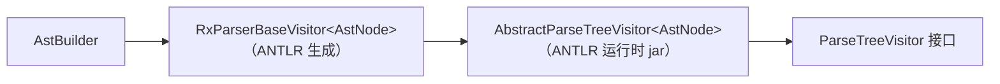
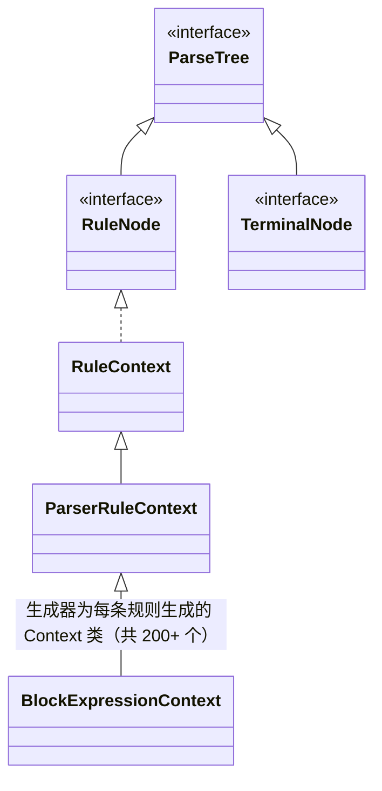

# AI_chat3 —— 对话记录

- 会话 ID：`130828df-00aa-44cc-a2d6-5ad39bb8cdb6`

- 覆盖时间：2026-10-07 14:25 ～ 2026-10-13 08:58（本地时间）

- 内容：按时间顺序导出全部「你」与「Copilot」消息；工具调用以单行摘要记录（工具输出不在记录内）。
- 说明：会话日志自首条 Copilot 回复起收录（首条提问未在日志中）；文件按日志如实导出。

---

**Copilot** · 2026-10-07 14:25

我先查看一下仓库笔记，然后仔细阅读 `AstBuilder.kt`。

- Read `src/main/kotlin/rx/ast/AstBuilder.kt`（行 1-400）
- Memory: view `/memories/repo/rx-compiler-notes.md`
- Listed `src/main/kotlin/rx/ast`
- Searched `override fun|private fun|fun`，范围 `src/main/kotlin/rx/ast/AstBuilder.kt`

**Copilot** · 2026-10-07 14:25

让我把 AST 包里相关文件也读一遍，确保完整理解上下文。

- Read `src/main/kotlin/rx/ast/AstBuilder.kt`（行 200-260）
- Read `src/main/kotlin/rx/ast/AstNode.kt`（行 1-300）
- Read `src/main/kotlin/rx/ast/Items.kt`（行 1-400）
- Read `src/main/kotlin/rx/ast/AstVisitor.kt`（行 1-400）
- Read `src/main/kotlin/rx/ast/Exprs.kt`（行 1-400）
- Searched `lifetimeParams`，范围 `src/**`
- Read `src/main/kotlin/rx/ast/TypeRefs.kt`（行 1-300）
- Read `src/main/kotlin/rx/ast/Stmts.kt`（行 1-300）
- Searched `AstBuilder`，范围 `src/**/*.kt`
- Ran terminal command: `cd /home/kai/ACM_class_project/rx-compiler && git status --short && echo ---- && git log --oneline -8 && echo ---- && wc -l src/main/kotlin/rx/ast/*.kt`

**Copilot** · 2026-10-07 14:26

工作区里 `AstBuilder.kt` 有未提交的修改。让我看看它相对 HEAD 的差异，以及相关的小文件。

- Read `src/main/kotlin/rx/ast/Ops.kt`（行 1-60）
- Read `src/main/kotlin/rx/ast/Type.kt`（行 1-60）
- Ran terminal command: `cd /home/kai/ACM_class_project/rx-compiler && git --no-pager diff src/main/kotlin/rx/ast/AstBuilder.kt | head -200`

**Copilot** · 2026-10-07 14:26

让我再核对语法规则与 CLI 的接入情况，确认 builder 里用到的 CST 形状。

- Listed `src/main/kotlin/rx`
- Searched `^(crate|item|functionDefinition|functionParameters|functionParam|selfParam|identifierBinding|typeRef|typePath|typePathSegment|pathIdentSegm…`，范围 `build/antlr-src/RxParser.g4`
- Read `src/main/kotlin/rx/Main.kt`（行 1-200）
- Searched `functionDefinition|blockExpression|statementExpression|typePathSegment|pathIdentSegment|genericParams`，范围 `build/antlr-src/RxParser.g4`
- Searched `functionDefinition|blockExpression|statementExpression|typePathSegment|pathIdentSegment|genericParams|genericArgs`，范围 `build/antlr-src/RxParser.g4`
- Listed `src/main/kotlin/rx/frontend`
- Read `build/antlr-src/RxParser.g4`（行 1-230）
- Checked for errors
- Read `src/main/kotlin/rx/frontend/ParserDriver.kt`（行 1-120）

**Copilot** · 2026-10-07 14:26

最后再看一眼设计文档，把 builder 的取舍与设计意图对上。

- Read `docs/ast-design.md`（行 1-200）

**Copilot** · 2026-10-07 14:26

我已经通读了 `AstBuilder.kt`（工作区版本，相对 HEAD 有未提交改动），并对照了 AST 节点定义、`AstVisitor`、生成用的 `RxParser.g4`、设计文档和 CLI 入口。先更新一下我的仓库笔记，然后给你一个理解摘要。

- Memory: insert `/memories/repo/rx-compiler-notes.md`

**Copilot** · 2026-10-07 14:27

我已经完整读过 `AstBuilder.kt`（含未提交的改动），并对照了节点定义、`RxParser.g4`、`AstVisitor` 和 `docs/ast-design.md`。以下是我对这份代码的理解摘要：

## 角色与机制

`AstBuilder : RxParserBaseVisitor<AstNode>()`，是 CST→AST 的建造方（手册 §2.4.2，设计文档 §7 分期第一/二刀）。每个 `visitXxx` 把一类 CST 节点翻译成 AST 节点，节点自身通过 `accept` 接回 visitor。不支持的构造一律 **fail-fast 抛 `IllegalArgumentException`**（而不是静默丢信息），这与设计文档"缺了再加"的按需扩展策略一致。

## 当前实现范围（工作区 = HEAD 的 crate 部分 + 未提交的 fn/类型/空块）

| 方法 | 行为 |
| --- | --- |
| `visitCrate` | 遍历 `item()`，`as? ItemNode`；null 时抛"does not support item"（即 use/struct/const/impl 还没实现） |
| `visitFunctionDefinition` | 名字、参数表、可选返回类型、函数体；`genericParams`/`whereClause` 出现即抛"not supported yet" |
| `buildFunctionParam` | `identifierBinding`（名字 + `mut` 旗）+ `typeRef` |
| `buildSelfParam` | `self` / `&self` / `&mut self` → `byReference`/`mutable` 两面旗；且 self 参数只可能排第一 |
| `visitTypeRef` | 五路分派：`typePath`→`PathTypeNode`、`referenceType`→`RefTypeNode`、`arrayType`→抛、`()`→`UnitTypeNode`、`(T)`→递归内层（丢括号） |
| `visitTypePath` | 逐段 `pathIdentSegment().text`（`Self` 也在此），**任何 `genericArgs` 都抛** |
| `visitReferenceType` | `mut` 旗 + 内层递归；`lifetime` 静默丢弃 |
| `visitBlockExpression` | 只支持空块 `{}`；有 `statement`/`statementExpression` 即抛 |
| `spanOf` | `ctx.start`/`ctx.stop`；行 1-based、列 0-based，`endColumn = stop.col + stop.text.length`（终点是"后一位"，exclusive） |

## 我特别留意的几个点

1. **`&&T` 尚未拆两层**：文法注释明确 `ANDAND` 构造两层引用（`&` 旗在内层），但 `visitReferenceType` 没特判 `ANDAND`——`&&T` 会建成单层，`&&mut T` 会变成 `&mut T`。设计文档 Expr/TypeRef 族都写了"`&&` 拆两层"，这里需要补。
2. **类型路径的泛型实参被挡**：`Vec<i32>`、`Box::<u32>` 这类在官方 semantic/codegen 用例里很普遍，是眼下最大的缺口；节点侧 `PathSegment(name, genericArgs)` 已就绪，只差 builder 放开。
3. **刻意丢弃的信息**：`(T)` 的括号、引用上的 lifetime——符合设计 §决策 E"丢有标准"。
4. **还没接入 CLI**：`Main.kt`/`ParserDriver` 目前都不引用 `AstBuilder`（也没有 `--dump-ast`），它现在只是编译进程里的一部分。
5. 小细节：`crate` 规则以 EOF 结尾，`ctx.stop` 是 EOF token（text 为 `<EOF>`），会让 `CrateNode` 的 `endColumn` 多出 4——如果之后 AstPrinter/诊断要用 crate 的 span，值得留意。

我已经准备好了，你的问题是什么？

---

**你** · 2026-10-07 14:42

identifierBinding这个是什么意思？

- Searched `identifierBinding`，范围 `build/antlr-src/RxParser.g4`

**Copilot** · 2026-10-07 14:43

`identifierBinding` 是 **文法规则名**（CST 层面的概念），不是 Kotlin 或 ANTLR 库里的东西。它的定义在 `RxParser.g4` 第 184 行：

```antlr
identifierBinding
    : MUT? identifier
    ;
```

意思是"**一个绑定位置上的名字**：可选的 `mut` + 标识符"。

## 它出现在哪、为什么叫 binding

文法里只有两处用到它——都是"**引入一个新名字**"的地方：

```antlr
functionParam : identifierBinding COLON typeRef ;              // 参数：mut x: i32
letStatement  : LET identifierBinding (COLON typeRef)? ... ;   // let：let mut y = 0;
```

这两处的共性就是"名字可能带 `mut`"，文法把这段共性抽成单独一条规则，ANTLR 就会为它生成独立的 `RxParser.IdentifierBindingContext` 类。

## CST 里的形状

以 `fn f(mut x: i32)` 为例，参数部分的 CST 是：

```
(functionParam (identifierBinding mut (identifier x)) : (typeRef (typePath ...)))
```

- `mut x` → `(identifierBinding mut (identifier x))`，`binding.MUT() != null`；
- `x` → `(identifierBinding (identifier x))`，`binding.MUT() == null`。

## 在 AstBuilder 里的用法（你选中的第 92 行）

```kotlin
val binding = ctx.identifierBinding()   // 拿到 (MUT? identifier) 这个子节点
...
name = binding.identifier().text,       // 名字，自动跳过 mut
mutable = binding.MUT() != null,        // 有没有 mut → 填 FnParam.mutable
```

因为 `functionParam : identifierBinding COLON typeRef`，这个子节点一定存在，所以可以直接取。绕这一层的意义是：**名字和 mut 旗子属于同一个 CST 节点**，从它身上统一取出信息，正好对应设计文档"语义小旗子要留成字段"（`FnParam.mutable`）。

顺带一提，这也是为什么访问 token 要用 `ctx.MUT()`、`ctx.AMP()` 这类生成方法——ANTLR 会为规则直接包含的每个 token 生成同名访问器。

---

**你** · 2026-10-07 14:49

所以我调用identifierBinding()这个函数得到了一个什么类型的东西，我是可以通过哪些函数继续访问

**Copilot** · 2026-10-07 14:49

我去生成的 `RxParser.java` 里确认一下实际类型和方法签名，给你准确答案。

- Searched `class IdentifierBindingContext`，范围 `build/antlr-src/RxParser.java`
- Searched `IdentifierBindingContext identifierBinding\(\)`，范围 `build/antlr-src/RxParser.java`
- Searched `^identifier\b`，范围 `build/antlr-src/RxParser.g4`
- Read `build/antlr-src/RxParser.java`（行 3495-3580）
- Read `build/antlr-src/RxParser.g4`（行 690-700）
- Searched `class IdentifierContext extends ParserRuleContext`，范围 `build/antlr-src/RxParser.java`
- Read `build/antlr-src/RxParser.java`（行 12337-12360）

**Copilot** · 2026-10-07 14:49

`ctx.identifierBinding()` 返回的是 ANTLR 为这条文法规则生成的上下文类：**`RxParser.IdentifierBindingContext`**（`RxParser.java` 第 3504 行的静态内部类）。

它对应 `identifierBinding : MUT? identifier` 这一次成功匹配的全部内容，能继续访问的东西如下。

## 规则自带的访问器

| 方法 | 返回类型 | 说明 |
| --- | --- | --- |
| `identifier()` | `RxParser.IdentifierContext` | 名字子节点，**一定非空**（文法里必需） |
| `MUT()` | `TerminalNode?` | `mut` 关键字 token，**可能为空**（`?` 是可选） |

因为生成的是 Java 类，Java 的 getter 在 Kotlin 里可以直接当属性用：`getText()` → `.text`，`getStart()` → `.start`，`getStop()` → `.stop`，`getChildCount()` → `.childCount`。

## 从 `ParserRuleContext` 继承的通用成员（所有 Context 都有）

- `.text` —— 整段文本；
- `.start` / `.stop` —— 首尾 `Token`（行、列、token 类型都在里面，`spanOf` 用的就是它们）；
- `.childCount` + `getChild(i)` / `.children` —— 子节点列表；
- `.parent` —— 父节点；
- `.accept(visitor)`、`.toStringTree(parser)` 等。

## 再往下：`IdentifierContext` 能访问什么

`identifier` 规则是 `IDENTIFIER | DERIVE | COPY | CLONE | PARTIAL_EQ | EQ`（上下文关键字也能当名字），所以生成了：

```java
TerminalNode IDENTIFIER();  DERIVE();  COPY();  CLONE();  PARTIAL_EQ();  EQ();
```

这些方法里**只有一个非空**。实际取名字时一般不用逐个判断，直接用 `.text` —— builder 里就是这么写的：

```kotlin
val binding = ctx.identifierBinding()          // RxParser.IdentifierBindingContext
val name = binding.identifier().text           // "x"
val mutable = binding.MUT() != null            // "mut x" 时为 true
```

⚠️ 一个坑：**不要用 `binding.text` 取名字**。组合节点的 `.text` 是把子 token 文本直接拼接（不补空格），`mut x` 会得到 `"mutx"`。名字要用 `identifier().text`，`mut` 单独用 `MUT() != null` 判断——builder 正是这么做的。

以后想知道某个 `ctx.xxx()` 的返回类型，两个办法：IDE 里跳转到定义，或直接看生成的 `build/antlr-src/RxParser.java`（每个 `XxxContext` 类都列着它全部的子节点访问器）。

---

**你** · 2026-10-07 14:53

这个AMP是什么

- Searched `^(AMP|ANDAND|MUT|AMP_EQ|ANDAND_EQ)\b.*`，范围 `build/antlr-src/RxLexer.g4`

**Copilot** · 2026-10-07 14:53

`AMP` 是词法文法里给 **`&` 符号起的 token 名字**（ampersand 的缩写），定义在 `RxLexer.g4` 第 88 行：

```antlr
AMP: '&';
```

ANTLR 会以这个名字生成两样东西：

1. **token 类型常量** `RxParser.AMP`（生成 Java 里的 `public static final int AMP`）；
2. **CST 节点上的访问方法** `AMP(): TerminalNode?` —— 对它所属规则里直接出现的 `&` token 提问。

## 在 builder 里的含义

`selfParam` 规则是：

```antlr
selfParam : (AMP lifetime?)? MUT? SELF_VALUE ;
```

- `&self` → 有 `AMP` token；
- `self` → 没有 `AMP`；
- `mut self` → 没有 `AMP`，有 `MUT`。

所以 `buildSelfParam` 里：

```kotlin
byReference = ctx.AMP() != null,   // 是不是 &self
mutable    = ctx.MUT() != null,    // 是不是 (mut)? 形式
```

两者组合正好覆盖 `self` / `&self` / `&mut self` / `mut self` 四种写法。因为文法里 `AMP` 可选（`?...`），方法返回的可能为 null，才要用 `!= null` 判断；像 `ctx.blockExpression()` 这种必需的子节点就一定非空。

## 一个相关提醒

`&` 和 `&&` 是**两个不同的 token**（最长匹配：`&&` 优先整读）：

- `AMP` = `&`；
- `ANDAND` = `&&`（第 79 行）。

`referenceType : (AMP | ANDAND) ...` 两者都可能出现。目前 `visitReferenceType` 只查了 `ctx.MUT()`，没区分 `AMP`/`ANDAND`——这就是之前说 `&&T` 会被错建成单层引用的地方，以后补"拆两层"时要先判 `ANDAND() != null`。

顺带：想看全部 token 名字，可以直接翻 `RxLexer.g4`，或者用 `./scripts/rxc --tokens` 打出来的 symbolic name（`Main.kt` 里就是通过 `RxLexer.VOCABULARY.getSymbolicName(...)` 拿的这些名字）。

---

**你** · 2026-10-07 15:05

请你解释一下visitTypeRef里面的东西在做什么？

**Copilot** · 2026-10-07 15:05

我先看一眼生成的 `TypeRefContext`，确保讲的方法签名都是实际存在的。

- Searched `class TypeRefContext extends ParserRuleContext`，范围 `build/antlr-src/RxParser.java`
- Read `build/antlr-src/RxParser.java`（行 2316-2345）

**Copilot** · 2026-10-07 15:05

`visitTypeRef` 是**类型引用（type reference）的 CST→AST 转换入口**：把"源码里写的一个类型"（如 `i32`、`&mut S`、`()`）变成对应的 `TypeRefNode` 子树。因为文法里 `typeRef` 有 5 个备选且没有 alt label，它必须**手动判断命中了哪个备选，再分派**。

## 先回顾文法

```antlr
typeRef
    : LPAREN typeRef RPAREN   // (T) 带括号
    | LPAREN RPAREN           // ()  单元类型
    | typePath                // i32、S、Box<...>
    | referenceType           // &T、&mut T
    | arrayType               // [T; N]
    ;
```

生成的 `TypeRefContext` 有 6 个访问器：`LPAREN()`、`RPAREN()`、`typeRef()`、`typePath()`、`referenceType()`、`arrayType()`。每次匹配只有一个备选被选中，所以"哪个非空"就等于"命中了哪条"。

## 逐分支看

| 判断 | 命中的备选 | 动作 |
| --- | --- | --- |
| `typePath() != null` | `typePath` | 委托 `visitTypePath`（那边逐段建 `PathSegment`），`as PathTypeNode` 取回 |
| `referenceType() != null` | `referenceType` | 委托 `visitReferenceType`（读 `mut` 旗 + 递归内层） |
| `arrayType() != null` | `arrayType` | 还没实现 → fail-fast 抛"not supported yet" |
| `LPAREN() != null && typeRef() == null` | `()` | 没有任何内层 → 现场 new `UnitTypeNode` |
| `typeRef() != null` | `(T)` | **递归**访问内层 typeRef，返回内层结果 —— 括号丢掉 |
| （都为空） | 理论到不了 | 兜底抛错，防御性代码 |

两个 LPAREN 备选靠**内层 `typeRef()` 在不在**区分：`()` 没有内层，`(T)` 有。对 `(T)`，括号本身不建节点，符合设计文档决策 E"括号直接丢"——`((i32))` 会一路递归回一个 `PathTypeNode(i32)`。

## 几个值得注意的点

1. **`as PathTypeNode` 为什么能硬转**：`visit(ctx.typePath())` 会调度到我们自己写的 `visitTypePath` override，它保证返回 `PathTypeNode`（否则抛异常），所以这里非空转换安全。加这一层的意义是"解构 CST 备选"和"构造 AST 节点"分离——具体怎么建路径节点是 `visitTypePath` 的事。
2. **递归镜像文法**：typeRef 自己套自己（`(T)`、`&T`、`[T; N]` 里都含 typeRef），visitor 也是递归。走一遍 `&mut (i32)`：
   - `visitTypeRef` → `referenceType` 非空 → `visitReferenceType`
   - 里面 `visit(ctx.typeRef())` 访问内层 `(i32)` → 落到最后一个分支 → 递归 → `visitTypePath` → `PathTypeNode(i32)`
   - 回到 `visitReferenceType` → `RefTypeNode(mutable = true, inner = PathTypeNode(i32))`
   - 最终 `RefTypeNode` 的 span 从 `&` 到 `)`，而 `(i32)` 那层返回的节点 span 不含括号（丢括号的小副作用，无碍）。
3. **返回基类 `TypeRefNode`**：调用方（`buildFunctionParam`、返回类型、以后的 cast）只关心"这是个类型"，具体是路径还是引用由语义阶段处理——这正是分派方法存在的意义。
4. 将来实现数组类型时，只需把那个 throw 换成 `visitArrayType` 的调用，构造 `ArrayTypeNode(element, length)`——`length` 在文法里是 `constValue`（常量表达式），到时候要想好复用什么小表达式逻辑。

---

**你** · 2026-10-07 15:25

接下来我们些什么语句比较合适

**Copilot** · 2026-10-07 15:25

我先看一下文法里语句/表达式部分的全貌，再给你排优先级建议。

- Read `build/antlr-src/RxParser.g4`（行 230-520）
- Read `build/antlr-src/RxParser.g4`（行 520-700）

**Copilot** · 2026-10-07 15:25

看完文法的语句/表达式部分后，我的建议很明确：**先把"块 + 语句 + 基础表达式"这一批做完**——也就是设计文档里第一刀的收尾。这是目前性价比最高的一刀。

## 为什么是这一批

- 现在 builder 只能建**空函数体**；`blockExpression` 一放开、语句一接上，真实用例（let、运算、调用链）立刻就能建树；
- if/loop/while、break/return（二刀）全都要以"非空块 + 表达式"为骨架，骨架不立，二刀没法接；
- struct/const/impl/use 这些 item 虽然好写，但写完函数体还是空的，价值排在后面。

## 具体顺序（由小到大）

1. **放开 `visitBlockExpression`**：`LBRACE statement* statementExpression? RBRACE` —— 前半进 `statements`，`statementExpression` 当 `tail`；空语句 `;` 直接丢。
2. **`visitStatement` 手动分派**（文法无 alt label）：`;`→丢；`letStatement`→`LetNode`；`expressionWithBlock SEMI?`→包 `ExprStmtNode`（if/loop/while 先抛、二刀补）；`statementExpression SEMI`→`ExprStmtNode`。
3. **`visitLetStatement`**：`identifierBinding`（复用参数那套取名字/mut）+ 可选 `typeRef` + `expression` 初值 → `LetNode`。
4. **表达式骨架 + 基础链**（主菜）：先做一个"**家族归一化**"工具，然后从低到高实现：
   `primary`（整数字面量/布尔/路径/括号/`()`）→ `postfix`（调用、下标、字段、方法）→ `unary`（`-` `!` `*` `&` `&mut`）→ `cast`（可链 `as`）→ `* / %` → `+ -` → `<< >>` → `& ^ |` → 比较 → `&& ||` → 赋值。

## 必须提前知道的坑

1. **4 套变体家族 + closed 双子**：同一优先级在文法里有 `expression` / `condition*` / `conditionBreak*` / `statement*` 四份，还各有 `closed*` 版本（专为 `as T <` / `<<` 消歧存在）。**别给每条规则写一个 override**——按规则名剥前缀（`statementClosedAdditiveExpression` → `ClosedAdditiveExpression`）归一到一个处理函数，这在 0028_operator_binding_power 那类用例上是唯一能维护的写法。
2. **多 token 运算符**：`>>` 是 `GT GT_SECOND` 两个 token 拼的（`shiftRight`），`>>=` 是 `GT GT_SECOND SHR_EQ`，`>=` 可能以 `GE_EQ` 出现——判运算符不能只看单个 token，要看辅助规则结构。
3. **比较非结合**（`comparisonExpression` 只允许一个比较符）、**赋值右结合**（右边递归回完整 `expression`）。
4. **`()` 单元表达式需要决策**：`LPAREN expression? RPAREN` 里可以为空，但 `Exprs.kt` 里没有对应节点——建议加一个一行大小的 `UnitLitNode`（旧版覆盖里就有 `unit-()` 用例），顺手补 `AstVisitor`。
5. **struct-lit 要能认出来**：`pathInExpression (LBRACE ...)?` 带花括号才是结构体字面量，别误当路径（先抛 not supported 也行，但分派必须识别）。
6. `statementPostfixExpression` 有 `expressionWithBlock dotSuffix` 形态（`{...}.m()`），别漏。

## 验证方式

等块/let/表达式能跑通，**优先加一个 `--dump-ast`（哪怕是最小 AstPrinter）**，先手动确认 `fn f(x: i32) -> i32 { let y = x + 1; y }` 打出来的树对，然后跑 47 个官方 crate accept 用例量覆盖。

要不要我先从第 1、2 步（块 + 语句分派 + let）动手？这两步最小、立刻可验证，做完再看表达式链怎么切。

---

**你** · 2026-10-07 15:26

先写1，2步，并说明写了什么内容

**Copilot** · 2026-10-07 15:27

先看一下构建/运行方式，以及生成的 `StatementContext`、`ExpressionWithBlockContext` 的访问器，确保代码一次写对。

- Read `compiler.mk`（行 1-120）
- Read `scripts/rxc`（行 1-80）
- Searched `public static class (StatementContext|ExpressionWithBlockContext|BlockExpressionContext) extends ParserRuleContext \{[\s\S]{0,700}`，范围 `build/antlr-src/RxParser.java`
- Read `build/antlr-src/RxParser.java`（行 3639-3835）
- Read `src/main/kotlin/rx/frontend/SyntaxDiagnostic.kt`（行 1-60）

**Copilot** · 2026-10-07 15:27

现在实现第 1、2 步（连带第 2 步分派所需的 `visitLetStatement`，否则 `letStatement→LetNode` 落不了地）。

- Edited `src/main/kotlin/rx/ast/AstBuilder.kt`
- Ran terminal command: `cd /home/kai/ACM_class_project/rx-compiler && make compiler 2>&1 | tail -20`

**Copilot** · 2026-10-07 15:28

编译通过。现在做行为验证——写一个小烟雾程序（放在 gitignored 的 `dev/` 下），实际建树看语句分派是否正确。

- Created `dev/ast-smoke/AstSmoke.kt`
- Created `dev/ast-smoke/t1.rx`
- Created `dev/ast-smoke/t2.rx`
- Created `dev/ast-smoke/t3.rx`
- Created `dev/ast-smoke/t4.rx`
- Created `dev/ast-smoke/t5.rx`
- Ran terminal command: `cd /home/kai/ACM_class_project/rx-compiler && kotlinc dev/ast-smoke/AstSmoke.kt -cp build/kotlin-classes:build/classes:$HOME/tools/antlr/antlr-4.13.2-complete.jar -d dev/ast-smoke/out 2>&1 | tail -3 && echo "=== build done ===" && for t in t1 t2 t3 t4 t5; do …`

**Copilot** · 2026-10-07 15:29

烟雾测试显示的居然是旧行为（"Non-empty block expressions are not supported yet"），说明运行时加载的是旧 class。让我查一下是哪份 class 在起作用。

- Ran terminal command: `cd /home/kai/ACM_class_project/rx-compiler && echo "== src 里还有没有旧文案 ==" && grep -n "Non-empty" src/main/kotlin/rx/ast/AstBuilder.kt; echo "== 哪些 class 含旧文案 ==" && grep -rl "Non-empty" build/kotlin-classes dev/ast-smoke 2>/dev/null; echo "== class 时间戳 ==" && l…`

**Copilot** · 2026-10-07 15:29

咦，源文件里旧文案还在？让我直接读当前文件确认。

- Read `src/main/kotlin/rx/ast/AstBuilder.kt`（行 150-280）

**Copilot** · 2026-10-07 15:29

文件里还是旧代码——刚才那次编辑没有落到盘上（可能被编辑器的旧缓冲区覆盖回去了）。我重新应用编辑，并立即验证是否落盘。

- Edited `src/main/kotlin/rx/ast/AstBuilder.kt`
- Ran terminal command: `cd /home/kai/ACM_class_project/rx-compiler && echo "src 命中数: $(grep -c 'Unsupported block tail' src/main/kotlin/rx/ast/AstBuilder.kt)" ; make compiler 2>&1 | tail -2 ; echo "class 命中数: $(strings build/kotlin-classes/rx/ast/AstBuilder.class | grep -c 'Unsuppor…`

**Copilot** · 2026-10-07 15:29

这次落盘成功，class 也更新了。重新跑烟雾测试：

- Ran terminal command: `cd /home/kai/ACM_class_project/rx-compiler && for t in t1 t2 t3 t4 t5; do echo "== $t ($(cat dev/ast-smoke/$t.rx)) =="; java -cp dev/ast-smoke/out:build/kotlin-classes:build/classes:$HOME/tools/antlr/antlr-4.13.2-complete.jar:$HOME/tools/kotlinc/lib/kotlin-st…`

**Copilot** · 2026-10-07 15:30

全部通过。更新一下仓库笔记：

- Memory: str_replace `/memories/repo/rx-compiler-notes.md`

**Copilot** · 2026-10-07 15:30

已完成第 1、2 步（外加第 2 步分派必需的 `visitLetStatement`），编译通过并有行为验证。以下是写入内容的说明。

## 1. `visitBlockExpression` 重写为完整版

- 遍历 `ctx.statement()`，逐个 `visit`：**返回 null 就丢弃**（null 专门表示"只有分号的空语句"），非空则收进 `statements`；
- `ctx.statementExpression()`（尾表达式）非空时作为 `tail`；目前表达式链还没写，会给清晰报错 `Unsupported block tail '...'`，第 4 步落地后这里自动通；
- 空块行为不变，`fn f() {}` 依旧正常。

## 2. 新增 `visitStatement`：四备选手动分派

文法是 `statement : SEMI | letStatement | expressionWithBlock SEMI? | statementExpression SEMI`，按子节点是否存在分派：

| 判定 | 处理 |
| --- | --- |
| `letStatement() != null` | 委托 `visitLetStatement` → `LetNode` |
| `expressionWithBlock() != null` | visit 后包一层 `ExprStmtNode` |
| `statementExpression() != null` | visit 后包一层 `ExprStmtNode` |
| 以上都无 | 只剩孤立的 `;` → **返回 null**，由 block 丢弃 |

返回类型写成了 `StmtNode?`，"null = 空语句"的约定在注释里写明。

## 3. 新增 `visitExpressionWithBlock`（第 2 步分支的底座）

`blockExpression | ifExpression | LOOP blockExpression | WHILE conditionExpression blockExpression` 的分派。**关键坑**：`LOOP`/`WHILE` 的备选里**也含** `blockExpression` 子节点，所以必须先判 `LOOP()`/`WHILE()`（和 `ifExpression()`），最后才落回纯块——否则 `loop {}` 会被误判成裸块。if/loop/while 现在各抛清晰错误，留二刀补。

## 4. 新增 `visitLetStatement`（严格说是原第 3 步）

没有它，第 2 步的 `letStatement→LetNode` 分派落不了地，所以一并写了：

- `identifierBinding` 取名字 + `mut`（复用参数那套写法）；
- 可选类型注解走 `visitTypeRef`；
- 初值 `visit(ctx.expression())` 暂时抛 `unsupported initializer`——等第 4 步表达式 override 写完，**这里一行都不用改**（visitor 自动分派到位）。

## 验证（`dev/ast-smoke/`，gitignored）

| 输入 | 结果 |
| --- | --- |
| `fn f() {}` | 0 条语句，无尾 ✓（旧行为保持） |
| `fn f() { ; ; {} }` | 两个 `;` 被丢弃，`{}` 成为 1 条块语句 ✓ |
| `fn f() { {} {} }` | 2 条块语句 ✓（顺带证明裸块只能当语句——尾表达式需要 `statementExpression`，裸块不构成） |
| `fn f() { let x: i32 = 1; }` | 正确分派到 let，报"initializer 暂不支持"（预期，等第 4 步） |
| `fn f() { if true {} }` | 报"If expressions are not supported yet"（预期，二刀） |

## 一个插曲需要你知道

第一次编辑后跑测试发现是旧行为——**源文件被编辑器里未保存的旧缓冲区覆盖回去了**，第一次 `make` 编译的还是旧代码。我重新落盘并逐级验证过（源码、编译产物、运行结果都对上了）。如果你 VS Code 里这个文件还停在旧内容/未保存状态，先 reload 一下再编辑，避免再次覆盖。

接下来就是第 4 步（表达式骨架 + 基础链），要开始的话我建议从 `primary`（字面量/路径/括号）→ `postfix` → `binary` 的顺序推进。

---

**你** · 2026-10-07 15:45

我们需要确认一些问题，visitBlockExpression里的tail是什么意思？

**Copilot** · 2026-10-07 15:45

`tail` 指块的**尾表达式（tail expression）**——块里最后一个**不带分号**的表达式，它的值就是整个块的值。这是 Rust/Rx 的核心语义之一。

## 文法依据

```antlr
blockExpression : LBRACE statement* statementExpression? RBRACE ;
```

`RBRACE` 前面那个可选的 `statementExpression?` 就是尾表达式。语义对比：

| 写法 | 块的值 |
| --- | --- |
| `{ x + 1 }` | `x + 1`（`x+1` 是尾表达式） |
| `{ x + 1; }` | `()`（分号使它变成语句，值被丢弃） |
| `{}` | `()`（没有尾表达式） |

正因为"块会出值"，设计文档决策 B 才把 block/if/loop/while 归入 **Expr 族**——`let y = { 1 + 2 };`、函数返回尾表达式，都靠它建模。

## AST 节点与 builder 对应关系

`BlockExprNode` 的定义就是 `statements: List<StmtNode>` + `tail: ExprNode?`。`visitBlockExpression` 里这段代码：

```kotlin
val statementExpressionContext = ctx.statementExpression()
val tail = if (statementExpressionContext == null) {
    null
} else {
    visit(statementExpressionContext) as? ExprNode ?: throw ...
}
```

含义是：

- **`tail == null`**：块没有尾表达式（`{}` 或最后一条带分号/`;`）→ 语义上块值是 `()`；
- **`tail != null`**：把尾表达式的 CST 建成 `ExprNode` 挂上去。

两个小细节：

1. 文法里尾表达式的入口是 `statementExpression`（语句家族变体）而不是普通 `expression`——所以块尾的解析起点规则和语句一致（比如裸块开头必须接 `.` 才能延续）。`visitBlockExpression` 里调 `visit(...)` 时，将来表达式链写好后会自动分派到对应 override。
2. 目前 builder 只会对非空 tail 抛 `Unsupported block tail '...'`——不是语义错误，而是表达式链（第 4 步）还没写。写完即通。

## 为什么后续阶段离不开它

- **语义检查**：`fn f() -> i32 { x }` 要检查 `x` 的类型与 `i32` 一致；而 `fn f() -> i32 { x; }` 的块值是 `()`，应当报"返回类型不匹配"——差别全在 `tail`；
- **代码生成**：块的代码要把尾表达式的值留在结果寄存器里，`tail == null` 时生成 `()` 的表示。

一个直观例子：`fn f() -> i32 { let y = 1; y + 1 }` 里，`let y = 1;` 是 statement，`y + 1` 是 tail（函数返回值）；把它写成 `y + 1;`，你就得到了一个返回 `()` 的函数，语义阶段会拒绝它。

---

**你** · 2026-10-07 15:47

我们现在似乎是处理一个块，那么这个函数是什么意思ctx.statementExpression()

**Copilot** · 2026-10-07 15:48

`ctx.statementExpression()` 是 ANTLR 为 `BlockExpressionContext` 生成的**子节点访问器**，返回这个块里那个"**尾表达式槽位**"的 CST 子节点，类型是 `RxParser.StatementExpressionContext`（因为文法里是 `?`，**可能为 null**）。

## 对照文法看

```antlr
blockExpression
    : LBRACE statement* statementExpression? RBRACE
    ;
```

| 文法片段 | 生成的访问器 | 返回 |
| --- | --- | --- |
| `statement*` | `ctx.statement()` | `List<StatementContext>`（可多次） |
| `statementExpression?` | `ctx.statementExpression()` | `StatementExpressionContext?`（0 或 1 个） |

所以 `visitBlockExpression` 里这两行：

```kotlin
val statementExpressionContext = ctx.statementExpression()
```

拿到的就是 **`}` 前面最后那一段不带分号的表达式**（如果有的话）：

- `{ 1 + 2 }` → 有个 `statementExpression`（内容是 `1 + 2`）→ 将成为 `tail`；
- `{ 1 + 2; }` → 没有——它被解析成 `statement`（alt4 `statementExpression SEMI`），`statementExpression()` 返回 null；
- `{}` → 返回 null → `tail = null`，块值 `()`。

这就是"**分号决定尾表达式**"在文法里的体现：带分号走 `statement`，不带分号走尾槽位。

## `statementExpression` 规则本身是什么

它是表达式 **4 套变体家族**里的"**语句起点家族**"的入口（`statement*` 前缀那一大家子）：

```antlr
statementExpression
    : statementAssignmentExpression
    ;
```

一路下探到：

```antlr
statementPostfixExpression
    : nonBlockPrimary postfixSuffix*
    | expressionWithBlock dotSuffix postfixSuffix*   // 裸块开头必须接 `.` 才能延续
    ;
```

也就是说：优先级/结合性和普通 `expression` 完全一样，只是**解析起点受限**（为语句环境消歧）。它和 `expression`、`conditionExpression`、`conditionBreakExpression` 是同一含义、不同入口——AST 层最后都归一成同一批节点，这正是设计文档里"变体被压扁"要处理的部分。

## 在 builder 里接下来会发生什么

- 当前：`statementExpression != null` 时调 `visit(...)`。由于 `visitStatementExpression` 还没写（表达式链，第 4 步），visitor 默认返回 null → 抛 `Unsupported block tail '...'`；
- 第 4 步写完后：`visit(statementExpressionContext)` 会自动分派到你的 override（或家族归一化函数），返回 `ExprNode` 挂进 `tail`。

顺带一提：这个 `statementExpression` 规则**两个地方共用**——块尾（这里）和 `statement` 的 alt4（带分号）。以后写 `visitStatementExpression` 时，这两条路径都会经过它。

---

**你** · 2026-10-07 15:49

visitStatement这个函数在做什么？

**Copilot** · 2026-10-07 15:49

`visitStatement` 是**语句规则的 CST→AST 分派器**：把块里的一条 `statement` 编译成对应的 `StmtNode`，或者"什么都没编译出来"。

## 文法背景

```antlr
statement
    : SEMI                               // 1) 空语句 ;
    | letStatement                       // 2) let 绑定
    | expressionWithBlock SEMI?          // 3) 块/if/loop/while 作语句（分号可选）
    | statementExpression SEMI           // 4) 普通表达式语句（带分号）
    ;
```

一个 `statement` 的产出恰好是三种可能：`LetNode`、`ExprStmtNode`、或**什么都没有**（空语句）。AST 语句族也只有 `LetNode`/`ExprStmtNode` 两种节点（设计文档里"空语句——纯语法，丢"）。

## 逐分支在做什么

| 判断 | 命中的备选 | 结果 |
| --- | --- | --- |
| `ctx.letStatement() != null` | let | 委托 `visitLetStatement` → `LetNode` |
| `ctx.expressionWithBlock() != null` | 块/if/loop/while | 先建出 `ExprNode`，**包一层 `ExprStmtNode`** |
| `ctx.statementExpression() != null` | 表达式语句 | 同样包 `ExprStmtNode` |
| 三个都为空 | 只剩 `SEMI` | 返回 **null**（丢弃） |

两个关键设计点：

1. **返回类型是 `StmtNode?`**，null 有专门含义："这条语句是纯 `;`，请调用方丢掉"。`visitBlockExpression` 里 `as? StmtNode` + null 跳过就是在消费这个约定。
2. **为什么要包 `ExprStmtNode`**：决策 B 把 if/loop/while/block 归入 Expr 族（因为它们出值，如 `let y = if ... {} - 1`）。但出现在语句位置时，它们只是"执行一下、值不要"——用薄壳 `ExprStmtNode` 包一层，既保留"这是个语句"的结构，又不改表达式节点形状。

## 一个容易踩的坑

**不能用 `ctx.SEMI() != null` 来判断空语句**——`SEMI` 在备选 1、3、4 里都可能出现（`expressionWithBlock SEMI?`、`statementExpression SEMI`）。所以必须按其它子规则判断，只有"let/expressionWithBlock/statementExpression 都没有"才必然是纯 `;`。

## 现在的实际行为（结合已有进度）

- `{}` 作语句 → `ExprStmt(BlockExpr)` ✓（烟雾测试已验证）
- `if c {}` 作语句 → 分发到 `visitExpressionWithBlock` → 抛 "If expressions are not supported yet"（二刀）
- `f(x);` → 分发到 `statementExpression`，表达式链还没写 → 抛 "Unsupported statement expression"（第 4 步）
- `let x = 1;` → 到 `visitLetStatement`，初值处抛 "unsupported initializer"（第 4 步）
- `;` → null 丢弃 ✓

也就是说：**分派骨架已经完整**，三个分支各自缺的部分都留好了接口，等表达式链（第 4 步）和二刀补上后，这个函数本身基本不需要再动。

---

**你** · 2026-10-07 16:09

visitExpressionWithBlock里面用到了ctx的一些函数比如LOOP WHILE，这个是从ANTLR中帮我生成出来的吗

**Copilot** · 2026-10-07 16:09

是的，`ctx.LOOP()`、`ctx.WHILE()` 这些**全部是 ANTLR 自动生成**的方法，不是手写的。生成路径就是项目 pipeline 里的：

```
grammar/Parser.g4 → build/antlr-src/RxParser.g4 → antlr4 -visitor → RxParser.java
```

## 生成规则

ANTLR 给**每条 parser 规则**生成一个 `XxxContext` 静态类，规则体里**直接出现的每个元素**各配一个访问器：

| 规则体里的元素 | 生成的方法 | 返回类型 |
| --- | --- | --- |
| token（如 `LOOP`、`WHILE`） | `LOOP()`、`WHILE()`（大写、同名） | `TerminalNode` |
| 子规则（如 `blockExpression`） | `blockExpression()`（小写、同名） | `BlockExpressionContext` |
| 带 `?` 的元素 | 单值方法，可能返回 null | `XxxContext?` / `TerminalNode?` |
| 带 `*` / `+` 的元素 | `List<XxxContext>`（外加 `xxx(int i)` 重载） | 列表 |

具体到 `visitExpressionWithBlock`，规则体是：

```antlr
expressionWithBlock
    : blockExpression
    | ifExpression
    | LOOP blockExpression
    | WHILE conditionExpression blockExpression
    ;
```

所以生成的 `ExpressionWithBlockContext` 里恰好有你在用的这几个：

```java
public static class ExpressionWithBlockContext extends ParserRuleContext {
    public BlockExpressionContext blockExpression() { ... }
    public IfExpressionContext ifExpression() { ... }
    public TerminalNode LOOP() { return getToken(RxParser.LOOP, 0); }
    public TerminalNode WHILE() { return getToken(RxParser.WHILE, 0); }
    public ConditionExpressionContext conditionExpression() { ... }
    ...
}
```

## 两个关键理解

1. **只看"直接子节点"**。这些访问器实现就是在这个 CST 节点的 children 列表里找第一个匹配的 token/子规则（所以 `getToken(..., 0)` 里的 `0` 是取第 0 个）。单词 `loop` 如果出现在别的规则里（比如某个嵌套块内部），`ExpressionWithBlockContext.LOOP()` 也**不会**看见它。所以"`ctx.LOOP() != null`"的准确含义是："**这个 expressionWithBlock 节点自己命中的是 LOOP 那个备选**"——这正是分派成立的依据。
2. **为什么先判 `LOOP()`/`WHILE()` 再判 `blockExpression()`**：`LOOP blockExpression`、`WHILE ... blockExpression` 两个备选里也**含** `blockExpression` 子节点，所以 `ctx.blockExpression()` 在 loop/while 情况下同样非空。若先判 `blockExpression() != null` 就返回块，`loop {}` 会被错建成裸块。访问器只能告诉你"哪些子节点存在"，**优先级要自己写对**。

## 怎么自查生成结果

- 直接看 `build/antlr-src/RxParser.java`（搜 `class ExpressionWithBlockContext`）；
- 或 IDE 里对 `ctx.LOOP` 跳转定义，会落到生成文件；
- **不要手改生成的 Java**——改了语法文件后 `make compiler` 会整个重新生成，手改会被覆盖。

---

**你** · 2026-10-07 16:12

visitLetStatement中的if (ctx.typeRef() == null)是不是在判断当前声明变量的类型是否是我们已经保留的几种类型

**Copilot** · 2026-10-07 16:13

不是——这个判断跟"类型是哪种、支不支持"无关，它判断的是**源码里到底有没有写类型标注**。

## 文法依据

```antlr
letStatement
    : LET identifierBinding (COLON typeRef)? equalsSign expression SEMI
    ;
```

`(COLON typeRef)?` 是**可选**的，所以两种写法都合法：

| 源码 | `ctx.typeRef()` | AST 里的 `declaredType` |
| --- | --- | --- |
| `let x: i32 = 1;` | 非 null（写了 `: i32`） | `PathTypeNode(i32)` |
| `let x = 1;` | null（没写冒号类型） | `null`（表示"未标注"） |

`LetNode` 的字段签名就是 `declaredType: TypeRefNode?`——设计文档里写的"类型注解?(TypeRef)"。`null` 是一个有意义的表达："用户没写，留给语义阶段按初值推断（或直接报需要标注）"，而不是错误。

## "类型是否支持"的检查在下一层

真正判断"是哪种类型"的地方是 `visitTypeRef`（备选分派）：

- `i32`、`S` → `PathTypeNode` ✓
- `&T`、`&mut T` → `RefTypeNode` ✓
- `()` → `UnitTypeNode` ✓
- `[T; N]` → 抛 `Array types are not supported yet`
- `(T)` → 拆括号递归

所以 `let x: [i32; 3] = ...` 被拒绝时，抛的是 `visitTypeRef` 里那句 "Array types are not supported yet"，**不会**走到这个 null 判断分支。

顺带说清结尾那个 `?: throw "Let '$name' has an unsupported type annotation"` 的角色：它是**防御性兜底**——正常情况下 `visit` 要么返回 `TypeRefNode`，要么自己抛更具体的错；兜底只在"分派意外落空（返回 null）或类型不符"时触发，实际不可达。

## 对比记忆

参数类型是**必写**的（`functionParam : identifierBinding COLON typeRef`），所以 `buildFunctionParam` 里没有 null 判断，直接 visit + 兜底；而 let 的类型标注**可选**，所以要多一个"判有没有写"的分支。这就是两处代码形状不同的原因。

---

**你** · 2026-10-07 16:17

好的，接下来请你说一下我们应该做什么内容？

**Copilot** · 2026-10-07 16:17

当前状态回顾一下：块 + 语句分派 + let 骨架已经完成（原计划第 1、2、3 步都落地了），**唯一的主要缺口是表达式链**——所有表达式 visit 现在都返回 null，导致 `let` 初值、语句表达式、块尾都抛"暂不支持"。

所以接下来的内容就是原第 4 步：**表达式骨架 + 基础链**。我建议切成 5 个小批次：

## 4a. 家族归一化基础设施（先做，最关键）

- 问题：每个优先级在文法里有 4 个家族变体（`expression` / `condition*` / `conditionBreak*` / `statement*`），还各有 `closed*` 双子（为 `as T <` / `<<` 消歧）。直接用 override 逐条写要写 80+ 个方法。
- 做法：在 builder 里做一个**名称归一化**钩子——规则名剥掉 `conditionBreak`/`condition`/`statement` 前缀、再剥 `closed` 前缀（大小写不敏感），映射到 canonical 名（如 `statementClosedAdditiveExpression` → `additiveExpression`），然后表驱动分派到同一个处理函数。实现上可覆盖 `visitChildren` 这一层（没写 override 的规则都从这里过），一处收口。
- **一个隐藏坑**：各家族的操作数入口类型并不对称——比如 `statementUnaryExpression` 的右操作数是普通 `unaryExpression`，`closed*` 家族的乘数/加数顺序也和开放版不同。所以处理函数要**按子节点结构做通用左折叠**（操作数递归 visit、运算符从子节点结构识别），不要逐条依赖 accessor 形状，否则 4 家族会写疯。

## 4b. primary 层

- `INTEGER_LITERAL`/`TRUE`/`FALSE` → `IntLitNode`/`BoolLitNode`；
- `pathInExpression` → `PathExprNode`（泛型实参继续抛，第三刀）；
- `LPAREN expression? RPAREN` → 括号（丢）；**`()` 空括号需要先拍一个决策**：建议加一个一行大小的 `UnitLitNode`（`Exprs.kt` + `AstVisitor` 各一行）；
- `arrayExpression`、struct-lit（`path { ... }`）先识别出来照旧抛（二刀）。

## 4c. postfix 层

- `callArguments` → `CallExprNode`；
- `[expr]` → `IndexExprNode`；
- `dotSuffix`：带 `callArguments` 的是方法调用 → `MethodCallExprNode`；否则字段 → `FieldExprNode`；
- 注意 `statementPostfixExpression` 的 `expressionWithBlock dotSuffix` 形态（块开头接 `.`）。

## 4d. unary + cast

- `-` / `!` / `*` → `UnaryExprNode`；
- `&` / `&mut` / `&&` → `ReferenceExprNode`（`&&x` 按设计拆两层嵌套）；
- `as` 可链 → `CastExprNode`（目标类型是 `TypeRefNode`）。

## 4e. 二元梯子 + 赋值

- 按优先级从低到高接上：`* / %` → `+ -` → `<< >>`（`shiftRight` 是 `GT GT_SECOND` 两个 token！）→ `& ^ |` → 比较（非结合）→ `&& ||` → 赋值（右结合，右边递归回完整 expression）；
- 运算符识别要处理 `comparisonExceptLt`/`equalsSign` 这类辅助规则的 token 组合。

## 里程碑验证

1. `fn f(x: i32) -> i32 { let y = x + 1; y }` 完整建树；
2. 跑官方 47 个 crate accept 用例量覆盖率；
3. 用 `0028_operator_binding_power` 验证优先级/结合性（老会话里它就是这块的试金石）。

## 开工前需要你拍的决策

1. **`()` 单元表达式**：加 `UnitLitNode`（推荐）还是 builder 特判？
2. `&&x` 拆两层引用——按设计执行，有异议吗？
3. struct-lit / 数组字面量 / 方法调用的 `::<T>`：先识别再抛，留二刀/三刀，对吧？

同意的话，我建议从 **4a + 4b** 开始（做完立刻能用 `let x = 1;` 之类的烟雾验证），要动手就说一声。

---

**你** · 2026-10-07 16:25

决策方面，加 `UnitLitNode`，`&&x` 拆两层引用，第三条也没问题。另一方面，其它的我都觉得很自然，4a是什么意思，什么是归一化，请你具体解释一下，我没太理解

**Copilot** · 2026-10-07 16:25

决策收到：`UnitLitNode`、`&&x` 拆两层、其余先识别后抛——下个批次按这个来。下面把 4a 讲清楚。

## 为什么要"归一化"——先看问题本身

文法作者把**同一套优先级梯子复制了 4 份**（这是 ANTLR LL 解析的消歧手段），原因就写在文法注释里：

- `condition*` 家族：条件里不允许"裸"结构体字面量（`if x { … }` 会和 `x { … }` 撞车）；
- `conditionBreak*` 家族：break 载荷的首个 primary 不能是裸块；
- `statement*` 家族：语句开头的裸块只有接 `.` 才能延续；
- `closed*` 双子：给 `as T <` / `as T <<` 这种"`<` 到底算比较还是泛型/移位"的场景做前瞻消歧。

**这些都是解析器的事，与语言含义无关**——`x + 1` 不管出现在哪里都是加法。所以同一段代码在 CST 里有"4 副面孔"：

| 源码位置 | CST 节点名 |
| --- | --- |
| `let y = x + 1;` 的初值 | `additiveExpression` |
| `if x + 1 < 5 {}` 的条件 | `conditionAdditiveExpression` |
| 语句位置 | `statementAdditiveExpression` |
| `as` 尾部消歧场景 | `closedAdditiveExpression`（及带前缀的 closed 变体） |

每副面孔对应**一个独立的生成类**（`RxParser.ConditionAdditiveExpressionContext`……）和独立的 `visitXxx` 方法。如果逐条写 override，光"加法"一级就要 4~8 个几乎一模一样的方法，整条梯子 ~12 级 = 上百个。这就是要解决的问题。

## "归一化" = 剥掉变体前缀，映射到同一个名字

做法：拿到规则名后剥前缀，让 8 个变体名落到一个 canonical 名：

| 规则名 | 剥 `conditionBreak` / `condition` / `statement` / `closed` 后 |
| --- | --- |
| `additiveExpression` | `additiveExpression` |
| `conditionAdditiveExpression` | `additiveExpression` |
| `conditionBreakAdditiveExpression` | `additiveExpression` |
| `statementAdditiveExpression` | `additiveExpression` |
| `closedAdditiveExpression` | `additiveExpression` |
| `statementClosedAdditiveExpression` | `additiveExpression` |
| `conditionClosedAdditiveExpression` | `additiveExpression` |
| `conditionBreakClosedAdditiveExpression` | `additiveExpression` |

于是**每级优先级只写一份处理逻辑**，4 家族 + closed 双子全部复用。

两个实现细节：

1. **剥的顺序**：先长前缀 `conditionBreak`（它包含 `condition`），再 `condition`、`statement`，最后 `closed`；而剥完前面后首字母可能是大写（`statementClosed…` → `Closed…`），所以 `closed` 要**大小写不敏感**——老会话在这踩过坑。
2. 少数规则名不规则（primary 层：`primaryExpression` / `nonBlockPrimary` / `conditionPrimary` / `conditionPrimaryWithoutBareBlock`……），算法剥不干净，配一张**显式小映射表**兜底即可。

## 怎么接进 visitor（机制）

ANTLR 的默认行为链是：

```
visit(ctx) → 按规则调用 visitXxx → 默认的 visitXxx 调 visitChildren(ctx)
```

所以我们**只覆盖一个地方**——`visitChildren`，把它变成中心分派器：

```
visitChildren(ctx):
    规则名 = RxParser.ruleNames[ctx.ruleIndex]     // ANTLR 生成的静态数组
    canonical = canonicalRuleName(规则名)           // 剥前缀
    查表(canonical) → 调对应 handler
    表外 → 返回 null（保持"暂不支持"的现状）
```

我们没写 override 的规则都会流经这里；写过的（crate、fn、block……）不受影响。

## handler 内部怎么写：结构式左折叠

不依赖各家族 accessor 的形状，直接**遍历子节点**：

```
additive handler(ctx):
    acc = null
    for child in ctx.children:
        if child 是运算符（additiveOperator 规则）: pending = op(child)
        if child 是操作数（*Expression 规则）: acc = 组合(acc, pending, visit(child))
```

为什么必须"结构式"而不是逐家族用 accessor？因为各家族**轻微不对称**：`closedAdditiveExpression` 的子节点顺序是 `(乘数 运算符)* 收尾乘数`（和开放版不同）；`statementUnaryExpression` 的右操作数用的是**普通** `unaryExpression`（跨界递归）。结构式折叠对这两种都免疫；而且操作数递归 `visit(child)` 时会自动再走归一化，天然支持混合家族。

一个好消息：**运算符辅助规则全家族共用一份**（`additiveOperator`、`multiplicativeOperator`、`unaryOperator`、`comparisonExceptLt`、`shiftRight`、`equalsSign`、`assignmentOperator` 都只定义了一次）——所以运算符识别代码天然不用管 4 家族。

## 4a 的交付物

1. `canonicalRuleName()` 辅助函数（剥前缀 + 小映射表）；
2. 重写 `visitChildren` 中心分派；
3. 每条梯子一个 handler（先用占位/逐步填充）。

做完 4a 本身没有可见行为，但**从 4b 起每接通一级，4 个家族同时生效**——这就是先做它的价值。

明白了吗？如果没问题，我就按 **4a + 4b** 开工：先加 `UnitLitNode`，再搭归一化骨架，然后做 primary 层，完成后用 `let x = 1;`、`let y = ();` 这类用例做烟雾验证。

---

**你** · 2026-10-07 16:33

所以你的意思是CST中现在有非常多不同的实现方式，要通过归一化的方式来抽象为同一个函数的功能，因为一个函数已经足够。

**Copilot** · 2026-10-07 16:33

对，理解基本到位。精确一点说，有两处可以锐化：

## 1. 同一语义 → 多个 CST"面孔"，归一化把它们折到同一个名字

CST 里那些名字（`additiveExpression` / `conditionAdditiveExpression` / `statementAdditiveExpression` / `closedAdditiveExpression`……）**不是不同的实现**，而是同一套文法复制出的多个"入口"——差别只在于**表达式允许从什么开始**（条件里禁裸结构体、语句开头裸块要接 `.`、`as` 后面 `<` 的前瞻消歧）。一旦进入梯子内部，运算符、优先级、结合性完全相同。

所以：**按规则名归一 → 每级只写一份真正干活的方法**。这正是设计文档说的"变体被压平"——AST 建完之后，语义检查/代码生成根本不会知道家族的存在。

## 2. "一个函数"准确说是"每级一个"

不是整个表达式只用一个函数，而是**每条优先级一个 handler**：

- 分派钩子 1 个（`visitChildren` 里做 normalize + 查表）；
- 处理函数 ~13 个：assignment、logicalOr、logicalAnd、comparison、bitOr、bitXor、bitAnd、shift、additive、multiplicative、cast、unary、postfix……
- 每个 handler 覆盖它对应的 **4 家族 + closed 双子**的全部变体。

对比一下量级：不归一化要写 80~100 个几乎一样的 override；归一化后是 13 个 handler + 1 个钩子。而且以后补一级（比如 cast），4 个家族自动同时接通。

## 关键点回顾

- 归一化只发生在**入口分派**这一层：算 canonical 名 → 查表 → 调 handler；
- handler 内部照常"遍历子节点、建 AST 节点"，递归 `visit` 子节点时会**自动再次经过归一化**，所以跨家族的混合（如 `statementUnaryExpression` 的右操作数是普通 `unaryExpression`）不用特殊处理；
- 运算符识别的辅助规则（`additiveOperator` 等）本来就不分家族，共用一份——这部分连归一都不需要。

一句话总结：**归一化 = 抹掉"解析器为了消歧而复制的东西"，让每一级优先级只保留一份真正的语义实现**。

---

**你** · 2026-10-07 16:34

好的，开始完成一下4a 4b

**Copilot** · 2026-10-07 16:35

开始动手。先做几个事实核查：lexer 里整数字面量的形态、`ruleNames` 是否存在、primary 层生成类的访问器，以及归一化是否存在误合并。

- Ran terminal command: `cd /home/kai/ACM_class_project/rx-compiler && echo "== INTEGER_LITERAL 定义 ==" && grep -n "INTEGER_LITERAL" build/antlr-src/RxLexer.g4 | head -5 && echo "== ruleNames ==" && grep -n "ruleNames =" build/antlr-src/RxParser.java | head -2 && echo "== NonBlockPrim…`

**Copilot** · 2026-10-07 16:35

归一化分组完全符合预期（14 组，全是家族变体；只有 `statement` 本身剥空，它本来就有显式 override）。再看整数字面量格式和几个生成类的访问器：

- Read `build/antlr-src/RxLexer.g4`（行 50-80）
- Read `build/antlr-src/RxParser.java`（行 10790-10810）
- Read `build/antlr-src/RxParser.java`（行 11049-11068）
- Ran terminal command: `cd /home/kai/ACM_class_project/rx-compiler && grep -n "fragment DECIMAL\|fragment BINARY\|fragment OCTAL\|fragment HEXADECIMAL\|INTEGER_SUFFIX" build/antlr-src/RxLexer.g4`

**Copilot** · 2026-10-07 16:36

核查完毕，全部符合预期。现在写代码：`UnitLitNode` 节点 + visitor 入口 + builder 的归一化分派与 primary 层。

- Edited: src/main/kotlin/rx/ast/Exprs.kt, src/main/kotlin/rx/ast/AstVisitor.kt, src/main/kotlin/rx/ast/AstBuilder.kt
- Ran terminal command: `cd /home/kai/ACM_class_project/rx-compiler && echo "src: $(grep -c 'canonicalRuleName\|UnitLitNode' src/main/kotlin/rx/ast/AstBuilder.kt) builder, $(grep -c 'UnitLitNode' src/main/kotlin/rx/ast/Exprs.kt) exprs, $(grep -c 'UnitLitNode' src/main/kotlin/rx/ast/A…`

**Copilot** · 2026-10-07 16:37

编译通过。现在升级烟雾程序并补充测试输入：

- Edited: dev/ast-smoke/AstSmoke.kt
- Created `dev/ast-smoke/t6.rx`
- Created `dev/ast-smoke/t7.rx`
- Created `dev/ast-smoke/t8.rx`
- Created `dev/ast-smoke/t9.rx`
- Created `dev/ast-smoke/t10.rx`
- Created `dev/ast-smoke/t11.rx`
- Created `dev/ast-smoke/t12.rx`
- Created `dev/ast-smoke/t13.rx`
- Created `dev/ast-smoke/t14.rx`
- Ran terminal command: `cd /home/kai/ACM_class_project/rx-compiler && kotlinc dev/ast-smoke/AstSmoke.kt -cp build/kotlin-classes:build/classes:$HOME/tools/antlr/antlr-4.13.2-complete.jar -d dev/ast-smoke/out 2>&1 | tail -3 && echo "=== smoke built ===" && for t in t1 t2 t3 t4 t5 t6 …`

**Copilot** · 2026-10-07 16:37

全部 14 个用例行为符合预期。更新仓库笔记：

- Memory: str_replace `/memories/repo/rx-compiler-notes.md`

**Copilot** · 2026-10-07 16:37

4a + 4b 完成，`make compiler` 绿，14 个烟雾用例全部符合预期。写的内容如下：

## 4a：归一化 + 中心分派（`AstBuilder.kt`）

1. **`canonicalRuleName()`**：剥 `conditionBreak` / `condition` / `statement` 前缀（长的先剥），再剥 `closed`（大小写不敏感，覆盖 `statementClosed…` → `Closed…` 的情况），首字母转小写。用脚本对全文法规则名验证过：合并出的**恰好是 14 组家族变体，没有误合并**；（规则 `statement` 本身会被剥空，已特判返回原名，而它本来就有显式 override，不会走这条路）。
2. **`visitChildren` 中心分派**：重写它的一个钩子——没写显式 override 的规则都流到这里，按 `RxParser.ruleNames[node.ruleIndex]` 归一后查 `expressionHandlers` 表；表外规则保持默认行为（返回 null，原"不支持"路径不变）。
3. **`expressionHandlers` 表**：18 个条目——
   - **直通**（`buildPassThroughExpression`）：`expression` / `assignmentExpression` / … 直到 `postfixExpression` 全部层级 + `primary`（来自 `conditionPrimary`）+ `primaryExpression`。规则是"**恰好一个子节点**就原样递归；否则抛 not supported yet"——这就是安全线：`1 + 2`、`-1`、`f(x)` 这类会被明确拒绝，**绝不会把运算符悄悄丢掉**；
   - **原子级 handler**：`nonBlockPrimary`、`primaryWithoutBareBlock`（= `conditionPrimaryWithoutBareBlock` 归一后的名字）。

## 4b：primary 层

- **新增 `UnitLitNode`**（`Exprs.kt` + `AstVisitor.kt` 各一行）；
- `buildNonBlockPrimary` / `buildConditionPrimaryWithoutBareBlock`：处理字面量、路径、括号；struct-lit（`LBRACE` 出现即识别）→ 抛；数组/break/return/continue → 抛；condition 版里 if/loop/while → 抛（二刀）；
- 括号：`(e)` 拆括号直接返回内层（span 归内层）；`()` → `UnitLitNode`；
- 整数字面量：支持 `0b`/`0o`/`0x`、下划线分隔、`i32/u32/isize/usize` 后缀（剥掉），`toLongOrNull` 存 `Long`，超范围抛错；
- 路径：逐段建 `PathSegment`（`::<T>` 泛型实参仍抛，第三刀）。

## 验证（`dev/ast-smoke/`，14 例）

| 用例 | 结果 |
| --- | --- |
| `let x: i32 = 1;` | ✅ 建成 `Let(x, type=PathTypeNode, init=IntLit(1))`（之前是抛错） |
| `let y = ();` | ✅ `UnitLit` |
| `fn f() -> i32 { 7 }` | ✅ `tail=IntLit(7)`——**尾表达式链路通**，且证明 `statement*` 家族归一化端到端有效 |
| `a::b` / `(1)` / `0x1F` / `1_000i32` | ✅ `Path(a::b)` / `IntLit(1)`（丢括号）/ `IntLit(31)` / `IntLit(1000)` |
| `1 + 2` / `-1` | 抛 "not supported yet"——**预期**（4d/4e 才实现运算符） |

一个说明：condition / conditionBreak 两个家族的归一化暂时没有端到端证据（if/while 还没实现，走不到条件里的表达式）——等二刀 if 落地后自然会覆盖到。

下一步就是 **4c（postfix：调用/下标/字段/方法）→ 4d（unary + cast + 引用）→ 4e（二元梯子 + 赋值）**。要继续的话说一声。

---

**你** · 2026-10-07 21:00

我们慢一点，我希望看到具体的代码示例，比如我们先来看canonicalRuleName，具体什么Rx代码会走到这个函数中，然后在这个里面会出现什么样的变化

**Copilot** · 2026-10-07 21:01

好，我们慢下来，用真实数据看。先跑 `rxc --dump-cst` 拿到几个例子的真实 CST（里面就是那些规则名）：

- Ran terminal command: `cd /home/kai/ACM_class_project/rx-compiler && echo "===== t8: fn f() -> i32 { 7 } =====" && ./scripts/rxc --dump-cst dev/ast-smoke/t8.rx && echo && echo "===== t4: fn f() { let x: i32 = 1; } =====" && ./scripts/rxc --dump-cst dev/ast-smoke/t4.rx && echo && ec…`

**Copilot** · 2026-10-07 21:01

拿到了真实 CST。下面我们就用这两个例子把 `canonicalRuleName` 的"谁进来、变成什么、去哪张表"讲透。

## 它什么时候被调用

链条是：**builder 访问一个没有显式 override 的 CST 节点** → 默认的 `visitXxx` 调用 `visitChildren` → 我们的钩子 → `canonicalRuleName(规则名)` → 查表。所以它的输入是**当前被访问 CST 节点的规则名**（一个字符串），不是 Rx 源码本身。

## 例 1：`fn f() -> i32 { 7 }` 的尾表达式（语句家族）

真实 CST（来自上面的 dump，我只留下 `7` 的路径）：

```
(statementExpression
  (statementAssignmentExpression
    (statementLogicalOrExpression
      (statementLogicalAndExpression
        (statementComparisonExpression
          ... 中间省略 ...
              (statementPostfixExpression
                (nonBlockPrimary (literalExpression 7)))))))
```

builder 从 `statementExpression` 开始逐级下行，每一层进入时都调用一次 `canonicalRuleName`：

| 被访问节点的规则名（输入） | canonicalRuleName 输出 | 命中 |
| --- | --- | --- |
| `statementExpression` | `expression` | 直通 |
| `statementAssignmentExpression` | `assignmentExpression` | 直通 |
| `statementLogicalOrExpression` | `logicalOrExpression` | 直通 |
| `statementLogicalAndExpression` | `logicalAndExpression` | 直通 |
| `statementComparisonExpression` | `comparisonExpression` | 直通 |
| `statementBitOrExpression` | `bitOrExpression` | 直通 |
| `statementBitXorExpression` | `bitXorExpression` | 直通 |
| `statementBitAndExpression` | `bitAndExpression` | 直通 |
| `statementShiftExpression` | `shiftExpression` | 直通 |
| `statementAdditiveExpression` | `additiveExpression` | 直通 |
| `statementMultiplicativeExpression` | `multiplicativeExpression` | 直通 |
| `statementCastExpression` | `castExpression` | 直通 |
| `statementUnaryExpression` | `unaryExpression` | 直通 |
| `statementPostfixExpression` | `postfixExpression` | 直通 |
| `nonBlockPrimary` | `nonBlockPrimary`（无前缀可剥） | 原子 handler → `IntLitNode(7)` |

15 个节点、输出只有两个 key——这就是"一份代码管一个家族"的实感。

## 例 2：`fn f() { let x: i32 = 1; }` 的初值（普通家族）

同一个初值位置，CST 名却**没有** `statement` 前缀：

```
(expression (assignmentExpression (logicalOrExpression ... (primaryExpression (nonBlockPrimary (literalExpression 1))))))
```

- `"assignmentExpression"` 剥不到前缀 → 输出还是 `"assignmentExpression"`；
- 而例 1 里 `"statementAssignmentExpression"` 剥掉 `statement` 后**也**是 `"assignmentExpression"`。

两条流的输出在这里合流、命中同一个 handler——这就是归一化的全部意义。

## 例 3：条件的 `true`（condition 家族，供以后用）

`fn f() { if true {} }` 的真实 CST 里，条件部分的名字是另一种皮肤：

```
(conditionExpression (conditionAssignmentExpression ... (conditionPrimary (conditionPrimaryWithoutBareBlock (literalExpression true)))))
```

builder 目前走到 `if` 就直接抛（二刀才实现），但归一化已经就位：`"conditionExpression"` → `"expression"`、`"conditionPrimary"` → `"primary"`、`"conditionPrimaryWithoutBareBlock"` → `"primaryWithoutBareBlock"`（表里有这个 key）。等 if 落地，条件里的表达式会**零改动**接上同一批 handler。

同理：条件里 break 载荷用的是 `conditionBreak*` 名字；`as` 附近跟 `<`/`<<` 的消歧场合会产生 `closed*` 名字——它们都已经在归一规则覆盖内。

## 函数体内部逐字符看

四个代表性的输入，看字符串一步步怎么变：

```
"statementExpression"
  → 剥 "statement"  → "Expression"          (首字母现在是大写)
  → 无 closed 前缀
  → 首字母小写      → "expression"

"statementClosedAdditiveExpression"
  → 剥 "statement"  → "ClosedAdditiveExpression"
  → 以 closed 开头（忽略大小写！）→ 剥掉 → "AdditiveExpression"
  → 首字母小写      → "additiveExpression"

"conditionBreakClosedBitOrExpression"
  → 先剥长的 "conditionBreak"（必须先长后短，否则 "condition" 也会命中）
                    → "ClosedBitOrExpression"
  → 剥 closed        → "BitOrExpression" → "bitOrExpression"

"conditionPrimaryWithoutBareBlock"
  → 剥 "condition"  → "PrimaryWithoutBareBlock"
  → 无 closed；首字母小写 → "primaryWithoutBareBlock"
```

一个**查不到的例子**：`structDefinition`（结构体 item 还没实现）——没有任何前缀可剥，输出还是 `"structDefinition"`，查表未命中，钩子返回 null，外层照旧抛 `does not support item...`。也就是说这个函数**只对表达式梯子的名字生效，其余规则原样穿透**。

## 小结

- 输入：正在被访问的 CST 节点规则名；输出：查表用的 canonical 名；
- 每个家族变体在输出端汇合（`statementXxx` / `conditionXxx` / `conditionBreakXxx` / `closedXxx` → `xxx`）；
- 表里 16 个直通 key + 2 个原子 key，就覆盖了语法里近 100 个表达式变体规则。

接下来想先看哪一块？`buildPassThroughExpression`（看它怎么把"没有运算符"和"有运算符"分开）还是 primary 层的某个 handler？

---

**你** · 2026-10-07 21:14

我想知道为什么会出现这样的不同名称的节点，请你用Rx中的具体例子解释一下

**Copilot** · 2026-10-07 21:15

好，这个问题值得眼见为实。我先构造一批能"触发不同家族"的 Rx 小例子，用 `rxc --dump-cst` 把真实的 CST 打出来，再解释每个家族为什么存在：

- Created `dev/ast-smoke/x1.rx`
- Created `dev/ast-smoke/x2.rx`
- Created `dev/ast-smoke/x3.rx`
- Created `dev/ast-smoke/x4.rx`
- Created `dev/ast-smoke/x5.rx`
- Created `dev/ast-smoke/x6.rx`
- Created `dev/ast-smoke/x7.rx`
- Created `dev/ast-smoke/x8.rx`
- Ran terminal command: `cd /home/kai/ACM_class_project/rx-compiler && for f in x1 x2 x3 x4 x5 x6 x7 x8; do echo "===== $f: $(cat dev/ast-smoke/$f.rx) ====="; ./scripts/rxc --dump-cst dev/ast-smoke/$f.rx 2>&1; echo "[exit=$?]"; echo; done`
- Read `/home/kai/.vscode-server/data/User/workspaceStorage/e66d81b3fd94ab34d2e0603d3700bf0b/GitHub.copilot-chat/debug-logs/130828df-00aa-44cc-a2d6-5ad39bb8cdb6/../../chat-session-resources/130828df-00aa-44cc-a2d6-5ad39bb8cdb6/call_00_ET_b4DvHyjX2giZMm00diKh0393__vscode-1791346735029/content.txt`（行 1-200）

**Copilot** · 2026-10-07 21:15

证据非常有价值。还差 `closed*` 家族的实例，再做三个实验：

- Created `dev/ast-smoke/y1.rx`
- Created `dev/ast-smoke/y2.rx`
- Created `dev/ast-smoke/y3.rx`
- Ran terminal command: `cd /home/kai/ACM_class_project/rx-compiler && for f in y1 y2 y3; do echo "== $f: $(cat dev/ast-smoke/$f.rx)"; ./scripts/rxc --dump-cst dev/ast-smoke/$f.rx >/tmp/cst.txt 2>/tmp/err.txt; echo "exit=$?"; echo "CST 中的 closed* 规则: $(grep -o 'closed[A-Za-z]*' /tmp/…`

**Copilot** · 2026-10-07 21:16

`closed*` 家族被大量触发（甚至在括号里也出现）。看看 y3 和 y1 的完整结构，确认为什么：

- Ran terminal command: `cd /home/kai/ACM_class_project/rx-compiler && echo "== y3 全文 ==" && ./scripts/rxc --dump-cst dev/ast-smoke/y3.rx | fold -w 110 && echo && echo "== y1 里 < 之前的部分 ==" && ./scripts/rxc --dump-cst dev/ast-smoke/y1.rx | fold -w 110 | sed -n '1,20p'`

**Copilot** · 2026-10-07 21:16

实验结果把五个"家族"的动机全部暴露出来了。下面按家族讲：**每个家族对应一类会发生歧义的 Rx 写法**，文法作者用"复制梯子 + 换名字"的办法把歧义消掉——这就是为什么同一段"加法"会有 `additiveExpression` / `conditionAdditiveExpression` / `statementAdditiveExpression` / `closedAdditiveExpression` 等多个节点名。

---

## 1. 普通家族 vs condition 家族：`if` 条件里的"裸结构体字面量"

对比这两个真实例子：

**x1（exit 0）**：`if (S { a: 1 }).x {}`

条件部分的 CST（截取）：

```
conditionExpression → ... → conditionPrimary
  → conditionPrimaryWithoutBareBlock
    → ( (expression → ... → nonBlockPrimary → pathInExpression S
          { structExprFields a: 1 } ) )          ← 括号里是【普通】家族，结构体字面量 OK
  → postfixSuffix (.x)                            ← 然后 .x 后缀
→ blockExpression { }                             ← 这才是 then 块
```

**x8（exit 1）**：`if S { a: 1 } {}` → `error: no viable alternative at input 'if S { a:'`

**为什么**：`if S { a: 1 } {}` 里，`{ a: 1 }` 到底是"条件里结构体字面量的一部分"还是"`if S` 的 then 块"？如果允许，`if c {}` 这种最常见的写法就完蛋了——`{}` 会被结构体字面量吞掉。所以**条件位置禁一切"裸"结构体字面量**：condition 家族的 `conditionPrimaryWithoutBareBlock` 里 `pathInExpression` 后面**没有** `(LBRACE ...)?`。要写就加括号 `(S { a: 1 })`，括号内部回到不限定的普通家族——这正是 x1 的 CST 结构。

---

## 2. statement 家族：语句开头的"裸块"

**x2（exit 0）**：`{}.go();`

```
statementExpression → ... → statementPostfixExpression
   → (expressionWithBlock (blockExpression { }))    ← 开头的块
   → (dotSuffix . go ( ))                           ← 必须靠 . 才能延续
```

对比 **t3**：`{ {} {} }` → 解析成**两条独立的块语句**（不是"块+后缀"）。

**为什么**：语句位置若允许块开始任意延续，`{} - 1`、`{} {}` 这类就分不清"块参与运算"还是"两条语句"。文法规定：**裸块作语句时只能通过 `.` 延续**，否则 `{}` 立刻收尾（块的值丢弃）。这正对应 `statementPostfixExpression` 里两条形状不同的备选：`nonBlockPrimary postfixSuffix*`（普通原子接后缀）和 `expressionWithBlock dotSuffix postfixSuffix*`（块只能接点）。

顺便：块**尾表达式**（t8 的 `7`）用的也是 statement 家族——因为它站在"语句位置"解析。

---

## 3. conditionBreak 家族：条件里 `break` 的载荷

**x3（exit 0）**：`if break {}`

```
... conditionPrimary → conditionPrimaryWithoutBareBlock → break   ← 条件是"break 无载荷"
→ blockExpression { }                                             ← {} 是 then 块
```

**x4（exit 0）**：`if break x {}`——载荷 `x` 走完整套 conditionBreak 皮肤：

```
conditionBreakExpression → conditionBreakAssignmentExpression → ...
→ conditionBreakPostfixExpression → conditionPrimaryWithoutBareBlock → pathInExpression x
```

**为什么**：条件里的 `break` 后面如果允许裸块载荷，x3 里那个 `{}` 就会被当成载荷，then 块又没了。所以规定"**break 载荷的第一个 primary 不能是裸块**"（想传块就加括号）；之后的运算符链才改用 conditionBreak 这套名字。

---

## 4. closed 家族：`as T` 后面跟着 `<` / `<<`

这是最绕的一族。`b as T` 之后遇到 `<`，它可能是：类型实参的开头、小于比较、或左移。文法把它**延迟到看清 as 目标类型的"末尾形态"**：

**x6（exit 1）**：`b as usize < c` → `error: mismatched input '<' ...`（官方 reject 用例同款）
**x7（exit 1）**：`b as usize << 2` → 同样报错（位移号也不认）

**y1（exit 0）**：`b as Vec<i32> < c`——cast 目标是**泛型已完整**的 `Vec<i32>`，`<` 不可能再是类型实参，于是被当成"小于"：

```
comparisonExpression
  → closedBitOrExpression → closedBitXor... → closedShift...
    → closedAdditiveExpression → closedMultiplicativeExpression
      → closedCastExpression → castExpression ... as
        (closedCastType (pathIdentSegment Vec) (genericArgs <i32>)))   ← 注意 closedCastType
  → <                                   ← 比较运算符
  → (bitOrExpression ... c ...)          ← 右操作数回到普通家族
```

**y2（exit 0）**：`b as Vec<i32> << 2`——`<<` 的左边同样是 closed 链（`closedAdditiveExpression`）。

**y3（exit 0）**：`(b as usize) < c`——即使 cast 在括号里，只要比较符是 `<`，它的**左操作数链就按 closed 解析**（`comparisonExpression` 的 `<` 分支就是 `closedBitOrExpression LT bitOrExpression`）。这是文法的机械设计：让"是否已封闭的 cast"状态沿操作数链一路向上传递，遇到 `<`/`<<` 时已有答案。

**x5（exit 0）**：`b as usize > c` 是合法的——`>` 走 `comparisonExceptLt → genericClose`，没有歧义。

数据对照：

| 写法 | 结果 | 解释 |
| --- | --- | --- |
| `b as usize < c` | 报错 | 裸段结尾，`<` 被当作类型实参开头，但补不成合法类型 |
| `b as usize << 2` | 报错 | 同上 |
| `b as usize > c` | OK | `>` 无歧义 |
| `b as Vec<i32> < c` | OK | 泛型已闭合（closed），`<` 是小于 |
| `b as Vec<i32> << 2` | OK | `<<` 是左移 |

---

## 汇总：一张表看懂"为什么有这么多名字"

| 家族（名字前缀） | 出现的上下文（Rx 例子） | 解决的歧义 | 归一后 |
| --- | --- | --- | --- |
| 无前缀 | let 初值、括号内、调用参数 | —（不限定的标准形态） | `xxx` |
| `condition*` | `if`/`while` 条件、`return` 载荷 | 裸结构体字面量 vs then 块（x1/x8） | `xxx` |
| `conditionBreak*` | 条件里 `break` 载荷 | 载荷裸块 vs 外层块（x3/x4） | `xxx` |
| `statement*` | 语句开头、块尾 | 裸块延续只能靠 `.`（x2/t3） | `xxx` |
| `closed*` | `as` 附近跟 `<`/`<<` | 类型实参 vs 比较/移位（x6/y1） | `xxx` |

关键认识：**这些节点名的"语法结构完全同构**"——同样的运算符、同样的优先级和结合性，差别只在"从哪里开始算合法"以及"消歧状态"。所以 AST 完全不在意它们谁是谁，`canonicalRuleName` 把五套皮肤剥成同一个 canonical 名，一份 handler 通吃。

实验文件都留在 `dev/ast-smoke/x1..x8.rx`、`y1..y3.rx`，你可以随时用 `./scripts/rxc --dump-cst` 重放对照。

---

**你** · 2026-10-07 21:31

visitChildren是从哪里来的，它是override了什么函数，然后node is ParserRuleContext这个可以直接这么用吗？

**Copilot** · 2026-10-07 21:31

好问题。先用事实核对一下继承链和生成的代码，再回答 `is` 的部分。

- Ran terminal command: `cd /home/kai/ACM_class_project/rx-compiler && echo "== AbstractParseTreeVisitor 的 visitChildren 签名 ==" && javap -cp $HOME/tools/antlr/antlr-4.13.2-complete.jar org.antlr.v4.runtime.tree.AbstractParseTreeVisitor | grep -B2 -A2 "visitChildren" && echo "== RxPar…`

**Copilot** · 2026-10-07 21:31

事实都核对完了，逐个回答。

## 1. `visitChildren` 从哪来——继承链



`visitChildren` **定义在 `AbstractParseTreeVisitor` 上**（`javap` 输出为证）：

```java
public T visitChildren(org.antlr.v4.runtime.tree.RuleNode);
```

我们写的 `override fun visitChildren(node: RuleNode): AstNode?` 覆盖的就是它（这里的 `T` 就是我们在 `RxParserBaseVisitor<AstNode>` 里选的 `AstNode`）。

一个小细节：Java 签名返回平台类型 `T`（≈`AstNode!`），Kotlin 允许用**可空版本**去覆盖平台类型，所以写成 `AstNode?` 能编译——这也是"返回 null 表示未处理"能成立的前提。

## 2. 为什么"所有没写 override 的规则都会流到这里"

看生成的 `RxParserBaseVisitor.java` 里每个方法的默认实现（第 329 行就是原样）：

```java
@Override public T visitExpression(RxParser.ExpressionContext ctx) { return visitChildren(ctx); }
```

**所有 `visitXxx` 的默认体都是一行 `return visitChildren(ctx)`**。于是完整的调用链是：

```
visit(ctx)                          // AbstractParseTreeVisitor 的方法
  → ctx.accept(this)                // 生成类的 accept
  → visitor.visitXxx(this)          // 调度到对应的 visitXxx
  → 默认实现: visitChildren(ctx)     // ← 我们没有 override 的规则全部到这里
  → 我们重写的 visitChildren        // 归一化分派
```

（生成的 `accept` 里还有个 `else return visitor.visitChildren(this)` 分支，但那是给"没实现 RxParserVisitor 的访客"兜底的；我们的 AstBuilder 通过基类天生实现了它，永远走前一条。）

这也就解释了为什么一个钩子能管住近 100 条规则——**根本不需要逐条 override，默认实现会替我们把它们送过来**。

## 3. `node is ParserRuleContext` 能直接这么用吗——能，两个理由

**理由一：类型关系成立**（`javap` 实锤）：

```java
public class ParserRuleContext extends RuleContext  { ... }
public class RuleContext implements RuleNode        { ... }   // RuleNode 是【接口】
```

所以 `ParserRuleContext` 是 `RuleNode` 的实现之一，`node is ParserRuleContext` 就是一个合法的向下检查（等价于 Java 的 `instanceof`）。

**理由二：Kotlin 的智能转换（smart cast）**。`node` 是**函数参数（不可变的 val）**，所以：

```kotlin
if (node is ParserRuleContext) {
    node.ruleIndex          // 块内 node 自动被当作 ParserRuleContext，可直接访问
    handler(node)           // 能直接传给期望 ParserRuleContext 的 handler
}
```

如果 `node` 是 `var` 或某个可变属性，智能转换就会失效，那时得先 `val ctx = node as? ParserRuleContext ?: ...`——这里不需要。

几个边角确认：

- **检查不通过时**走 `super.visitChildren(node)`，保持默认行为（返回 null），不会崩；
- **终结符不会进来**：`visitChildren` 只接收 `RuleNode`，终结符（`TerminalNode`）走的是 `visitTerminal` 那条路；
- `ruleIndex` 是 `ParserRuleContext` 继承来的 getter（`getRuleIndex()`），`RxParser.ruleNames` 是生成 parser 里的 `static String[]` 原名表，两者一拼就得到"规则名字符串"——这就是 `canonicalRuleName` 的输入。

顺带说一句设计取舍：之所以敢覆盖这个底层的 `visitChildren`，是因为**比"重写所有 visitXxx + 手动维护列表"更不容易漏**——语法文件将来改了，规则名归一化的逻辑不动，新规则自动落入同一张表。

---

**你** · 2026-10-07 21:47

super.visitChildren(node)这个表示什么，是指他父类的visitChildren吗

**Copilot** · 2026-10-07 21:47

对，`super.visitChildren(node)` 就是**显式调用父类实现**——更准确地说，是"跳过本类这个重写，去执行继承链上最近的那个 `visitChildren` 实现"。

## 它会走到哪个实现

继承链：

```
AstBuilder                 ← 我们在这里重写了 visitChildren
  → RxParserBaseVisitor    ← 生成类，只实现了各 visitXxx，没有覆盖 visitChildren
    → AbstractParseTreeVisitor  ← visitChildren 的真正实现在这里（ANTLR 运行时）
```

所以 `super.visitChildren(node)` 实际执行的是 `AbstractParseTreeVisitor.visitChildren` 的标准实现，行为大致是：

```java
// AbstractParseTreeVisitor（ANTLR 源码的语义，非项目代码）
public T visitChildren(RuleNode node) {
    T result = defaultResult();          // 默认 null
    for (每个子节点 c) {
        T childResult = c.accept(this);  // 递归访问子节点（会再进入我们的分派）
        result = aggregateResult(result, childResult); // 默认取最新结果
    }
    return result;
}
```

也就是"**按 ANTLR 的老规矩：遍历全部子节点、聚合结果、返回**"。对我们的 builder 来说，这一步基本就是"保持加入钩子之前的原有行为"——未处理的规则照旧得到 null（或最后子节点的结果），由外层按约定抛"暂不支持"。

## 为什么必须带 `super.`

因为**本类里有同名方法（正在写的这个函数自己）**。如果省略 `super.` 直接写 `visitChildren(node)`，那就是调用自己 → 无限递归 → 栈溢出。`super.` 是"我要基类那份实现，不要我自己的"的显式写法。

## 它在分派逻辑里的角色

```kotlin
override fun visitChildren(node: RuleNode): AstNode? {
    if (node is ParserRuleContext) {
        val handler = expressionHandlers[canonicalRuleName(...)]
        if (handler != null) return handler(node)   // 表达式梯子：归我们管
    }
    return super.visitChildren(node)                // 其他规则：交还 ANTLR 默认遍历
}
```

- **表命中的**（表达式梯子的各种家族变体）：直接走我们的 handler，永远不到 `super`；
- **表未命中的**（`structDefinition`、`identifier`、`useTree` 等等）：落到 `super.visitChildren`，维持默认行为不变——这正是"加钩子不破坏原有路径"的保证。

顺带一提，这个模式在别的语言里也一样（Java 的 `super.f()`、Python 的 `super().f()`），语义都是"调用基类实现而非虚分派到自己"。

---

**你** · 2026-10-07 21:57

我还是不明白，为什么可以返回一个父类的visitchildren，为什么父类就可以解决这个问题：node is ParserRuleContext？

**Copilot** · 2026-10-07 21:57

这个疑惑点很关键，我们把它彻底拆开："类型检查"和"调父类"其实是**两件独立的事**。先拿一条证据看看父类的 `visitChildren` 到底用了什么：

- Ran terminal command: `cd /home/kai/ACM_class_project/rx-compiler && javap -c -cp $HOME/tools/antlr/antlr-4.13.2-complete.jar org.antlr.v4.runtime.tree.AbstractParseTreeVisitor | grep -A 30 "public T visitChildren(org.antlr.v4.runtime.tree.RuleNode)" | head -40`

**Copilot** · 2026-10-07 21:57

现在可以把迷惑点彻底拆开了。你这句话里其实混了**两个彼此独立的东西**——它们负责的事完全不同：

```kotlin
if (node is ParserRuleContext) {                        // ← ① 类型检查
    val ruleName = RxParser.ruleNames[node.ruleIndex]   //    为【我们自己的分派】服务
    val handler = expressionHandlers[canonicalRuleName(ruleName)]
    if (handler != null) return handler(node)
}
return super.visitChildren(node)                        // ← ② 兜底
                                                        //    跟①没有关系
```

## ① `node is ParserRuleContext` 为什么"用父类检查"就够了

`is` 就是 Java 的 `instanceof`：**在运行时沿着对象的类继承链，找"有没有 ParserRuleContext 这一层"**。而生成的每个具体上下文类都继承自它：

```java
public static class IdentifierContext extends ParserRuleContext { ... }
public static class ExpressionContext extends ParserRuleContext { ... }
public static class BlockExpressionContext extends ParserRuleContext { ... }
// ……全部规则上下文都是这样
```

所以"**是 ParserRuleContext 吗**"一次就能覆盖所有具体规则类型——这正是用公共父类做检查的意义（不然要写上百个具体类的判断）。检查通过后，我们才能安全使用接下来的关键成员：

- `node.ruleIndex`（规则编号）——定义在 `ParserRuleContext`/`RuleContext` 上的 getter；
- 配上 `RxParser.ruleNames[ruleIndex]` 得到**规则名字符串**。

一句话：**这个检查是给"我们自己的分派逻辑"用的**，因为只有它需要知道"这是什么规则"。

## ② `super.visitChildren(node)` 为什么能这么写、这么返回

三个层面都很平常：

1. **参数类型**：父方法的签名本来就是 `visitChildren(RuleNode node)`——我们手里的 `node` 正是 `RuleNode`，直接传，连转换都不需要；
2. **返回类型**：父方法返回 `T`（在我们这里是 `AstNode` 平台类型），我们的函数声明返回 `AstNode?`，兼容；
3. **语法**：`super.` 就是"显式调用父类实现"（不写会递归调用自己）。

## ③ 关键澄清：父类**根本不需要**"解决类型问题"

刚才反汇编的证据显示，父类的 `visitChildren` 从头到尾只调用了这些：

```
RuleNode.getChildCount()          ← RuleNode 接口方法
RuleNode.getChild(i)              ← RuleNode 接口方法
ParseTree.accept(visitor)         ← ParseTree 接口方法
defaultResult / shouldVisitNextChild / aggregateResult
```

它干的事就是**递归遍历所有子节点、聚合结果**——它从不需要知道"这是什么规则"、从不需要 `ruleIndex`、从不需要名字。所以它压根不关心那个 `is` 检查的结果。

换句话说：**"是不是 ParserRuleContext"这个问题只对我们的分派成立；对父类不成立也不存在**——你没法"用父类解决"一个父类根本不需要解决的问题。

## ④ 那到底哪些情况会走到 `super` 这行

| 情况 | 是否常见 | 走向 |
| --- | --- | --- |
| 检查通过，但 canonical 名不在表里（`structDefinition`、`identifier`、`useTree`……） | **绝大多数** | 走 super，保持"加钩子之前"的默认行为 |
| 检查不通过（node 不是 ParserRuleContext） | 几乎遇不到（防御性） | 跳过查表，直接走 super |

## ⑤ 整个流程串一遍（以 `struct S {}` 为例）

```
visitCrate → visit(item) → 默认的 visitStructDefinition → visitChildren
  → 我们的钩子：
      node 是 StructDefinitionContext → is ParserRuleContext ✓
      名字 "structDefinition" → 查表未命中
  → super.visitChildren(node)     ← 交还给父类的通用遍历（只是"没人认领"的默认处理）
  → 递归访问子节点，聚合结果 null
→ 返回 null 给 visitCrate → as? ItemNode 得 null → 抛 "does not support item '...' yet"
```

所以更准确的理解是：**类型检查决定"我们能不能处理"；`super` 是"我们不处理时，退回 ANTLR 的默认行为"的出口**。两者一前一后，各自独立。

---

**你** · 2026-10-07 22:00

为什么会出现不处理的情况，为什么它的父类就有可能可以处理

**Copilot** · 2026-10-07 22:00

先做个小实验，把"不处理"的完整生命路径跑出来看：

- Created `dev/ast-smoke/t15.rx`
- Created `dev/ast-smoke/t16.rx`
- Ran terminal command: `cd /home/kai/ACM_class_project/rx-compiler && for t in t15 t16; do echo "== $t: $(cat dev/ast-smoke/$t.rx)"; java -cp dev/ast-smoke/out:build/kotlin-classes:build/classes:$HOME/tools/antlr/antlr-4.13.2-complete.jar:$HOME/tools/kotlinc/lib/kotlin-stdlib.jar As…`

**Copilot** · 2026-10-07 22:00

实验结果已经把答案演示出来了：未支持的东西**最终还是明确报错**，并没有被"处理"成别的什么。下面把这个机制说清楚。

## 1. 先纠正一个隐含假设

"父类可以处理"——这个说法要加引号。父类**不是更有能力**，恰恰相反：它是"要求最少"的那一层。它不是"懂 struct 语法"，它只是"**什么语义都不懂，也能把子节点走一遍**"。

## 2. 为什么会出现"不处理"的情况

我们的分派表是**人工登记**的，当前只登记了表达式梯子的 18 个 canonical 名（4a/4b 的范围）。而 CST 里有几百种规则：`structDefinition`、`useDeclaration`、`useTree`、`identifier`、`item`……

- **表未命中 = 这个版本还没实现它的转换**——这是设计文档里"分批实现、缺了再加"的**正常状态**（struct/const/impl/use 本来就排在后面）；
- 另有第二类（防御性）：node 不是 `ParserRuleContext`——理论存在、实际几乎遇不到。

所以"不处理"不是异常，是**开发进度的自然反映**。

## 3. 为什么父类"接手"任何节点都成立

看它的实现要求什么（javap 反汇编过）：

```
RuleNode.getChildCount()   ← 接口方法，任何规则节点都有
RuleNode.getChild(i)       ← 同上
ParseTree.accept(visitor)  ← 同上
defaultResult / shouldVisitNextChild / aggregateResult
```

父类的合同只有一句话："**遍历孩子、聚合结果**"。它用的每个 API 都属于 `RuleNode`/`ParseTree` 接口——**不存在哪个规则节点不满足这些**。它不需要规则名、不需要查表、不需要理解任何语法。

所以准确的说法是：**父类能接手，不是因为它强，而是因为它要求得少**。它是"对所有节点都成立的最小公共行为"。

## 4. "接手"交出的是什么——一个信号，不是结果

它的返回值是"子节点访问的聚合"，对未理解的结构通常就是 **null**——含义是"**这里没有可用的 AST 节点**"。然后**由调用者决定怎么办**。实验里的完整路径：

```
struct S {}  → visitCrate → visit(item) → 默认 visitStructDefinition
             → visitChildren → 钩子：名字 "structDefinition" 表未命中
             → super.visitChildren → 遍历子节点 → 返回 null
             → visitCrate: as? ItemNode 得 null
             → 抛 "AST builder does not support item 'structS{}' yet"   ← 实验实测
```

`use a::b;` 同样走出 `... 'usea::b;' yet`。所以你看到的行为是：**不理解 → 明确报错（fail-fast）**。父类没有"帮你实现功能"，它只是把流程**无害地走完**并把 null 传上去。

## 5. 为什么不干脆在钩子里直接抛

我们选择 `super` 兜底而不是直接 throw，是为了：

- **零回归**：所有非表达式规则的行为和"加钩子之前"完全一致（之前默认实现就是 visitChildren）；
- **错误消息归位**：什么时候报错、报什么，交给最懂上下文的调用者——`visitCrate` 会说"这个 item 不支持"，表达式层会说"这个表达式不支持"，比钩子里一句笼统的错好得多。

## 一句话心智模型

```
节点来了
 ├─ 在登记表里        → 我们的 handler 处理，返回真正的 AST 节点
 ├─ 不在登记表里      → super 兜底：通用遍历 + 返回 null（= "没人能建出节点"）
 └─ 由最近的调用者检查 null → 抛"暂不支持"，保证 fail-fast
```

**"不处理"= 我们还没登记它；"父类接手"= 用最小通用动作兜底收场，而不是它替你把它实现了。**

---

**你** · 2026-10-07 22:07

buildPassThroughExpression这个函数在做什么？

**Copilot** · 2026-10-07 22:07

`buildPassThroughExpression` 是**梯子所有层级共用的"无运算符直通"处理器**——它干的事一句话：**"这一层没有运算符，就原样往下走一层；有运算符，就明确报'暂不支持'，绝不静默丢东西。"**

## 为什么需要它——"梯子必须逐级走完"

文法即使对最平凡的一个 `7`，也套了完整的一整条优先级梯子（t8 的真实 CST）：

```
statementExpression
 → statementAssignmentExpression
  → statementLogicalOrExpression → ... → statementAdditiveExpression
   → ... → statementUnaryExpression → statementPostfixExpression
    → nonBlockPrimary → literalExpression 7
```

也就是说：**每一个层级都会被访问一次**。如果哪一层没有 handler，那里就会返回 null、链条断掉。而我们这一批（4b）只实现了最底下的 primary 原子。中间 14 层怎么办？——用这个函数：**只要"没有运算符"，每层的意义就等于它唯一的孩子**，直接递归下去即可，不必在这一层建任何 AST 节点。

它在表里被登记为 16 个 key 的处理器（`expression` 到 `postfixExpression`、`primary`、`primaryExpression`），一次覆盖所有层。

## 函数体逐句看

```kotlin
private fun buildPassThroughExpression(ctx: ParserRuleContext): AstNode {
    val onlyChild = if (ctx.childCount == 1) ctx.getChild(0) else null

    if (onlyChild !is ParserRuleContext) {
        throw IllegalArgumentException("Expression '${ctx.text}' is not supported yet")
    }

    return visit(onlyChild) ?: throw IllegalArgumentException("Unsupported expression '${onlyChild.text}'")
}
```

| 语句 | 含义 |
| --- | --- |
| `childCount == 1` | "无运算符形状"：表达式规则恰好只有一个儿子（它的操作数）。`7` 的每一层都是这样 |
| `childCount != 1` | 有"多出来的东西"：运算符（`additiveOperator`）、运算符 token（`OROR`/`SHL`）、`as` + 类型（cast）、后缀（`postfixSuffix`）……本批还没实现 → **抛错**（fail-fast） |
| `getChild(0)` | 取出唯一的孩子（操作数节点） |
| `onlyChild !is ParserRuleContext` | 防御：单孩子理应是规则节点（终结符形状不会出现）；否则同样抛错 |
| `visit(onlyChild)` | **递归**访问孩子——会重新走 visitor 分派 → 归一化 → 下一层的 handler（或显式 override / 最终的原子 handler） |
| `?: throw` | 孩子访问结果如果是 null（没人能建出节点），抛"Unsupported expression" |

## 两类行为，用我们跑过的用例对照

**无运算符 → 直通**（各级 childCount==1，一层层下传，最后到达原子层）：

- t8 尾表达式 `7` → 14 层直通 → `IntLit(7)` ✅
- t4 `let x: i32 = 1;` 初值 → 同样直达 `IntLit(1)` ✅

**有运算符 → 抛错**（childCount ≥ 2，本批未实现，拒绝得干干净净）：

- t10 `1 + 2` → 到 `additiveExpression` 时孩子是 `[乘法节点, additiveOperator, 乘法节点]`，childCount=3 → `Expression '1+2' is not supported yet` ✅
- t12 `-1` → `unaryExpression` 孩子是 `[unaryOperator, unaryExpression]`，childCount=2 → 抛错 ✅（**不会**悄悄返回 `1`）
- `f(x)`、`a.b`、`b as usize` 同理（postfix/cast 层 childCount ≥ 2）

## 为什么"直通"在语义上是安全的

在无运算符的情形，这一层 CST 节点的**含义就等于唯一孩子的含义**——那些优先级套壳只是解析器为了表达优先级而存在的结构，不该出现在 AST 里（设计文档："变体被压平、括号/包装节点丢掉"）。真正需要建节点的只有三类：运算符（`BinaryExpr`）、后缀（`Call/Index/Field`）、cast。

## 后续批次会怎么替换它

4d/4e 实现运算符折叠时，每个层级会换成自己的 handler：**先数有没有运算符孩子——有就折叠成 `BinaryExprNode` 等，没有就走"直通"分支**。也就是说这个函数不会消失，它会从"全权代理"变成每层 handler 里的**无运算符分支**，继续承担"梯子逐级下传"的职责。

---

**你** · 2026-10-07 22:10

buildNonBlockPrimary这个是什么？

**Copilot** · 2026-10-07 22:11

`buildNonBlockPrimary` 是**表达式梯子最底层的"原子构建器"**——负责处理普通家族的 primary 表达式（也就是"真正出值的叶子"都在这里诞生）。它是 `nonBlockPrimary` 这条 CST 规则的专属 handler，在分派表里登记为：

```kotlin
"nonBlockPrimary" to { ctx -> buildNonBlockPrimary(ctx as RxParser.NonBlockPrimaryContext) },
```

## 它处理的是什么规则

```antlr
primaryExpression : nonBlockPrimary | expressionWithBlock ;   // ← 两个入口
nonBlockPrimary
    : literalExpression                                   // 123、true、false
    | pathInExpression (LBRACE structExprFields? RBRACE)?  // a::b、S { a: 1 }
    | LPAREN expression? RPAREN                            // (e)、()
    | arrayExpression                                      // [1, 2]、[0; 8]
    | BREAK expression?                                    // break、break v
    | RETURN expression?                                   // return、return v
    | CONTINUE                                             // continue
    ;
```

"**nonBlock**" 是与 `expressionWithBlock`（block/if/loop/while）相对命名的：primary 被拆成"**不以块开头的原子**"和"以块开头的表达式"两半。梯子每一层直通到最后，普通表达式（let 初值、调用参数等）都会落进这个函数（t4 的 `1`、t8 的 `7`、t9 的 `a::b` 都是从这里出来的）。

## 函数体逐分支

因为这一层是**多个备选**（不像梯子中层的"单孩子"形状），所以必须逐个检查"哪个子节点/token 存在"，再建对应节点：

| CST 命中的备选 | 动作 | 状态 |
| --- | --- | --- |
| `literalExpression()` | `buildLiteralExpression` → `IntLitNode` / `BoolLitNode` | ✅ |
| `pathInExpression()` 且**没有** `LBRACE` | `buildPathExpression` → `PathExprNode`（逐段 `PathSegment`） | ✅ |
| `pathInExpression()` **有** `LBRACE` | 识别出是结构体字面量 `S { a: 1 }` → 抛错 | 二刀 |
| `LPAREN() != null` | `buildParenthesizedExpression`：`(e)` 拆括号返回内层；`()` → `UnitLitNode` | ✅ |
| `arrayExpression()` | 抛"Array literals..." | 二刀 |
| `BREAK()` / `RETURN()` / `CONTINUE()` | 抛"..."（节点类已经就绪，等二刀接载荷） | 二刀 |
| 都不匹配 | 兜底抛 `Unsupported primary expression`（防御性） | — |

几个细节：

1. **`pathInExpression` 的两个形态**要在这里区分：文法写的是 `pathInExpression (LBRACE ...)?`——**同一个子规则名**，带不带花括号靠 `ctx.LBRACE()` 判断。带 ⇒ 结构体字面量（暂拒）；不带 ⇒ 普通路径（建 `PathExprNode`）。
2. **括号直接拆掉**：`(1)` 返回的就是内层的 `IntLitNode(1)`（span 也归内层），符合设计"丢括号"；只有内层为空（`()`）才现场造一个 `UnitLitNode`。
3. **它有一个"孪生"handler**：`buildConditionPrimaryWithoutBareBlock`（条件家族专用）。两者原子部分类似，但 condition 版**没有**结构体字面量备选（文法层面就不允许，见 x8 实验），却多了 if/loop/while 备选；所以拆成两个函数而不是硬归一。
4. **谁来调用它**：只由 `visitChildren` 钩子在遇到规则名 `nonBlockPrimary` 时分派——而 `nonBlockPrimary` 既被普通家族的 `postfixExpression` 用，也被**语句家族**的 `statementPostfixExpression` 用，所以两条线最后都汇聚到这里。

## 验证过的行为（烟雾测试）

```
let p = a::b;      →  Path(a::b)          ✅（路径）
let x: i32 = 1;    →  IntLit(1)           ✅（字面量）
let b = false;     →  BoolLit(false)      ✅
let y = ();        →  UnitLit             ✅（空括号）
let q = (1);       →  IntLit(1)           ✅（拆括号）
S { a: 1 }         →  IAE: Struct literals are not supported yet   （二刀）
[1, 2]             →  IAE: Array literals are not supported yet    （二刀）
```

一句话总结：**梯子中层负责"透传优先级"，它负责"在底部把真正的叶子（字面量/路径/括号/单元）建成 AST 节点"**——这也是我们目前唯一能产出表达式节点的地方。

---

**你** · 2026-10-07 22:25

LBRACE和LPAREN是什么意思？

- Ran terminal command: `cd /home/kai/ACM_class_project/rx-compiler && grep -n "^LBRACE\|^RBRACE\|^LPAREN\|^RPAREN\|^LBRACKET\|^RBRACKET\|^SEMI\|^DOT\|^COMMA" build/antlr-src/RxLexer.g4`

**Copilot** · 2026-10-07 22:25

它们是**词法文法给标点符号起的 token 名字**，来自英文缩写：

| Token 名 | 缩写来源 | 符号 |
| --- | --- | --- |
| `LPAREN` | **L**eft **Paren**thesis（左圆括号） | `(` |
| `RPAREN` | **R**ight **Paren**thesis | `)` |
| `LBRACE` | **L**eft **Brace**（左花括号） | `{` |
| `RBRACE` | **R**ight **Brace** | `}` |
| `LBRACKET` / `RBRACKET` | Left/Right Bracket（方括号） | `[` / `]` |
| `SEMI` | semicolon | `;` |
| `DOT` / `COMMA` | 点 / 逗号 | `.` / `,` |

`RxLexer.g4` 里的原始定义（第 108–113 行）：

```antlr
LBRACE: '{';
RBRACE: '}';
LBRACKET: '[';
RBRACKET: ']';
LPAREN: '(';
RPAREN: ')';
```

规律：**L/R 表示左/右半边，后面的词是符号的英文名**。读任何 `ctx.XXX()` 时都可以按这个规律猜。

## 在代码里怎么用

和第 87 行的 `AMP: '&'` 一样，token 名会生成两样东西：

1. 常量 `RxParser.LBRACE`、`RxParser.LPAREN`（token 数字编号）；
2. 上下文类上的访问器 `LBRACE(): TerminalNode?`——**"这个规则节点里出现过 `{` 吗"**（可选 token 返回可空）。

我们代码里用到它们的地方，语义都是"**用标点的出现来判断命中了哪个备选**"：

- `buildNonBlockPrimary`：
  - `ctx.LBRACE() != null` → 这是 `pathInExpression { ... }` 形态，即**结构体字面量** `S { a: 1 }`（所以现在抛"暂不支持"）；
  - `ctx.LPAREN() != null` → 命中的是 `(e)` / `()` 圆括号备选，走 `buildParenthesizedExpression`；
- `visitTypeRef`：
  - `ctx.LPAREN() != null && ctx.typeRef() == null` → `()` 单元类型；
- `visitBlockExpression` 里问的是 `ctx.statement()` / `ctx.statementExpression()`（规则访问器），`visitExpressionWithBlock` 里问 `ctx.LOOP()` / `ctx.WHILE()`（关键字 token）——同一套机制。

一句话：**`LBRACE` = `{`，`LPAREN` = `(`**；它们不是我们起的名字，是 ANTLR 从词法文件里生成的标准 token 名，`ctx.XXX() != null` 就是在问"这段 CST 里出现过这个符号吗"。

---

**你** · 2026-10-07 22:30

buildConditionPrimaryWithoutBareBlock那这个函数是做什么的

**Copilot** · 2026-10-07 22:30

它和 `buildNonBlockPrimary` 是**一对孪生兄弟**：`buildNonBlockPrimary` 管普通家族的原子，`buildConditionPrimaryWithoutBareBlock` 管**条件家族**的原子。它对应这条 CST 规则：

```antlr
conditionPrimaryWithoutBareBlock
    : literalExpression                                   // 123、true、false
    | pathInExpression                                     // a::b（注意：没有 { ... } 后缀！）
    | LPAREN expression? RPAREN                            // (e)、()
    | arrayExpression
    | ifExpression                                         // 条件里可以嵌 if
    | LOOP blockExpression
    | WHILE conditionExpression blockExpression
    | BREAK conditionBreakExpression?
    | RETURN conditionExpression?
    | CONTINUE
    ;
```

## 什么时候会被走到

它是条件家族梯子的"最后一站"：

```
conditionExpression → ... → conditionPostfixExpression
  → conditionPrimary（表 key "primary" 直通）
      ├─ blockExpression        → 已有显式 override
      └─ conditionPrimaryWithoutBareBlock   → 本函数（表 key "primaryWithoutBareBlock"）
```

**注意：目前它还不会被真正触发**——因为 if/while 还没实现，`visitExpressionWithBlock` 在更早的地方就抛了，builder 根本下不到条件的表达式里。它是"**装好弹、等二刀开枪**"的状态；if/while 落地后（条件开始被访问），这段逻辑自动接上。

## 函数体逐分支

结构和 `buildNonBlockPrimary` 一模一样（顺序检查哪个子节点/token 存在），但有三处关键差异：

| 备选 | 本函数 | 与 `nonBlockPrimary` 的差异 |
| --- | --- | --- |
| `literalExpression` | 委托 `buildLiteralExpression` | 相同 |
| `pathInExpression` | 委托 `buildPathExpression` | **没有** `ctx.LBRACE()` 检测——文法里这里就不允许 `{ ... }` 后缀（这正是 x8 实验里 `if S { a: 1 } {}` 报错的根源） |
| `LPAREN` | `buildParenthesizedExpression` | 相同（括号内回到普通 `expression`，限制会被重置——x1 实验） |
| `ifExpression` / `LOOP` / `WHILE` | 抛"暂不支持" | **多出这三条**（条件里可以嵌 if/loop/while）；普通版没有 |
| `arrayExpression` / `BREAK` / `RETURN` / `CONTINUE` | 抛"暂不支持" | 相同（都等二刀）；break/return 的**载荷**在文法里用的是 condition 家族规则 |
| 兜底 | `Unsupported primary expression` | 相同 |

## 为什么要单独写一个，而不是和 `buildNonBlockPrimary` 合并

因为两条规则**不是同一件事**：

- condition 版**没有**结构体字面量后缀（文法层面禁掉了，见 x8）；
- condition 版**多了** if/loop/while 备选；
- 两者的 break/return 载荷入口规则不同（`conditionBreakExpression?` / `conditionExpression?` vs 普通 `expression?`）。

合并就要在函数里到处 `if` 判断"我是哪个家族的"，反而更乱。分成一对孪生，和文法结构一一对应，各自保持简单——**归一化处理的是"梯子中层"的形状差异，但 primary 层的备选集合真的不同，所以如实分成两个。**

## 共性部分

两个函数里**真正建节点的逻辑都委托给了共享 helper**：

- `buildLiteralExpression`（整数/布尔字面量）
- `buildPathExpression`（路径）
- `buildParenthesizedExpression`（拆括号 / `()` 单元）

所以两个函数本质上只是"**备选分派壳**"——判断命中了哪条备选、然后调用对应的共享构建器。这也是为什么 4b 的实验（t4/t8/t9/t11）虽然只走了普通家族，但条件家族的二刀落地时，"叶子"部分不需要再写第二遍。

---

**你** · 2026-10-07 22:32

buildLiteralExpression这个什么叫literal的expression

**Copilot** · 2026-10-07 22:33

"Literal" = **字面量**：值的字样**直接写在源码里**，读一眼就知道值是多少，不需要任何计算。`literalExpression` 就是文法里"字面量表达式"这条规则：

```antlr
literalExpression
    : INTEGER_LITERAL      // 123、0x1F、1_000i32
    | TRUE                 // true
    | FALSE                // false
    ;
```

也就是表达式这个大家族里，**"本身就是个值"的那一小撮**。

## 对照着理解

| Rx 源码 | 是字面量吗 | 说明 |
| --- | --- | --- |
| `123` | ✅ | 值直接写在源码里 |
| `0x1F`、`1_000i32` | ✅ | 还是字面量，只是带进制/下划线/后缀 |
| `true` / `false` | ✅ | 布尔字面量 |
| `()` | ⚠️ 特殊 | 单元字面量，我们也给了它 `UnitLitNode`（名字里同样带 Lit） |
| `-1` | ❌（`-1` 整体是**一元运算**） | `-` 是运算符，字面量只是后面的 `1`——这就是 t12 里 `-1` 被抛"not supported"的原因（缺的是 unary 批次的实现，不是字面量） |
| `x`、`a::b` | ❌ | 这是**路径**（名字引用），值要去符号表里找，不是字面写的 |
| `1 + 2`、`f(x)` | ❌ | 需要计算/调用才知道值 |

## 名字的来源与对应关系

这个词是文法里就这么叫的，一路贯穿到我们的代码：

```
词法:   INTEGER_LITERAL          ← 数字 token（Literal 已在名字里）
规则:   literalExpression        ← 字面量表达式（INTEGER_LITERAL | TRUE | FALSE）
AST:    IntLitNode / BoolLitNode / UnitLitNode   ← Lit = literal
builder: buildLiteralExpression  ← 本函数：判断命中了哪个字面量备选，建对应节点
```

所以 `buildLiteralExpression` 做的事就是：**看这个字面量 CST 节点里是数字还是 true/false，然后造出对应的 AST 叶子节点**——

- `INTEGER_LITERAL` → `parseIntegerLiteral`（剥后缀、去下划线、识别 0b/0o/0x）→ `IntLitNode(值, span)`；
- `TRUE` / `FALSE` → `BoolLitNode(true/false, span)`。

一句话：**literal = 字面写出来的常量值**；`literalExpression` = 文法中"字面量"这一类表达式；`buildLiteralExpression` = 把它们翻译成 `IntLitNode` / `BoolLitNode` 的构造器。

---

**你** · 2026-10-07 22:39

那这个呢parseIntegerLiteral

**Copilot** · 2026-10-07 22:39

`parseIntegerLiteral` 是**把源码里写的一个整数 token，翻译成 `Long` 数值**的工具函数——因为词法允许的写法不止一种，**token 文本不能直接 `toLong()`**。

## 为什么需要它

词法给 `INTEGER_LITERAL` 的定义（`RxLexer.g4`）：

```antlr
INTEGER_LITERAL: (DECIMAL | BINARY | OCTAL | HEXADECIMAL) INTEGER_SUFFIX?;
fragment DECIMAL:      [0-9] [0-9_]*;
fragment BINARY:       '0b' [01_]* [01] [01_]*;
fragment OCTAL:        '0o' [0-7_]* [0-7] [0-7_]*;
fragment HEXADECIMAL:  '0x' [0-9a-fA-F_]* [0-9a-fA-F] [0-9a-fA-F_]*;
fragment INTEGER_SUFFIX: 'i32' | 'u32' | 'isize' | 'usize';
```

也就是说用户写 `1_000i32`、`0x1F`、`0b1010` 都是**合法的单个 token**。这些文本直接喂给 `"0x1F".toLong()` 是会抛 `NumberFormatException` 的——所以要先"拆干净"再解析。

## 算法四步（逐行走）

```kotlin
private fun parseIntegerLiteral(text: String): Long {
    var body = text

    // 第 1 步：剥掉类型后缀（isize/usize/i32/u32）
    for (suffix in listOf("isize", "usize", "i32", "u32")) {
        if (body.endsWith(suffix)) { body = body.dropLast(suffix.length); break }
    }

    // 第 2 步：去掉下划线分隔符
    body = body.replace("_", "")

    // 第 3 步：按前缀识别进制，取出纯数字部分
    val digits: String
    val radix: Int
    when {
        body.startsWith("0b") -> { digits = body.substring(2); radix = 2 }
        body.startsWith("0o") -> { digits = body.substring(2); radix = 8 }
        body.startsWith("0x") -> { digits = body.substring(2); radix = 16 }
        else                  -> { digits = body;              radix = 10 }
    }

    // 第 4 步：按进制解析成 Long；失败就是超范围，明确抛错
    return digits.toLongOrNull(radix)
        ?: throw IllegalArgumentException("Integer literal '$text' is out of range")
}
```

## 用真实数据走一遍

| 源码 token | ① 剥后缀 | ② 去下划线 | ③ digits / radix | ④ 结果 |
| --- | --- | --- | --- | --- |
| `123` | `123` | `123` | `123` / 10 | `123` |
| `1_000i32` | `1_000` | `1000` | `1000` / 10 | `1000` ✅（t14 实测） |
| `0x1F` | `0x1F` | `0x1F` | `1F` / 16 | `31` ✅（t13 实测） |
| `0b1010` | `0b1010` | `0b1010` | `1010` / 2 | `10` |
| `0o777` | `0o777` | `0o777` | `777` / 8 | `511` |
| 超出 64 位的数字 | — | — | — | `toLongOrNull` 返回 null → 抛 "out of range" |

小细节：**后缀必须先剥、再整体去下划线、再识别前缀**，顺序反了就乱套（比如先按前缀切会切到带后缀的字符串）。另外后缀列表放 `isize/usize` 在前只是习惯，四者互不重叠、顺序其实无所谓。

## 设计上的两个取舍（值得知道）

1. **后缀被丢掉了**：`IntLitNode` 只存 `Long` 值——`1u32` 和 `1i32` 建成同一个 `IntLitNode(1)`，类型由声明的类型/语义阶段决定。设计文档当初就写的"先按 Long 存值，范围检查交给语义阶段"。如果以后语义阶段需要靠后缀区分 `u32`，那时要在节点上补一个字段。
2. **只查 Long 范围**：`toLongOrNull` 保证值不溢出 64 位；`i32/u32` 的范围检查是 2.5 语义阶段的事（builder 宁可报错也不存一个错值）。

## 它在哪里被调用

只有一个调用点——`buildLiteralExpression` 里：

```kotlin
if (ctx.INTEGER_LITERAL() != null) {
    return IntLitNode(
        value = parseIntegerLiteral(ctx.INTEGER_LITERAL().text),  // 输入是 token 原文
        span = spanOf(ctx),
    )
}
```

`ctx.INTEGER_LITERAL().text` 拿到的就是**源码原文**（如 `"1_000i32"`，连下划线带后缀），这个函数负责把它变成一个干净的 `Long` 放进 AST。

---

**你** · 2026-10-07 22:42

接下来我们开始写4c 4d 4e，请你先说一下这些部分在做什么，不要写代码

**Copilot** · 2026-10-07 22:42

收到。先说清楚 4c / 4d / 4e 各自负责梯子的哪一段、产出什么节点、有哪些坑，最后给验证计划。（只讲思路，不动代码。）

## 总览：它们分别在梯子的哪个位置

```
assignmentExpression     ← 4e（最顶：赋值，右结合）
  logicalOr → logicalAnd → comparison → bitOr → bitXor → bitAnd
  shift → additive → multiplicative    ← 4e（二元运算符左折叠）
    castExpression       ← 4d（as 链，可连续）
      unaryExpression    ← 4d（- ! * & &mut &&）
        postfixExpression ← 4c（调用 / 下标 / 字段 / 方法）
          primary / nonBlockPrimary   ← 4b 已完成
```

三批做完的目标里程碑：**`fn f(x: i32) -> i32 { let y = x + 1; y }` 这类真实函数能完整建树**。

---

## 4c：postfix 层——"原子后面挂的一串后缀"

**处理什么**（文法 `postfixSuffix` 三种形态，可连续出现多个）：

| Rx 写法 | 产出节点 |
| --- | --- |
| `f(a, b)` | `CallExprNode(被调者, 实参表)` |
| `x[i]` | `IndexExprNode(接收者, 下标表达式)` |
| `a.b` | `FieldExprNode(接收者, 字段名)` |
| `x.m(a)` | `MethodCallExprNode(接收者, 方法名, 实参表)` |

**核心算法**：把当前 postfix 层的"直通"换成真处理器——先建出第一个孩子（primary 或 `expressionWithBlock`），然后**从左到右扫描剩下的 `postfixSuffix` 孩子逐个包上去**（`f(a)(b)` → `Call(Call(f,a),b)`，链式自然成立）。

**要处理的几个点**：

- `dotSuffix` 有两种形态，靠"后面跟不跟 `callArguments`"区分：`DOT pathExprSegment callArguments` = 方法调用；`DOT identifier` = 字段。
- `callArguments` 可以为空：`f()` → `args = []`。
- 实参和下标里的表达式都是普通 `expression`，递归 visit 即可（自动走已有机制）。
- **家族差异在这里也可见**：语句家族的 `statementPostfixExpression` 有 `expressionWithBlock dotSuffix ...` 形态——就是之前 x2 实验的 `{}.go()`（裸块只能靠 `.` 续）。归一化后同一个处理器天然覆盖；块作基底的情况在 4c 就能建树。
- **已知限制（先抛错）**：`y.bar::<T>(1, 2)` 方法调用的泛型实参——`MethodCallExprNode` 目前只有 `name: String`，存不下 `::<T>`，留到第三刀补字段再说。

## 4d：unary + cast + 引用

**处理什么**：

- 一元：`-x` → `UnaryExprNode(NEG)`；`!x` → `UnaryExprNode(NOT)`；`*x`（解引用）→ `UnaryExprNode(DEREF)`；
- 引用：`&x` → `ReferenceExprNode(mutable=false)`；`&mut x` → `ReferenceExprNode(mutable=true)`；
- **`&&x` 按已拍板的决策拆两层**：`ReferenceExprNode(ReferenceExprNode(x))`；`&&mut x` 则改成"外层 `&`、内层 `&mut`"（`MUT` 旗子挂里层，与类型语法里的处理一致）；
- cast：`e as T` → `CastExprNode(e, 目标类型)`。文法允许**连续 as**：`x as i32 as usize`，按**左结合**折叠成嵌套 `Cast(x as i32) as usize`。目标类型复用现成的 `visitTypeRef`（路径/引用/单元已支持；数组仍抛）。

**两个细节坑**：

1. 一元是**右递归**（`unaryExpression : unaryOperator unaryExpression`），所以先递归建操作数、再包一层即可；`--x` 这类自然嵌套。
2. **closed 场景的 cast 目标不是 `typeRef`**：在 `<`/`<<` 消歧链里走的是 `closedCastType` 规则（y1 实验里 `b as Vec<i32> < c` 的 CST 为证）。所以 4d 要给这个形态写一个小适配（能翻译的翻译、遇到泛型实参照旧抛——那本来就是第三刀的活）。

## 4e：二元梯子 + 赋值（本批的"主菜"）

**处理什么**：把中间那 12 层（乘除模 → 加减 → 移位 → 位与 → 位异或 → 位或 → 比较 → 逻辑与 → 逻辑或）+ 最顶的赋值全部换成真处理器。

**每层的算法（可复用同一套）**：

- **结构式左折叠**：顺序扫描子节点——遇到运算符就记住"待用运算符"，遇到操作数就拿 `acc op 操作数` 结合。因为 closed 变体的子节点顺序和开放版不同（`(操作数 op)* 收尾操作数` vs `操作数 (op 操作数)*`），**按子节点顺序扫**是唯一对两种形状都正确的做法；折叠天然产出左结合。
- **无运算符时保持现状**：恰好一个操作数孩子 → 沿用"直通"（正好保留已实现的 no-op 行为）。

**运算符识别是这块最容易翻车的地方**，要点：

- 运算符大多藏在**全家族共用**的辅助规则里（`additiveOperator`、`multiplicativeOperator`、`comparisonExceptLt`、`shiftRight`、`assignmentOperator`、`equalsSign`），取它们的文本映射到 `BinOp`/`AssignOp` 即可；
- **多 token 拼出来的运算符**：`>>` 是 `GT GT_SECOND` 两个 token（`shiftRight` 规则）；`>>=` 在 `assignmentOperator` 里是 `GT GT_SECOND SHR_EQ` 三段；`=` 可能以 `GE_EQ`/`SHR_EQ` 等形态出现在 `equalsSign` 里（词法模式切的）。所以**按辅助规则的整体文本映射**（如 `">>"`、`">>="`、`"="`），不要按单个 token 判断；
- **比较层有点特殊**：`<` 是直接挂在规则上的 `LT` token（closed 分支），其余比较符才在 `comparisonExceptLt` 里——折叠时两类都要认；
- **比较非结合**：文法只允许一个比较符，折叠不用管链；**赋值右结合**：`assignmentExpression : logicalOrExpression (assignmentOperator expression)?`——右边递归回整个 `expression`，所以 `a = b += c` 自然建成 `a = (b += c)`。

**红利**：家族归一化在 4a 就位了，所以 4e 每实现一层，`statement*` / `condition*` / `conditionBreak*` / `closed*` 变体**同时接通**；条件家族那套等二刀 if/while 落地后零改动生效。

## 实现后的代码形态（预告）

- 只动 `AstBuilder.kt`：替换 `expressionHandlers` 里约 15 个表项 + 新增几个 build 函数 + 运算符映射表；**不需要新的 AST 节点**（Call/Index/Field/MethodCall/Unary/Reference/Cast/Binary/Assign 全都现成）；
- `buildPassThroughExpression` 不删除，它会继续作为每层"无运算符分支"被复用。

## 验证计划

| 批次 | 烟雾用例（dev/ast-smoke） | 预期 |
| --- | --- | --- |
| 4c | `f()`, `f(1)`, `a.b`, `a[0]`, `x.m(1)`, `f(a)(b)`, `{}.go()` | `Call/Field/Index/MethodCall`；链式嵌套正确 |
| 4d | `-x`, `!x`, `*p`, `&x`, `&mut x`, `&&x`, `x as i32`, `x as i32 as usize` | `Unary/Reference(两层)/Cast(左嵌套)` |
| 4e | `1 + 2 * 3`, `a << 2`, `a && b || c`, `a == b`, `a = b += c` | `Binary/Assign` 形状与优先级正确 |

然后三连验证：**① 里程碑函数** `fn f(x: i32) -> i32 { let y = x + 1; y }` 全通；**② 官方 `0028_operator_binding_power`**（优先级/结合性试金石，老会话用它验过）；**③ 47 个 crate-accept 用例量覆盖率**——剩下的不支持项应当精确等于"二刀清单（if/loop、break/return、struct-lit、数组字面量）+ 三刀清单（泛型实参、方法 turbofish、use/struct/impl/const item）"。

## 明确不在本批的

- if / loop / while、break/return/continue 载荷（二刀；但它们用的 condition 家族已被 4a 覆盖，届时即插即用）；
- 结构体字面量、数组字面量（二刀）；
- 泛型实参 `::<T>`、方法 turbofish、数组类型（三刀）。

没问题的话，我就从 4c 开始写，写完一批跑一批烟雾，逐步推进到 4e 和里程碑验证。

---

**你** · 2026-10-07 22:45

开始吧，写一下4c-4e

**Copilot** · 2026-10-07 22:46

开始动手。先核查生成代码里几个关键上下文的访问器名字（postfix/unary/cast 相关），避免写错：

- Ran terminal command: `cd /home/kai/ACM_class_project/rx-compiler && echo "== lexer: MINUS/NOT/STAR ==" && grep -n "^MINUS\|^NOT\|^STAR" build/antlr-src/RxLexer.g4 && echo "== 上下文类行号 ==" && grep -n "class PostfixSuffixContext\|class DotSuffixContext\|class CallArgumentsContext\|cla…`
- Read `build/antlr-src/RxParser.java`（行 3121-3160）
- Read `build/antlr-src/RxParser.java`（行 5251-5280）
- Read `build/antlr-src/RxParser.java`（行 11549-11825）

**Copilot** · 2026-10-07 22:47

访问器全部确认。现在写入 4c/4d/4e 的代码（表项替换 + 新函数）：

- Edited: src/main/kotlin/rx/ast/AstBuilder.kt
- Ran terminal command: `cd /home/kai/ACM_class_project/rx-compiler && echo "src: postfix=$(grep -c 'buildPostfixExpression' src/main/kotlin/rx/ast/AstBuilder.kt) dot=$(grep -c 'buildDotSuffix' src/main/kotlin/rx/ast/AstBuilder.kt) unary=$(grep -c 'buildUnaryExpression' src/main/kotl…`

**Copilot** · 2026-10-07 22:47

编译通过。升级烟雾程序并添加 4c/4d/4e 测试输入：

- Edited: dev/ast-smoke/AstSmoke.kt
- Created `dev/ast-smoke/t17.rx`
- Created `dev/ast-smoke/t18.rx`
- Created `dev/ast-smoke/t19.rx`
- Created `dev/ast-smoke/t20.rx`
- Ran terminal command: `cd /home/kai/ACM_class_project/rx-compiler && kotlinc dev/ast-smoke/AstSmoke.kt -cp build/kotlin-classes:build/classes:$HOME/tools/antlr/antlr-4.13.2-complete.jar -d dev/ast-smoke/out 2>&1 | tail -3 && echo "=== smoke built ===" && CP="dev/ast-smoke/out:build…`

**Copilot** · 2026-10-07 22:48

全部通过，包括官方 0028 优先级用例（右结合复合赋值、混结合都正确）。更新仓库笔记：

- Searched `closed`，范围 `grammar/Parser.g4`
- Searched `castExpression`，范围 `grammar/Parser.g4`
- Read `grammar/Parser.g4`（行 140-300）
- Searched `closedCastType`，范围 `**/*.md`
- Searched `public final ComparisonExpressionContext comparisonExpression`，范围 `build/antlr-src/RxParser.java`
- Read `grammar/Parser.g4`（行 90-140）
- Searched `^SHL|^LT|^GT|^PATHSEP|SHL\s*:|LT\s*:`，范围 `grammar/Lexer.g4`
- Searched `ComparisonExpressionContext comparisonExpression(`，范围 `build/antlr-src/RxParser.java`
- Searched `comparisonExceptLt|shiftRight\s*:|SHL\s*`，范围 `grammar/Parser.g4`
- Searched `ComparisonExpressionContext comparisonExpression(`，范围 `build/antlr-src/RxParser.java`
- Read `grammar/Parser.g4`（行 655-700）
- Read `build/antlr-src/RxParser.java`（行 4262-4330）

**Copilot** · 2026-10-08 13:12

Now let me verify the mechanics with the generated parser code and a live CST dump experiment:

- Searched `ClosedCastExpressionContext closedCastExpression()`，范围 `build/antlr-src/RxParser.java`
- Ran terminal command: `cd /home/kai/ACM_class_project/rx-compiler && mkdir -p /tmp/rx-closed && printf 'fn f() -> i32 {\n let x = b as Vec<i32> < c;\n 0\n}\n' > /tmp/rx-closed/closed.rx && printf 'fn f() -> i32 {\n let x = b as usize < c;\n 0\n}\n' > /tmp/rx-closed/bare.rx && print…`
- Read `build/antlr-src/RxParser.java`（行 5355-5400）
- Searched `closedCastType();`，范围 `build/antlr-src/RxParser.java`
- Memory: view `/memories/repo/rx-compiler-notes.md`
- Memory: str_replace `/memories/repo/rx-compiler-notes.md`

**Copilot** · 2026-10-08 13:16

结论先说：**closed 的判定是"纯解析期"的事**——由 ANTLR 的 `adaptivePredict` 在**外层规则入口的一次前瞻决策**中完成，**早于** `closedCastType` 这个节点被构造。CST 建成时它已经固化在节点种类里；不存在"事后扫描 CST 再判断 closed"的阶段。你选中的 `ctx is RxParser.ClosedCastTypeContext` 只是在**读取** parser 早已做出的决定。

## 1. 文法为什么需要 closed：`<` 的二义性

```antlr
comparisonExpression
    : bitOrExpression (comparisonExceptLt bitOrExpression)?   // 非 `<` 的比较
    | closedBitOrExpression LT bitOrExpression                // ← `<` 专门走 closed 链
    ;

closedCastExpression
    : unaryExpression
    | castExpression AS closedCastType                        // ← 唯一通向 closedCastType 的门
    ;

// A cast ending in one of these types can be followed by < or <<. A bare
// final type-path segment instead interprets < as the start of type arguments.
closedCastType
    : LPAREN typeRef? RPAREN
    | arrayType
    | (AMP | ANDAND) lifetime? MUT? closedCastType
    | (typePathSegment PATHSEP)* pathIdentSegment PATHSEP? genericArgs
    ;
```

设计意图：**凡是在 `<` / `<<` 出现的位置，它左边的操作数链必须以 "closed 形式收尾"**——即最后一段 cast 的目标用 `closedCastType` 解析（括号 / 数组 / `&…` / 自带 `<…>` 的路径）。`closedCastType` 最后一条备选里 `genericArgs` 是**必需**的：裸路径段后面的 `<` 只能被当成泛型实参开头（这正是 rustc 对 `x as usize < y` 报 "`<` is interpreted as a start of generic arguments" 的行为）。

## 2. 判定发生的"时刻"：看生成代码

`build/antlr-src/RxParser.java` 里 `comparisonExpression()`（约 4273 行）第一件事就是：

```java
switch ( getInterpreter().adaptivePredict(_input, 86, _ctx) ) {
case 1:  // bitOrExpression (comparisonExceptLt bitOrExpression)?
    bitOrExpression(); ... 
case 2:  // closedBitOrExpression LT bitOrExpression
    closedBitOrExpression(); match(LT); bitOrExpression();
}
```

也就是说：**进入这一层时立刻做一次预测**，用剩余 token 流"虚拟地"把两个分支各推一遍（ALL(\*)，前瞻长度按需伸缩，不限于固定 k 个 token）：

- 对 `b as Vec<i32> < c`：alt1 推到 `b as Vec<i32>` 后在 `<` 处死（`<` 不在它后面允许的 token 集合里）；alt2 活（closed 链能读完 `Vec<i32>` 再匹配 `LT`）→ **选中 case 2**。从这一刻起，"这次 cast 要用 closed 形式"已成定局。
- 之后 `closedCastExpression()`（约 5355 行）再决策一次 `case 2: castExpression(); match(AS); closedCastType();` —— **`closedCastType` 节点只是在执行这个既定路线时被构造出来**，它自己不参与任何判断。

## 3. 三个实测（刚才跑的 CST dump）

| 源码 | comparisonExpression 走的备选 | CST 里 cast 目标的节点 | 结果 |
|---|---|---|---|
| `b as Vec<i32> < c` | alt2（closed 链） | **`closedCastType`** | accept |
| `b as usize < c` | alt1（open 链） | 普通 `typeRef`，随即在 `<` 报语法错 | **reject**（exit 1） |
| `b as i32 == c` | alt1 + `comparisonExceptLt` | 普通 `typeRef` | accept |

接受例的 CST 形态（截自 `/tmp/rx-closed/closed.dump.txt`）：

```
comparisonExpression
├── closedBitOrExpression
│    └── … → closedCastExpression
│         ├── castExpression → … → b
│         ├── as
│         └── closedCastType            ← 判定结果的"物证"
│              ├── pathIdentSegment → Vec
│              └── genericArgs < i32 >
├── <
└── bitOrExpression → … → c
```

拒绝例：`b as usize < c` 时裸段 `usize` 后 `PATHSEP? genericArgs` 无法把 `< c` 闭合（后面要看到 `,` 或 `>`），open 路径又留着一个悬空的 `<`，两边都不通 → `error: [parser] mismatched input '<' ...`。

注意这三个例子里源文本 `b as …` 本身一模一样，**节点种类却因后续 token 而不同**——这正说明 closed 不是文本的固有属性，而是解析器在建树前用前瞻做的一个决策。

## 4. 所以"是在 CST 阶段吗"？

- 若指"解析建树那段时间"：**是**——判定就在 parser 运行时（外层规则入口的 `adaptivePredict`）完成，且先于对应节点被构造；CST 只是把这个决定**记录**成不同的节点名。
- 若指"对建好的 CST 做事后分析/重扫"：**不是**——没有任何这样的步骤。AntLR 在预测阶段只是模拟，选定分支后才真正消费 token 建节点。

对我们 AstBuilder 的意义：4a 的 `canonicalRuleName` 把 `closed` 前缀剥掉，只是**分派上的便利**（open/closed 两族语义相同，一行 handler 通吃）；`buildCastTarget` 里判断 `ClosedCastTypeContext` 也只是识别 parser 的分支产物，不是在重做判定。这不是什么"猜"出来的性质——整条四家族（condition\*/statement\* 各自也有 closed 孪生）差异都只存在于**解析路径**上，AST 层面完全一致。

---

**你** · 2026-10-08 14:02

接下来是不是到更多的Expr的部分了

- Searched `class (IfExprNode|LoopExprNode|WhileExprNode|BreakExprNode|ReturnExprNode|ContinueExprNode|StructLitNode|StructLitField|ArrayLitNode|ArrayR…`，范围 `src/main/kotlin/rx/ast/Exprs.kt`
- Searched `^(nonBlockPrimary|arrayExpression|ifExpression|conditionPrimary|primaryExpression|nonBlockPrimary|statementExpression)\b|BREAK|RETURN|CONTI…`，范围 `grammar/Parser.g4`
- Read `grammar/Parser.g4`（行 590-675）
- Read `src/main/kotlin/rx/ast/Exprs.kt`（行 118-215）

**Copilot** · 2026-10-08 14:03

对——节点类其实早就齐了（batch-2 那批 `IfExprNode`/`LoopExprNode`/`WhileExprNode`/`Break`/`Return`/`Continue`/`StructLitNode`/`ArrayLitNode` 都在 `Exprs.kt` 里躺着），现在是**把 builder 里还挂着 "not supported yet" 的表达式分支全部接通**。清点一下，Expr 剩下正好四块，全部是 throw 点：

## A. 块状表达式：`if` / `loop` / `while`（大头）
- 位置：`visitExpressionWithBlock`（3 个 throw）+ `buildConditionPrimaryWithoutBareBlock`（if/LOOP/WHILE 3 个 throw）
- 目标节点：
  - `IfExprNode(condition, thenblock, elseBranch)` —— `else if` 就是在 elseBranch 里递归
  - `LoopExprNode(block)`
  - `WhileExprNode(block, condition)`
- **附带收益**：`while`/`if` 的 condition 走 `conditionExpression` 家族——做完这块，4a 的 condition/conditionBreak 归一化才算第一次真正被跑通（现在它们只会死在 throw 上，是 4a 验证链的最后一环）。

## B. `break` / `return` / `continue` 载荷
- 位置：`buildNonBlockPrimary` 3 个 throw + `buildConditionPrimaryWithoutBareBlock` 3 个 throw
- 目标节点：`BreakExprNode(value?)`、`ReturnExprNode(value?)`、`ContinueExprNode`
- 细节：条件位置的载荷分别是 `conditionBreakExpression?` / `conditionExpression?`，这两个名字会被 `canonicalRuleName` 归一化掉，不用特殊处理。

## C. 结构体字面量
- 位置：`buildNonBlockPrimary` 里检测到 `LBRACE` 的那个 throw
- 目标：`StructLitNode(path: List<String>, fields: List<StructLitField>)`，字段是 `identifier: expression`
- 不用操心条件场景——`conditionPrimaryWithoutBareBlock` 根本没有结构体字面量备选（这正是 `if S { a: 1 } {}` 被文法直接拒绝的原因）。

## D. 数组字面量
- 位置：两个 `arrayExpression` throw（nonBlockPrimary / conditionPrimaryWithoutBareBlock）
- 三种形态：`[]`、`[a, b,]`（末尾逗号可选）、`[elem; N]` → `ArrayLitNode(elements, repeat)`
- 需要顺手写个小 `buildConstValue`（`N` 是 `constValue`：整数/true/false/path/`-magnitude`/括号，产出 ExprNode）。

做完 A–D，**Expr 家族就彻底闭口了**。后面剩下的就不再是 Expr：item 侧接线（`visitCrate` 目前只认 fn）、三刀（泛型实参/方法 turbofish/数组类型）、CLI 的 `--dump-ast`、语料覆盖率小工具。

一个小提醒：块尾的无分号 `if`/块（如 `fn f() -> i32 { if c {1} else {2} }`）按现在定下的设计仍会作为**语句**进 `statements`（tail 只收 `statementExpression`）——语义阶段要把它当"块值"时再做映射，暂时不影响。

建议顺序 A → B → D → C（C 的 `StructLitNode.path` 还牵扯三刀要不要升级成 `PathSegment`，放最后）。说一声就开工。

---

**你** · 2026-10-08 14:05

我们先来完成一下A，这个需要写哪些函数

**Copilot** · 2026-10-08 14:06

先确认两处调用点会用到的生成代码访问器长什么样（`ifExpression` 里 `blockExpression` 出现了两次，访问器可能是列表形式；`conditionPrimaryWithoutBareBlock` 也要确认），顺带确认三个 AST 节点的 visitor 入口都在：

- Searched `public static class IfExpressionContext`，范围 `build/antlr-src/RxParser.java`
- Searched `public static class ConditionPrimaryWithoutBareBlockContext`，范围 `build/antlr-src/RxParser.java`
- Searched `IfExprNode|LoopExprNode|WhileExprNode`，范围 `src/main/kotlin/rx/ast/AstVisitor.kt`
- Read `build/antlr-src/RxParser.java`（行 3901-3960）
- Read `build/antlr-src/RxParser.java`（行 11049-11160）
- Searched `conditionPrimary`，范围 `grammar/Parser.g4`
- Read `grammar/Parser.g4`（行 296-345）

**Copilot** · 2026-10-08 14:07

A 部分要动的函数一共 **3 个新增 + 2 个修改**，全部集中在 `AstBuilder.kt`，不用碰别的地方：

## 新增函数

**① `buildIfExpression(ctx: RxParser.IfExpressionContext): IfExprNode`**（核心）
- `condition` = `visit(ctx.conditionExpression()) as? ExprNode ?: throw`
- `thenblock` = `visit(ctx.blockExpression(0)) as? BlockExprNode ?: throw`
  ⚠️ 坑：`ifExpression` 规则里 `blockExpression` 出现两次（then + else），生成的是**列表访问器** `blockExpression(int i)`，不像别的 context 是单个可空
- `elseBranch` 三分支（注意 Java 平台类型要存局部变量才能智能转换）：
  ```kotlin
  val innerIf = ctx.ifExpression()
  val elseBranch: ExprNode? = when {
      ctx.ELSE() == null -> null
      innerIf != null -> buildIfExpression(innerIf)   // else if 链：递归
      else -> visit(ctx.blockExpression(1)) as? BlockExprNode ?: throw ...
  }
  ```
- `span = spanOf(ctx)`

**② `buildLoopExpression(blockContext: RxParser.BlockExpressionContext?, span: Span): LoopExprNode`**
- 职责只有：把 block 子节点 visit 成 `BlockExprNode`（null/类型不对 → throw），包成 `LoopExprNode`；两个入口共用。

**③ `buildWhileExpression(conditionContext: RxParser.ConditionExpressionContext?, blockContext: RxParser.BlockExpressionContext?, span: Span): WhileExprNode`**
- 同上；注意构造器参数顺序是 `WhileExprNode(block, condition, span)`（block 在前）。

## 修改函数

**④ `visitExpressionWithBlock`** —— 三个 throw 原位替换：
- `LOOP()` → `return buildLoopExpression(ctx.blockExpression(), spanOf(ctx))`
- `WHILE()` → `return buildWhileExpression(ctx.conditionExpression(), ctx.blockExpression(), spanOf(ctx))`
- `ifExpression()` → `return buildIfExpression(ctx.ifExpression()!!)`（或存局部变量）
- 检查顺序不用动（LOOP/WHILE 必须在纯 block 分支之前，这条已经是对的）

**⑤ `buildConditionPrimaryWithoutBareBlock`** —— 同样三处替换（这里的 `blockExpression()`/`conditionExpression()` 都是单个可空访问器，刚好对上 helper 签名）。

## 不用写的

- **不用** override `visitIfExpression` / loop / while 的 visit 方法——所有入口只收敛在这两处：
  - 普通表达式侧：`statement` 里的表达式语句、`postfixExpression : primaryExpression …`（`let y = if c {1} else {2};`）、`statementPostfixExpression : expressionWithBlock dotSuffix …`（`if…{}.go()`）都汇到 `visitExpressionWithBlock`；
  - 条件侧：`conditionPostfixExpression : conditionPrimary postfixSuffix*` 汇到 `buildConditionPrimaryWithoutBareBlock`。
- 不用动 `visitChildren` / `canonicalRuleName`——`ifExpression` 不是家族规则；`conditionExpression → expression` 的归一化已有 handler 兜着。
- visitor 条目已就绪（`AstVisitor.kt` 34–36 行的 `Loop/While/If`）。

## 写完后怎么验

建议样例（顺带把 4a 里一直没跑通的 condition 家族激活——`if a < 5` 会走 `conditionClosedBitOrExpression…`）：

```rust
fn f(a: i32) {
    if a < 5 {
    } else if a == 5 {
    } else {
    }
    while a > 0 {
        a -= 1;
    }
    loop {
    }
}
fn g(c: bool) -> i32 {
    let y = if c { 1 } else { 2 };
    y
}
```

预期：if 三态 + else-if 递归、`While(block, cond)`、`Loop(block)`；语句位置的 if/while/loop 被 `visitStatement` 包成 `ExprStmt`；`let y` 的初始化器直接是 `If` 节点。

结构没异议的话我就按这个写（想让 `buildIfExpression` 自己来试也行，说一声）。

---

**你** · 2026-10-08 14:09

请你根据刚刚的思路写一下

**Copilot** · 2026-10-08 14:10

按计划动手，先改 `AstBuilder.kt`（3 处新增 + 2 处替换）：

- Edited: src/main/kotlin/rx/ast/AstBuilder.kt

**Copilot** · 2026-10-08 14:10

验证源码确实落地（上次有过编辑被旧缓冲区覆盖的教训），然后编译：

- Searched `buildIfExpression`，范围 `src/main/kotlin/rx/ast/AstBuilder.kt`
- Read `src/main/kotlin/rx/ast/AstBuilder.kt`（行 246-385）

**Copilot** · 2026-10-08 14:10

编辑都已落地。确认第二个入口的替换，然后编译：

- Read `src/main/kotlin/rx/ast/AstBuilder.kt`（行 540-600）

**Copilot** · 2026-10-08 14:10

两处入口都替换完成。编译并检查：

- Ran terminal command: `cd /home/kai/ACM_class_project/rx-compiler && make compiler 2>&1 | tail -5 && strings build/kotlin-classes/rx/ast/AstBuilder.class | grep -c "buildIfExpression\|buildWhileExpression\|buildLoopExpression"`

**Copilot** · 2026-10-08 14:22

编译绿。看一下 smoke driver 是否已支持描述 If/Loop/While 节点：

- Ran terminal command: `cd /home/kai/ACM_class_project/rx-compiler && ls dev/ast-smoke/ && grep -n "IfExprNode\|LoopExprNode\|WhileExprNode\|describeExpr\|describeStmt" dev/ast-smoke/AstSmoke.kt | head -40`

**Copilot** · 2026-10-08 14:22

smoke 驱动还没有 If/Loop/While 的描述分支，先读全文再补上：

- Read `dev/ast-smoke/AstSmoke.kt`（行 1-90）

**Copilot** · 2026-10-08 14:23

现在扩展 smoke 驱动（加 If/Loop/While 的描述与递归转储），并创建 t21 测试：

- Edited: dev/ast-smoke/AstSmoke.kt
- Created `dev/ast-smoke/t21.rx`

**Copilot** · 2026-10-08 14:23

编译 smoke 驱动并跑新用例 t21 + 回归 t19/t20：

- Ran terminal command: `cd /home/kai/ACM_class_project/rx-compiler/dev/ast-smoke && kotlinc AstSmoke.kt -cp ../../build/kotlin-classes:../../build/classes:$HOME/tools/antlr/antlr-4.13.2-complete.jar -d out 2>&1 | tail -3; RUN="java -cp out:../../build/kotlin-classes:../../build/clas…`

**Copilot** · 2026-10-08 14:23

全部符合预期——尤其注意 `if a < 5`（条件里带 `<`）说明 **condition 家族归一化第一次真正跑通**；else-if 递归、`let y = if…`（表达式位置 if）都正确，t19/t20 无回归。再补一个边界用例：条件里直接以 `if`/`while`/`loop` 开头（走 `buildConditionPrimaryWithoutBareBlock` 的新分支）：

- Created `dev/ast-smoke/t22.rx`
- Ran terminal command: `cd /home/kai/ACM_class_project/rx-compiler/dev/ast-smoke && RUN="java -cp out:../../build/kotlin-classes:../../build/classes:$HOME/tools/antlr/antlr-4.13.2-complete.jar:$HOME/tools/kotlinc/lib/kotlin-stdlib.jar AstSmokeKt"; for f in t22 x2; do echo "=== $f ==…`

**Copilot** · 2026-10-08 14:23

边界用例也全部正确（条件位置的 `if`——正是 `buildConditionPrimaryWithoutBareBlock` 的新分支；`loop`/`while` 作为初始化器），x2 回归正常。更新一下 repo 记忆：

- Memory: str_replace `/memories/repo/rx-compiler-notes.md`

**Copilot** · 2026-10-08 14:24

A 部分完成。总结一下：

## 写了什么

**新增 3 个函数**（`AstBuilder.kt`，"块状表达式" 节，位于 `visitExpressionWithBlock` 与 `visitLetStatement` 之间）：
- `buildIfExpression` —— 三分支 else 处理：无 else → `null`；else-if → 递归自身；else 块 → `blockExpression(1)`
- `buildLoopExpression(blockContext?, span)` / `buildWhileExpression(conditionContext?, blockContext?, span)` —— 两处入口共用

**替换 2 处共 6 个 throw**：
- `visitExpressionWithBlock`：LOOP/WHILE/ifExpression 三个 throw → 调上面三个 helper
- `buildConditionPrimaryWithoutBareBlock`：同样三处

踩到的唯一坑（已在 KDoc 里写明）：`IfExpressionContext.blockExpression()` 是**列表访问器**（规则里出现两次），then=`(0)`、else 块=`(1)`；另两个 context 则是单个可空。

## 验证结果（t21/t22 新用例 + t19/t20/x2 回归，全绿）

| 用例 | 结果 |
|---|---|
| `if a < 5 {} else if a == 5 {} else {}` | 三态正确，else-if 每层独立递归，else 块 = `blockExpression(1)` ✓ |
| 条件里的 `<` | `cond=Binary(LT, a, 5)` —— **condition/conditionClosed 家族归一化第一次端到端跑通**（4a 验证链补齐）✓ |
| `while a > 0 { a -= 1; }` | `While(cond=Binary(GT,…))` + 块内 `Assign(SUB_ASSIGN,…)` ✓ |
| `loop {}` | `Loop(Block(0 stmts))` ✓ |
| `let y = if c {1} else {2};` | 初始化器直接是 `If` 节点（表达式位置的 if，经 `primaryExpression → expressionWithBlock`）✓ |
| `if if c {1} else {2} > 0 {}` | 条件以 `if` 开头 → 走 `buildConditionPrimaryWithoutBareBlock` 新分支 ✓ |
| `let w = loop {};` / `let v = while c {};` | 块状表达式当初始化器 ✓ |

`make compiler` 绿，t19（二元全梯）+ t20（里程碑函数）+ x2（`{}.go()`）无回归。smoke 驱动也补了 If/Loop/While 的一行描述和递归转储。

## 接下来

Expre 家族还剩 **B（break/return/continue 载荷，6 处 throw）→ D（数组字面量 + constValue）→ C（结构体字面量）**。B 最小、也和 A 配套（循环里没 break 还不完整），要不要直接上 B？

---

**你** · 2026-10-08 15:00

接下来写B吧，请注意好，之前函数中留的位置（throw处）一定要修改

**Copilot** · 2026-10-08 15:00

先核查一件事：`break`/`return`/`continue` 也会从 **statement / conditionBreak 家族的 primary** 流进来，确认这些家族的规则名与 handler 归一化后能否正确落到同一个 builder（避免 cast 到错误的 Context 类型）：

- Searched `Primary`，范围 `grammar/Parser.g4`
- Searched `postfixSuffix`，范围 `grammar/Parser.g4`
- Searched `BreakExprNode|ReturnExprNode|ContinueExprNode`，范围 `src/main/kotlin/rx/ast/AstVisitor.kt`
- Edited: src/main/kotlin/rx/ast/AstBuilder.kt, dev/ast-smoke/AstSmoke.kt
- Created `dev/ast-smoke/t23.rx`
- Ran terminal command: `cd /home/kai/ACM_class_project/rx-compiler && echo "--- leftover throws (expect none) ---"; grep -n "Break expressions are not supported\|Return expressions are not supported\|Continue expressions are not supported" src/main/kotlin/rx/ast/AstBuilder.kt || ech…`

**Copilot** · 2026-10-08 15:02

编译绿、6 处调用点齐全、无残留 throw。重建 smoke 驱动并跑 t23（含条件族载荷路径）+ t21 回归：

- Ran terminal command: `cd /home/kai/ACM_class_project/rx-compiler/dev/ast-smoke && kotlinc AstSmoke.kt -cp ../../build/kotlin-classes:../../build/classes:$HOME/tools/antlr/antlr-4.13.2-complete.jar -d out 2>&1 | tail -3; RUN="java -cp out:../../build/kotlin-classes:../../build/clas…`

**Copilot** · 2026-10-08 15:02

全部正确。补测最后一个未覆盖的路径——`RETURN conditionExpression?`（条件位置的 return）：

- Edited `dev/ast-smoke/t23.rx`
- Ran terminal command: `cd /home/kai/ACM_class_project/rx-compiler/dev/ast-smoke && java -cp out:../../build/kotlin-classes:../../build/classes:$HOME/tools/antlr/antlr-4.13.2-complete.jar:$HOME/tools/kotlinc/lib/kotlin-stdlib.jar AstSmokeKt t23.rx | tail -16`

**Copilot** · 2026-10-08 15:02

条件位置的 `return` 也验证通过。看一眼 AstBuilder 里还剩哪些 throw（量化 C/D 与三刀的余量）：

- Ran terminal command: `cd /home/kai/ACM_class_project/rx-compiler && grep -n "not supported yet" src/main/kotlin/rx/ast/AstBuilder.kt`

**Copilot** · 2026-10-08 15:03

B 部分完成。收尾更新记忆：

- Memory: str_replace `/memories/repo/rx-compiler-notes.md`

**Copilot** · 2026-10-08 15:03

B 部分完成。汇报：

## 写了什么

**新增 2 个 helper**（"break / return / continue" 节，`buildConditionPrimaryWithoutBareBlock` 之后）：
- `buildBreakExpression(payloadContext: ParserRuleContext?, span)` —— `null` → `value = null`（裸 `break`），否则 visit 成 `ExprNode` 塞进 `BreakExprNode`
- `buildReturnExpression(...)` —— 同理
- `CONTINUE` 无载荷，两处直接 `ContinueExprNode(spanOf(ctx))` 内联

**6 处 throw 全部替换**（你特别叮嘱的点，已逐一核对）：
- `buildNonBlockPrimary`：`BREAK`/`RETURN` 载荷是 `ctx.expression()`（普通 + statement 家族共用）
- `buildConditionPrimaryWithoutBareBlock`：`BREAK` 载荷是 `ctx.conditionBreakExpression()`、`RETURN` 载荷是 `ctx.conditionExpression()`（condition/conditionBreak 家族共用）

替换前特意核查过文法：四个家族的 postfix 规则**共享同一批 primary**（`statementPostfixExpression : nonBlockPrimary …`、`conditionPostfixExpression : conditionPrimary …`、`conditionBreakPostfixExpression : conditionPrimaryWithoutBareBlock …`），所以不存在"别的家族还有第三个入口"的漏网之鱼，也没有 context 强转错型的风险。

## 验证（t23 新用例 + t21 回归）

| 用例 | 结果 |
|---|---|
| `break a;` / `break;` | `Break(Path(a))` / `Break(none)` ✓ |
| `break a + 1;` | `Break(Binary(ADD, a, 1))`（载荷含二元）✓ |
| `continue;` | `Continue` ✓ |
| `return -1;` / `return 1;` | `Return(Unary(NEG, 1))` / `Return(IntLit(1))` ✓ |
| `if break {}` / `if break 1 {}` | `If(cond=Break(none))` / `If(cond=Break(IntLit(1)))`（**条件族载荷路径**）✓ |
| `if return {}` / `if return 2 {}` | `If(cond=Return(none))` / `If(cond=Return(IntLit(2)))`（`conditionExpression` 路径）✓ |

`make compiler` 绿；grep 确认 `Break/Return/Continue expressions are not supported yet` **零残留**；t21（if/loop/while）回归无变化。

## 剩余盘点

两个 primary builder 里现在只剩 **C/D 两处特征**的 throw：
- 505 行：struct-lit（`LBRACE` 分支）
- 517/572 行：array-lit（两个 builder 各一处）

其余 `not supported yet` 全部属于三刀：泛型实参 ×5、数组类型 ×2、fn 泛型/where ×2（外加 `visitCrate` 的非 fn item）。

按之前定的顺序，接下来是 **D（数组字面量 + `constValue`）→ C（结构体字面量）**，说一声就继续。

---

**你** · 2026-10-08 15:15

请你解释一下ParserRuleContext这个是什么

**Copilot** · 2026-10-08 15:16

`ParserRuleContext` 是 **ANTLR 运行时里"CST 规则节点"的基类**——你可以把它理解为"CST 内部节点的通用类型"。你这行选中的 `payloadContext: ParserRuleContext?`（`buildReturnExpression` 的载荷参数）就是"任何一条规则的节点都行"的意思。

## 它在类型层级里的位置



- **`ParseTree`**（接口）：一切 CST 节点的总接口——规则节点、终结符叶子都算。
- **`TerminalNode`**（接口）：叶子节点，即 token（`IDENTIFIER`、`+`、`{`……）。
- **`RuleNode`**（接口）：只表示"由某条规则展开产生的节点"。ANTLR 给你的 `visitChildren(node: RuleNode)` 参数就是这个类型。
- **`RuleContext`**：`RuleNode` 的实现类，有 parent、`ruleIndex` 等。
- **`ParserRuleContext`**：parser 专用的子类，多了 `start` / `stop`（首尾 Token）、`exception` 等。**每条规则编译后生成的 `RxParser.XxxContext` 都继承它**——比如 `BlockExpressionContext`、`IfExpressionContext`。

所以"CST 节点"这个名字在代码里的真实身份就是：`RxParser.XxxContext`（具体类）→ `ParserRuleContext`（基类）→ `RuleNode`（接口）→ `ParseTree`（接口）。文件名里 import 的两处正好对应：`org.antlr.v4.runtime.ParserRuleContext` 和 `org.antlr.v4.runtime.tree.{ParseTree, RuleNode, TerminalNode}`。

## 它提供什么（我们代码里实际在用的）

| 能力 | 我们在哪用 | 用途 |
|---|---|---|
| `.text` | 所有错误消息 `'${ctx.text}'` | 该规则整段源码文本 |
| `.childCount` / `.getChild(i)` / `.children` | `buildBinaryExpression`、`buildPostfixExpression`、`isOperatorChild` | 不看规则种类、按位置扫孩子做折叠 |
| `.start` / `.stop`（Token） | `spanOf(ctx)`、`spanFrom` | 算源码位置；注意 `stop` 可能为 null（`ctx.stop ?: ctx.start`） |
| `.ruleIndex`（`getRuleIndex()`） | `visitChildren` 里的 `RxParser.ruleNames[node.ruleIndex]` | 把节点的类身份还原成规则名字符串 → `canonicalRuleName` 分派 |
| `accept(visitor)` | `visit(ctx)` 的底层 | 双分派：有 override 走 `visitBlockExpression(this)`，否则落到我们的 `visitChildren` |
| 生成类额外生成的具名访问器 | `ctx.blockExpression(0)`、`ctx.IF()`、`ctx.conditionExpression()` | 按名字取具体孩子（单个可空 or 列表，由文法里出现次数决定） |

## 为什么我们到处写基类类型而不是具体类型

1. **统一 handler 表**：`Map<String, (ParserRuleContext) -> AstNode>`（18 个 key）要覆盖几十个规则类（还有 condition/conditionBreak/statement/closed 四家族孪生），静态类型上只能取公共基类；具体类型在 lambda 里用名字查到后 cast 回来（如 `ctx as RxParser.NonBlockPrimaryContext`）。字符串分派天然"擦除"了编译期类型，cast 是把它恢复回来的手段。
2. **通用折叠算法**：`buildBinaryExpression(ctx: ParserRuleContext)` 只靠 `childCount/getChild/text` 就同时服务 10 层二元规则 ×4 家族——它不需要知道自己在处理 additive 还是 shift。
3. **你选中的这行（614 行）**：`buildReturnExpression` 被两处调用——普通/语句族传 `ctx.expression()`（`ExpressionContext`），条件族传 `ctx.conditionExpression()`（`ConditionExpressionContext`）。两个不同的类，唯一的公共基类就是 `ParserRuleContext`；`?` 则是因为 `return;` 允许没有载荷。helper 对它只做一件事：`visit(payloadContext)`——所以不需要更强的类型。
4. **`visitChildren(node: RuleNode)` 为什么还要 `if (node is ParserRuleContext)`**：ANTLR 给的参数是接口 `RuleNode`，要用 `.ruleIndex` 就必须先窄化到 `ParserRuleContext`（所有生成的 XxxContext 都是它的子类）。

## 顺带区分两个常见混淆点

- **终结符不是 ParserRuleContext**：`+`、`{`、`IDENTIFIER` 是 `TerminalNode`。这正是 `isOperatorChild` 要分流的原因——`TerminalNode` 直接就是运算符；`ParserRuleContext` 则要看它的规则名是否在 `operatorHelperRules` 里；两者都不是的才当操作数。
- **`RuleNode` vs `ParserRuleContext`**：前者是接口（`visitChildren` 的签名用它），后者是实际基类（要 `start/stop/ruleIndex/children` 时用它）。在 parser 建出来的树上，能见到的规则节点全是 ParserRuleContext 子类。

一句话总结：**`ParserRuleContext` = "一条规则的这次展开"的通用对象**，是 CST 内部节点的公共祖先；我们的 AstBuilder 用它来"先按规则名泛型分派、再在具体 handler 里恢复具体类型"，并从中读取孩子、文本和源码位置。

---

**你** · 2026-10-08 15:29

接下来我们写D了是吗，里面包含什么内容

**Copilot** · 2026-10-08 15:29

D = 数组字面量。先核实几个关键细节（生成代码的访问器形态、AST 设计文档对 `ArrayRepeat` 的约定、`UnaryExprNode` 构造参数），再给你完整清单：

- Searched `class (ArrayExpressionContext|ConstValueContext|MagnitudeContext)`，范围 `build/antlr-src/RxParser.java`
- Searched `ArrayLit|ArrayRepeat|repeat`，范围 `docs/ast-design.md`
- Searched `class UnaryExprNode`，范围 `src/main/kotlin/rx/ast/Exprs.kt`
- Read `build/antlr-src/RxParser.java`（行 3307-3345）
- Read `build/antlr-src/RxParser.java`（行 3420-3460）
- Read `build/antlr-src/RxParser.java`（行 11430-11500）
- Read `src/main/kotlin/rx/ast/Exprs.kt`（行 44-60）

**Copilot** · 2026-10-08 15:29

对，D = **数组字面量**。先把它包含的内容梳理清楚（关键细节都已对着生成代码和设计文档核实过）：

## 文法覆盖范围：三种形态

```antlr
arrayExpression
    : LBRACKET (expression (SEMI constValue | (COMMA expression)* COMMA?))? RBRACKET
    ;
```

| 形态 | 例子 | 含义 |
|---|---|---|
| 空数组 | `[]` | 内层整体可选 |
| 元素列表 | `[a, b, c]`、`[a, b, c,]` | 末尾逗号可选 |
| 重复形式 | `[0; 5]` | 元素 `;` 长度 |

**最容易踩的点**：`[0; N]` 里的长度 `N` 不是任意表达式，而是一个受限子语言 **constValue**：

```antlr
constValue : INTEGER_LITERAL | TRUE | FALSE | pathInExpression | MINUS magnitude | LPAREN constValue RPAREN ;
magnitude  : INTEGER_LITERAL | pathInExpression | LPAREN magnitude RPAREN ;
```

即：整数 / `true` / `false` / 路径（`N`）/ `-整数`、`-路径`、`-((N))` / 括号。`[0; 1 + 1]`、`[0; f()]` **不是合法文法**。这套 constValue 之后还会被**三刀的数组类型** `[T; N]` 复用（`arrayType` 里也是 `SEMI constValue`），所以值得单独写成 helper 而不是内联。

## 入口：替换 2 处 throw

- `buildNonBlockPrimary`（~517 行的 `arrayExpression` throw）
- `buildConditionPrimaryWithoutBareBlock`（~572 行的同一 throw）

数组自带 `[ ]` 定界符，所以**条件里也允许**（文法特意把 `arrayExpression` 放进了 `conditionPrimaryWithoutBareBlock`）：`if [1, 2, 3][0] > 0 {}`、`while [x; 4][i] > 0 {}` 都是合法写法——这正是为什么两个入口都要接。

## 要写的函数（3 个新增）

1. **`buildArrayExpression(ctx): ArrayLitNode`**
   - 访问器已核实：`expression()` 是**列表访问器**（`expression(i)` 下标取第 i 个）；`SEMI()`、`constValue()` 是单个可空。
   - 三分支：
     - `expression()` 为空 → `ArrayLitNode(elements = emptyList(), repeat = null)`
     - `SEMI() != null` → 重复形：`expression(0)` 是元素、`constValue()` 是长度 → `ArrayRepeat(element, length)`，**`elements` 留空**（设计文档第 123 行写的正是"元素列表 **或** 重复形式"，二选一）
     - 否则 → 列表形：逐个 visit 收进 `elements`，`repeat = null`
2. **`buildConstValue(ctx): ExprNode`** —— 5 分支：整数 → `IntLitNode`；true/false → `BoolLitNode`；路径 → `buildPathExpression`；`MINUS magnitude` → `UnaryExprNode(NEG, buildMagnitude(...))`；`(constValue)` → 拆括号递归。
3. **`buildMagnitude(ctx): ExprNode`** —— 3 分支：整数 / 路径 / `(magnitude)` 拆括号递归。

（`UnaryExprNode(op, operand, span)`、`ArrayLitNode(elements, repeat, span)`、`ArrayRepeat(element, length)` 的构造参数都已确认。）

## 验收用例（t24 计划）

```rust
fn f() {
    let a = [];              // 空数组
    let b = [1, 2, 3];       // 列表
    let c = [1, 2, 3,];      // 尾逗号
    let d = [0; 5];          // 重复形式
    let e = [x; -N];         // 长度 = `-路径`（magnitude 分支）
    let g = [10, 20][1];     // 数组后接下标（postfix 集成）
    let h = [[1, 2], [3]];   // 嵌套
}
fn k(i: i32) {
    if [1, 2, 3][0] > 0 {    // 条件位置的数组（第二入口）
    }
}
```

预期：`[10, 20][1]` → `Index(ArrayLit, 1)`；`[x; -N]` → `repeat = (Path(x), Unary(NEG, Path(N)))`；空数组 `elements=0, repeat=null`。smoke 驱动还需要给 `ArrayLitNode` 加一个描述分支。

另外说明边界：**类型侧的数组** `[T; N]`（`arrayType`、`visitTypeRef` 里的 throw）不属于 D，留三刀——但那边的 `N` 正好会直接复用今天写的 `buildConstValue`。

没问题的话就开工。

---

**你** · 2026-10-08 15:32

请写一下数组函数，并注意替换throw

**Copilot** · 2026-10-08 15:32

写 D：3 个新函数 + 替换两处 throw + smoke 驱动补充，并建 t24：

- Edited: src/main/kotlin/rx/ast/AstBuilder.kt, dev/ast-smoke/AstSmoke.kt
- Created `dev/ast-smoke/t24.rx`
- Ran terminal command: `cd /home/kai/ACM_class_project/rx-compiler && echo "--- leftover (expect none) ---"; grep -n "Array literals are not supported yet" src/main/kotlin/rx/ast/AstBuilder.kt || echo "OK: no leftover array-lit throws"; echo "--- call sites ---"; grep -n "buildArray…`

**Copilot** · 2026-10-08 15:33

编译绿、无残留 throw。重建 smoke 驱动，跑 t24 + t23/t21 回归：

- Ran terminal command: `cd /home/kai/ACM_class_project/rx-compiler/dev/ast-smoke && kotlinc AstSmoke.kt -cp ../../build/kotlin-classes:../../build/classes:$HOME/tools/antlr/antlr-4.13.2-complete.jar -d out 2>&1 | tail -3; RUN="java -cp out:../../build/kotlin-classes:../../build/clas…`

**Copilot** · 2026-10-08 15:33

全部通过。更新记忆并收尾：

- Memory: str_replace `/memories/repo/rx-compiler-notes.md`

**Copilot** · 2026-10-08 15:33

D 完成。汇报：

## 写了什么

**新增 3 个函数**（"数组字面量（二刀-D）"节，位于 `buildPathExpression` 与 postfix 层之间）：

1. `buildArrayExpression(ctx): ArrayLitNode` —— 三分支：
   - 空 → `ArrayLitNode(elements = [], repeat = null)`
   - `SEMI() != null` → 重复形：`expression(0)` 元素 + `constValue()` 长度 → `ArrayRepeat`，**elements 留空**
   - 否则 → 列表形（末尾逗号天然忽略）
   - 踩的坑：`ArrayExpressionContext.expression()` 是**列表访问器**（规则里出现两次），用 `isEmpty()`/`[0]` 处理
2. `buildConstValue(ctx): ExprNode` —— 整数 / true/false / path / `MINUS magnitude`→`Unary(NEG, …)` / `(cv)` 拆括号
3. `buildMagnitude(ctx): ExprNode` —— 整数 / path / `(mag)` 拆括号

**两处 throw 已替换**（你叮嘱的）：
- `buildNonBlockPrimary`（现 516 行）→ `return buildArrayExpression(ctx.arrayExpression())`
- `buildConditionPrimaryWithoutBareBlock`（现 569 行）→ 同上
- grep 确认 `Array literals are not supported yet` **零残留**

## 验证（t24 新用例 + t23/t21 回归，全绿）

| 用例 | 结果 |
|---|---|
| `[]` | `ArrayLit([])` ✓ |
| `[1, 2, 3]` / `[1, 2, 3,]` | 都是 3 个元素（尾逗号忽略）✓ |
| `[0; 5]` | `ArrayRepeat(IntLit(0); IntLit(5))` ✓ |
| `[x; -N]` | `ArrayRepeat(Path(x); Unary(NEG, Path(N)))`（magnitude 分支）✓ |
| `[10, 20][1]` | `Index(ArrayLit([…]), IntLit(1))`（postfix 集成）✓ |
| `[[1, 2], [3, 4]]` | 嵌套 ✓ |
| `if [1, 2, 3][0] > 0 {}` | 条件位置数组（第二入口）✓ |

`make compiler` 绿；t23（break/return/continue）与 t21（if/while/loop）回归无变化；smoke 驱动加了 ArrayLit/ArrayRepeat 描述。

## 剩余

**Expr 家族现在只剩最后一块：C = 结构体字面量**（`buildNonBlockPrimary` 里 `LBRACE` 那一处 throw，~505 行）。它需要：路径收集（`S`、`mod::S`）、`structExprFields` 的 `name: expression` 列表、空字段表 `S {}` 也合法——没有 `constValue` 这种子语言，比 D 还简单。连上之后整个表达式侧就闭环了，要不要一鼓作气把 C 也收了？

---

**你** · 2026-10-08 15:42

把C也写了，注意throw

**Copilot** · 2026-10-08 15:42

开始写 C。先核实结构体相关 context 的生成访问器和 visitor 入口：

- Searched `class (NonBlockPrimaryContext|StructExprFieldsContext|StructExprFieldContext)`，范围 `build/antlr-src/RxParser.java`
- Searched `StructLitNode`，范围 `src/main/kotlin/rx/ast/AstVisitor.kt`
- Read `build/antlr-src/RxParser.java`（行 10790-10845）
- Read `build/antlr-src/RxParser.java`（行 11295-11420）

**Copilot** · 2026-10-08 15:43

访问器确认：`NonBlockPrimaryContext.structExprFields()` 单个可空、`StructExprFieldsContext.structExprField()` 是**列表**、`StructExprFieldContext` 是 `identifier`/`COLON`/`expression` 单个。写 C：

- Edited: src/main/kotlin/rx/ast/AstBuilder.kt, dev/ast-smoke/AstSmoke.kt
- Created `dev/ast-smoke/t25.rx`
- Ran terminal command: `cd /home/kai/ACM_class_project/rx-compiler && echo "--- leftover (expect none) ---"; grep -n "Struct literals are not supported yet" src/main/kotlin/rx/ast/AstBuilder.kt || echo "OK: no leftover struct-lit throws"; echo "--- call sites ---"; grep -n "buildStr…`

**Copilot** · 2026-10-08 15:43

编译绿、无残留。重建 smoke 并跑 t25 + 回归：

- Ran terminal command: `cd /home/kai/ACM_class_project/rx-compiler/dev/ast-smoke && kotlinc AstSmoke.kt -cp ../../build/kotlin-classes:../../build/classes:$HOME/tools/antlr/antlr-4.13.2-complete.jar -d out 2>&1 | tail -3; RUN="java -cp out:../../build/kotlin-classes:../../build/clas…`

**Copilot** · 2026-10-08 15:43

全部正确。做一次 Expr 全家族的收尾回归（t17–t25 只查有无意外 IAE/报错）：

- Ran terminal command: `cd /home/kai/ACM_class_project/rx-compiler/dev/ast-smoke && RUN="java -cp out:../../build/kotlin-classes:../../build/classes:$HOME/tools/antlr/antlr-4.13.2-complete.jar:$HOME/tools/kotlinc/lib/kotlin-stdlib.jar AstSmokeKt"; for f in t17 t18 t19 t20 t21 t22 t2…`

**Copilot** · 2026-10-08 15:43

t17–t25 全绿——**Expr 家族闭环**。更新记忆：

**Copilot** · 2026-10-08 17:44

这是概念梳理题，我先把"三刀"涉及的东西对着**当前代码**核实一遍（throw 清单、文法规则、AST 依赖），再给你具体讲：

- Searched `not supported yet`，范围 `src/main/kotlin/rx/ast/AstBuilder.kt`
- Searched `genericParams`，范围 `grammar/Parser.g4`
- Read `src/main/kotlin/rx/ast/TypeRefs.kt`（行 1-130）
- Read `src/main/kotlin/rx/ast/Items.kt`（行 1-160）
- Read `grammar/Parser.g4`（行 25-95）
- Ran terminal command: `cd /home/kai/ACM_class_project/rx-compiler && mkdir -p /tmp/rx3 && printf 'fn f<T>() {}\n' > /tmp/rx3/fn_t.rx && printf "fn f<'a>() {}\n" > /tmp/rx3/fn_lt.rx && printf 'fn g() { let v: [i32; 4] = [0; 4]; }\n' > /tmp/rx3/arr_ty.rx && printf 'fn g() { let x = S…`
- Searched `class (MethodCallExprNode|PathSegment|PathExprNode)`，范围 `src/main/kotlin/rx/ast/Exprs.kt`
- Read `src/main/kotlin/rx/ast/Exprs.kt`（行 30-48）
- Read `src/main/kotlin/rx/ast/Exprs.kt`（行 95-110）

**Copilot** · 2026-10-10 08:59

这条 spec 信息很关键，它直接影响三刀里"哪些要真做、哪些只要丢弃"。我去把 spec 原文和几个关键证据（where 文法、那个 `fn main` 语义测试的真实内容）都核实一下：

- Fetched webpage: https://acmclasscourse-2025.github.io/rx-compiler-specification/grammar.html
- Read `grammar/Parser.g4`（行 85-115）
- Searched `main-cannot-have-generic-parameters`，范围 `tests/official/**`

**Copilot** · 2026-10-10 09:00

spec 原文拿到了——关键句子是："discard **lifetime parameter declarations, reference lifetime annotations, explicit lifetime arguments, outlives bounds, and lifetime where clauses**"。不过我记得有个 `rej-main-cannot-have-generic-parameters` 语义测试可能与之冲突，先核实它到底长什么样：

- Read `tests/official/semantic/entry/manifest.json`（行 1-40）
- Ran terminal command: `cd /home/kai/ACM_class_project/rx-compiler/tests/official/semantic/entry && ls && echo "--- file content ---" && cat rej-main-cannot-have-generic-parameters.rx`
- Fetched webpage: https://acmclasscourse-2025.github.io/rx-compiler-specification/undefined-behavior.html, https://acmclasscourse-2025.github.io/rx-compiler-specification/items/functions.html
- Ran terminal command: `cd /home/kai/ACM_class_project/rx-compiler && ./scripts/rxc tests/official/semantic/entry/rej-main-cannot-have-generic-parameters.rx; echo "rxc exit=$?"`

**Copilot** · 2026-10-10 09:01

`fn main<'a>() {}` 必须被拒绝（官方语义测试），但 spec 又说 lifetime 可丢弃——还差最后一块拼图：program entry 的原文规则。取一下：

- Fetched webpage: https://acmclasscourse-2025.github.io/rx-compiler-specification/undefined-behavior/builtin.html

**Copilot** · 2026-10-10 09:02

全部证据齐了（包括那个冲突测试）。先把结论记进仓库记忆，然后给你完整梳理：

- Memory: str_replace `/memories/repo/rx-compiler-notes.md`

**Copilot** · 2026-10-10 09:02

对——这条 spec 规则让三刀里**好几块直接取消或降级**。我把原文和几个关键证据都对过了，给你完整梳理（还挖出一个**必须保留的例外**）：

## ✅ 可以取消/降级的

### 1. fn/struct/impl 的 `<'a>` 与 where —— 不用保存了
spec 原文：discard "**lifetime parameter declarations** ... and **lifetime where clauses**"。而且我核对了文法，Rx 里这两个东西**整个都是生命周期语法**：

```antlr
genericParams : LT (lifetimeParam (COMMA lifetimeParam)* COMMA?)? genericClose ;   // 只允许 'a 这种
typeParamBounds : lifetime (PLUS lifetime)* PLUS? ;                                 // where 的 bound 也全是 lifetime
```

所以之前说"要给 `FnNode` 加 lifetimeParams/whereClause 字段、保存下来"——**这项整个取消**。只需把 builder 里 35/41 行的 throw 改成"跳过不处理"。

### 2. use 声明 —— 不用建树了
spec：discard **the entire declaration**，连 import 解析/别名/冲突检查都不用。`visitCrate` 里遇到 use 直接跳过就行，`UseNode`/`UseTree` 那些类写了也白写（可留可删）。

### 3. 其它 lifetime 痕迹 —— 全是"接受并丢弃"
`&'a T`（我们本来就忽略）、`&'a self`（忽略）、use-site 的 `S<'a>`、`View<'_>` 实参（构建 genericArgs 时挑掉）、`'a: 'b` outlives bound（在 genericParams/where 里一起跳过）——不用写任何逻辑。

## ❌ 不能丢的（spec 明确要求 / 没被豁免）

1. **具体类型实参必须保留**，原句："The compiler must preserve reference types, mutability qualifiers, **concrete type arguments (such as `i32` in `Vec::<&'a i32>`)**, and all other AST structures."——所以 4 处泛型实参接线**照做**，只是规则变成**逐项过滤**：`genericArg : lifetime | typeRef` → lifetime 丢、typeRef 收。`Vec<&'a i32>` 要建出段上的 `&i32`。
2. **数组类型 `[T; N]`** 照做（spec 没提可丢）。
3. **struct / const / impl 的 item 接线**照做（它们不是兼容语法）。
4. 顺手的小活：`&&T` 类型目前只建一层（文法注释说两层）要修；`MethodCallExprNode` 的升级（方法 turbofish 的具体类型实参要留住，将来 `v.len::<i32>()` 要能语义拒绝）。

## ⚠️ 重要例外：main 的泛型检查不能丢

有个官方语义测试，我把它打开看了：

```rust
// tests/official/semantic/entry/rej-main-cannot-have-generic-parameters.rx
use rx::core::*;

fn main<'a>() {}
```

manifest 要求 **compilation_success = false**。program entry 的 spec 原句："The `main` function has an empty parameter list and **no generic parameters**."——**main 上的 `<'a>` 算"generic parameters"，必须报错**。而实测 rxc 对这个文件 **exit 0**（parser 接受），所以这个检查得在后面的阶段做。

结论：fn 的 `<'a>` 内容可以丢，但"**出现过没有**"这个信息不能丢——建议给 `FnNode` 加一个 `hasGenericParams: Boolean`（内容仍丢弃，只留一个布尔位），留给 2.5 检查 main 用。这样 spec 两句话都满足：数据可丢弃 ✓、entry 检查还能做 ✓。

## 修订后的三刀（比原来小了一圈）

| 块 | 原计划 | 现在 |
|---|---|---|
| fn/struct/impl `<...>` / where | 加 AST 字段保存 | **跳过丢弃**（只留 `FnNode.hasGenericParams` 一个布尔） |
| use | 接 UseNode/UseTree | **整条跳过** |
| 泛型实参 ×4（类型/turbofish/方法/closed cast） | 全接 | 接，但**逐项过滤 lifetime** |
| 数组类型 ×2 | 接 | 接（不变） |
| struct/const/impl 接线 | 接 | 接（不变） |

之前最重的两块（use 建树 + 声明侧 AST 改造）都没了，工作量大约缩掉三分之一以上。

要不要我现在就把"接受并丢弃"这一步落地（35/41 行改跳过 + `FnNode.hasGenericParams` + `visitCrate` 跳过 use）？这步很小，而且落地后 `fn f<'a>()`、带 use 的程序就不会再 IAE 了。

---

**你** · 2026-10-10 09:07

现在请你根据你刚刚的规划完成剩下的部分

- Updated todo list
- Memory: view `/memories/repo/rx-compiler-notes.md`

**Copilot** · 2026-10-10 09:08

Let me refresh the current state of the code before making the edits.

- Read `src/main/kotlin/rx/ast/AstBuilder.kt`（行 1-360）
- Read `src/main/kotlin/rx/ast/Items.kt`（行 1-200）
- Read `src/main/kotlin/rx/ast/Exprs.kt`（行 1-200）
- Read `src/main/kotlin/rx/ast/TypeRefs.kt`（行 1-150）
- Read `src/main/kotlin/rx/ast/AstVisitor.kt`（行 1-120）
- Read `grammar/Parser.g4`（行 1-140）

**Copilot** · 2026-10-10 09:08

Now let me read the rest of `AstBuilder.kt` and the remaining grammar rules.

- Read `src/main/kotlin/rx/ast/AstBuilder.kt`（行 360-740）
- Read `grammar/Parser.g4`（行 140-300）
- Read `grammar/Parser.g4`（行 300-400）
- Read `src/main/kotlin/rx/ast/AstBuilder.kt`（行 740-1250）
- Read `src/main/kotlin/rx/ast/AstBuilder.kt`（行 1250-1500）
- Read `grammar/Parser.g4`（行 400-480）
- Searched `^(dotSuffix|postfixSuffix|callArguments|arrayExpression|structExprFields|structExprField|nonBlockPrimary|conditionPrimaryWithoutBareBlock|l…`，范围 `grammar/Parser.g4`
- Read `grammar/Parser.g4`（行 595-680）

**Copilot** · 2026-10-10 09:08

Now let me look at the smoke driver and the derive tokens in the lexer.

- Read `dev/ast-smoke/AstSmoke.kt`（行 1-250）
- Searched `COPY|CLONE|PARTIAL_EQ|DERIVE|EQ\s*:`，范围 `grammar/Lexer.g4`
- Listed `dev/ast-smoke`

**Copilot** · 2026-10-10 09:09

I have full context now. Before editing, let me check for all construction sites of `FnNode`/`MethodCallExprNode` and find the lifetimes-and-use corpus file to use as an end-to-end test.

- Searched `FnNode\(|MethodCallExprNode\(|StructNode\(|ConstNode\(|ImplNode\(`，范围 `src/**`
- Searched for files matching `tests/official/semantic/lifetimes-and-use/*`

**Copilot** · 2026-10-10 09:09

Now I'll make the AST-node and item-level edits.

- Edited: src/main/kotlin/rx/ast/Items.kt, src/main/kotlin/rx/ast/Exprs.kt, src/main/kotlin/rx/ast/AstBuilder.kt

**Copilot** · 2026-10-10 09:09

One replacement didn't match — let me check which parts of `AstBuilder.kt` changed.

- Searched `not supported yet|hasGenericParams|visitStructDefinition|visitConstantItem|visitInherentImpl|useDeclaration`，范围 `src/main/kotlin/rx/ast/AstBuilder.kt`

**Copilot** · 2026-10-10 09:09

Edit 4 didn't apply — the two throws remain while `hasGenericParams` is now referenced. Let me read the current function and fix it precisely.

- Read `src/main/kotlin/rx/ast/AstBuilder.kt`（行 28-100）
- Edited `src/main/kotlin/rx/ast/AstBuilder.kt`

**Copilot** · 2026-10-10 09:10

Now the type-side and expression-side edits (array types, generic args, turbofish, `&&T`).

- Edited: src/main/kotlin/rx/ast/AstBuilder.kt

**Copilot** · 2026-10-10 09:10

All edits applied. Let me verify the remaining throws and check for compile errors.

- Checked for errors
- Searched `not supported yet|hasGenericParams|buildPathSegment|buildArrayType|buildGenericArgs`，范围 `src/main/kotlin/rx/ast/*.kt`

**Copilot** · 2026-10-10 09:10

The IDE diagnostics are stale language-server config artifacts (the real build uses the `Makefile` pipeline with `build/classes` on the classpath). Let me run the actual build.

- Ran terminal command: `cd /home/kai/ACM_class_project/rx-compiler && make compiler 2>&1 | tail -20`

**Copilot** · 2026-10-10 09:10

Build is green. Now let me update the smoke driver to dump the new constructs (struct/const/impl items, generic args, types).

- Edited: dev/ast-smoke/AstSmoke.kt

**Copilot** · 2026-10-10 09:10

Now let me create the new smoke test files for the landed features.

- Created `dev/ast-smoke/t26.rx`
- Created `dev/ast-smoke/t27.rx`
- Created `dev/ast-smoke/t28.rx`

**Copilot** · 2026-10-10 09:11

Now rebuild the smoke driver and run the three new tests.

- Ran terminal command: `cd /home/kai/ACM_class_project/rx-compiler/dev/ast-smoke && kotlinc AstSmoke.kt -cp ../../build/kotlin-classes:../../build/classes:$HOME/tools/antlr/antlr-4.13.2-complete.jar -d out 2>&1 | tail -5 && echo BUILD-OK`
- Ran terminal command: `cd /home/kai/ACM_class_project/rx-compiler/dev/ast-smoke && for f in t26 t27 t28; do echo "== $f"; java -cp out:../../build/kotlin-classes:../../build/classes:$HOME/tools/antlr/antlr-4.13.2-complete.jar:$HOME/tools/kotlinc/lib/kotlin-stdlib.jar AstSmokeKt $f.…`

**Copilot** · 2026-10-10 09:11

All three new tests pass with correct ASTs. Now the regression over the existing smoke suite — let me run everything and flag IAE/error outputs.

- Ran terminal command: `cd /home/kai/ACM_class_project/rx-compiler/dev/ast-smoke && for f in t*.rx x*.rx y*.rx; do out=$(java -cp out:../../build/kotlin-classes:../../build/classes:$HOME/tools/antlr/antlr-4.13.2-complete.jar:$HOME/tools/kotlinc/lib/kotlin-stdlib.jar AstSmokeKt "$f" …`

**Copilot** · 2026-10-10 09:12

The three "FAIL"s are parser-level rejects (by design). Let me confirm they're the intentional reject cases, and look at y1's newly-built output.

- Ran terminal command: `cd /home/kai/ACM_class_project/rx-compiler/dev/ast-smoke && for f in x6 x7 x8 y1 y2 y3; do echo "== $f"; cat "$f.rx"; done && echo "---- y1 output:" && java -cp out:../../build/kotlin-classes:../../build/classes:$HOME/tools/antlr/antlr-4.13.2-complete.jar:$HO…`

**Copilot** · 2026-10-10 09:12

Confirmed: x6/x7/x8 are the intentional grammar rejects (official reject twins), and y1/y2 now build with closed-cast generic args. Let me run the two key official files — the lifetimes/use acc twin and the main-with-lifetimes reject (which must now parse and carry the `hasGenericParams` flag).

- Ran terminal command: `cd /home/kai/ACM_class_project/rx-compiler/dev/ast-smoke && RUN="java -cp out:../../build/kotlin-classes:../../build/classes:$HOME/tools/antlr/antlr-4.13.2-complete.jar:$HOME/tools/kotlinc/lib/kotlin-stdlib.jar AstSmokeKt" && echo "== rej-main-cannot-have-gen…`

**Copilot** · 2026-10-10 09:13

Both official files build perfectly. Now a broader check — let me see how many of the official parser-stage crate-accept cases the AST builder can now handle.

- Ran terminal command: `cd /home/kai/ACM_class_project/rx-compiler && ls tests/official/parser/ | head -8 && python3 -c " import json m = json.load(open('tests/official/parser/manifest.json')) print(type(m), len(m) if hasattr(m,'__len__') else '') print(json.dumps(m if isinstance(m,…`
- Ran terminal command: `cd /home/kai/ACM_class_project/rx-compiler && python3 -c " import json m = json.load(open('tests/official/parser/manifest.json')) files = [e['source'] for e in m if e.get('metadata',{}).get('entry') == 'crate' and e['compilation_success']] print(len(files)) o…`
- Ran terminal command: `cd /home/kai/ACM_class_project/rx-compiler/dev/ast-smoke && CP="out:../../build/kotlin-classes:../../build/classes:$HOME/tools/antlr/antlr-4.13.2-complete.jar:$HOME/tools/kotlinc/lib/kotlin-stdlib.jar" && fails=0; total=0; while read -r rel; do total=$((total…`

**Copilot** · 2026-10-10 09:14

46 processed (last line lacked a newline), zero failures. Let me cover the missing one.

- Ran terminal command: `cd /home/kai/ACM_class_project/rx-compiler/dev/ast-smoke && last=$(tail -1 /tmp/rx-crate-accepts.txt) && echo "last=$last" && out=$(java -cp "out:../../build/kotlin-classes:../../build/classes:$HOME/tools/antlr/antlr-4.13.2-complete.jar:$HOME/tools/kotlinc/li…`

**Copilot** · 2026-10-10 09:14

All 47/47 parser-stage crate-accept cases build. Let me record the state in memory and close out the todos.

---

**你** · 2026-10-13 08:58

请你导出一下这个对话中所有的历史对话记录，直接导出成markdown文件，叫做AI_chat3.md

**Copilot** · 2026-10-13 08:58

我先看一下之前的导出格式（`AI_chat2.md`）和本次会话记录文件的结构。

- Searched for files matching `**/AI_chat*.md`
- Read `docs/AI_chat2.md`（行 1-60）
- Ran terminal command: `F=/home/kai/.vscode-server/data/User/workspaceStorage/e66d81b3fd94ab34d2e0603d3700bf0b/GitHub.copilot-chat/transcripts/130828df-00aa-44cc-a2d6-5ad39bb8cdb6.jsonl && ls -la "$F" && wc -l "$F" && echo "--- first line:" && head -1 "$F" | cut -c1-1500 && echo "--…`
- Read `docs/AI_chat2.md`（行 60-200）
- Ran terminal command: `cd /home/kai/ACM_class_project/rx-compiler && wc -lc docs/AI_chat2.md && echo "=== debug-logs dir:" && ls -la /home/kai/.vscode-server/data/User/workspaceStorage/e66d81b3fd94ab34d2e0603d3700bf0b/GitHub.copilot-chat/debug-logs/130828df-00aa-44cc-a2d6-5ad39bb8c…`

**Copilot** · 2026-10-13 08:59

记录文件是 1102 行 JSONL。我先看一下各类记录的字段结构，再写转换脚本。

- Ran terminal command: `ls -la /home/kai/ACM_class_project/rx-compiler/docs/ && python3 - <<'EOF' import json F='/home/kai/.vscode-server/data/User/workspaceStorage/e66d81b3fd94ab34d2e0603d3700bf0b/GitHub.copilot-chat/transcripts/130828df-00aa-44cc-a2d6-5ad39bb8cdb6.jsonl' seen=set(…`

**Copilot** · 2026-10-13 08:59

数据结构清楚了：`assistant.message` 含正文和工具请求，`tool.execution_start` 含工具名与参数（但工具输出不在记录里）。再看一眼 `AI_chat2.md` 的中段和结尾，确认旧导出格式的细节。

- Ran terminal command: `cd /home/kai/ACM_class_project/rx-compiler && sed -n '250,300p' docs/AI_chat2.md && echo "================ END ================" && tail -60 docs/AI_chat2.md && echo "================ STRUCTURE ================" && grep -nE "^(#|---|\*\*|> )" docs/AI_chat2.md…`

**Copilot** · 2026-10-13 09:00

格式确认了：线性文本流 + 工具调用单行摘要。现在写转换脚本，从记录文件生成 `docs/AI_chat3.md`。
