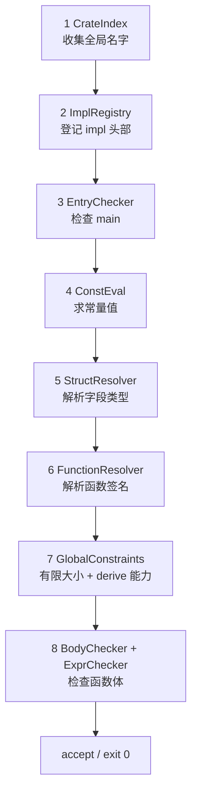

# Rx 语义检查教学文档

> 目标：把 2.5 语义检查从入口到函数体完整串一遍，方便快速回忆。
> 代码入口：`src/main/kotlin/rx/semantic/SemanticAnalyzer.kt`
> 运行：`./scripts/rxc --stage semantic <file.rx>`（0 接受 / 1 拒绝）
> 回归：`python3 scripts/check_semantic.py [SUBSTR...] [-v]`
>
> 示例默认省略 `use rx::core::*;` 和 `fn main() {}`；单独运行时请补上。

---

## 0. 全景：一条固定顺序的流水线

```kotlin
fun analyze(crate: CrateNode) {
    Builtins.install(ctx.globals)                  // 0 内建环境
    CrateIndex(ctx).collect(crate.items)           // 1 声明收集
    ImplRegistry(ctx).register(crate.items)        // 2 结构体身份 + impl 头部
    EntryChecker.check(crate)                      // 3 入口契约
    ctx.constEval.evaluateAll(crate)               // 4 常量求值
    StructResolver(ctx).resolve(crate.items)       // 5 结构体字段
    FunctionResolver(ctx).resolve(crate.items)     // 6 函数签名
    GlobalConstraints(ctx).check(crate.items)      // 7 全局约束
    BodyChecker(ctx).check(crate.items)            // 8 函数体
}
```



任一阶段抛出 `SemanticError` 都会立即 reject / exit 1（fail-fast）。

**一句话记忆：**

```text
收名字 → 认主人 → 查 main → 算常量 → 定字段 → 定签名 → 查布局/derive → 查函数体
```

### 0.1 每步的产物

| # | 文件 | 一句话 | 主要产物 |
| --- | --- | --- | --- |
| 0 | `Builtins.kt` | 预置原生类型、`Box`/`Vec`、I/O 函数 | 全局作用域初值 |
| 1 | `CrateIndex.kt` | 收集顶层 `struct` / `fn` / `const` | 全局 `Scope` 中的三类符号 |
| 2 | `ImplRegistry.kt` | 给 impl 找合法宿主，挂关联项 | `StructSymbol.associatedValues` |
| 3 | `EntryChecker.kt` | 检查 `main` 契约 | 无（只报错） |
| 4 | `ConstEval.kt` | 常量初值、数组长度、repeat 长度 | `ConstantSymbol` → 常量值 |
| 5 | `StructResolver.kt` | 解析每个字段的类型 | `StructSymbol.fields` |
| 6 | `FunctionResolver.kt` | 解析参数/返回类型 | `FunctionSymbol.signature` |
| 7 | `GlobalConstraints.kt` | 递归布局、derive 合法性/能力 | 无（只报错） |
| 8 | `BodyChecker.kt` / `ExprChecker.kt` | 作用域、语句、表达式类型 | `LocalSymbol`、`ExprNode.type` 回填 |

### 0.2 为什么顺序不能乱

| 阶段 | 依赖 | 原因 |
| --- | --- | --- |
| 2 | 1 | impl 目标要先能查到 `StructSymbol` |
| 3 | 1 | `main` 的重名/命名空间问题要在阶段 1 先定型 |
| 4 | 1、2 | 顶层常量、关联常量都必须已经建好符号 |
| 5、6 | 4 | 字段/签名里的 `[T; N]` 要先把 `N` 算出来 |
| 7 | 5 | 布局和 derive 能力都要看字段类型 |
| 8 | 5、6 | 字段访问要查字段表，调用要查签名表 |

底层原因：**先收集、后检查**。这样才支持前向引用：

```rust
fn main() {
    f();          // f 定义在后面也没问题
}

fn f() {}
```

### 0.3 贯穿全程的共享设施

```text
类型名字空间: i32 u32 isize usize bool Box Vec + 用户 struct
值名字空间:   get_i32 print_i32 println_i32 + fn + const + 局部变量/参数
```

| 文件 | 作用 |
| --- | --- |
| `Scope.kt` | 父子作用域链；类型/值两个独立名字空间 |
| `Symbols.kt` | `StructSymbol` / `FunctionSymbol` / `ConstantSymbol` / `LocalSymbol` |
| `SemanticContext.kt` | 当前 `Self`、当前作用域、当前返回类型、循环栈、`resolveType` |
| `Type.kt` | 内部类型：标量、`StructType`（名义类型）、`RefType`、`ArrayType`、`BoxType`、`VecType` |
| `Coercion.kt` | `assignable` / `join` / `requireAssignable` / `stripSharedRef` |
| `Capabilities.kt` | `supportsPartialEq` / `supportsClone` / `isCopy`（阶段 8 使用） |
| `Place.kt` | 左值 `Place(type, mutable, underShared)` |
| `SemanticError.kt` | 统一诊断，CLI 捕获后 exit 1 |

三条全局约定：

1. **fail-fast**：第一个语义错误就抛 `SemanticError`，CLI 打印 `file:line:col: error: [semantic] ...` 后退出 1。
2. **`resolveType` 是唯一的"类型写法 → 内部类型"入口**，阶段 2/5/6/8 都走它。
3. **表达式类型写回 `ExprNode.type`**，供后续 codegen 直接使用。

---

## 1. 声明收集：CrateIndex

**只做一件事：把所有顶层名字放进全局作用域，不解析任何类型细节。**

```rust
struct Point { x: i32 }   // → 类型名字空间
fn distance() -> i32 { 0 } // → 值名字空间
const ORIGIN: i32 = 0;     // → 值名字空间
```

### 1.1 两个名字空间

`struct` 和 `fn` 可以同名，因为它们不在一个空间：

```rust
struct S { x: i32 }
fn S() -> i32 { 1 }      // ✓ 类型 S 与值 S 共存
```

但 `fn` 和 `const` 共享值空间，不能同名：

```rust
const f: i32 = 1;
fn f() {}                 // ✗ duplicate function 'f'
```

同一个名字空间内重复声明也会在这里报错：

```rust
struct S { x: i32 }
struct S { y: i32 }       // ✗ duplicate struct 'S'
```

### 1.2 几个容易忘的点

- `Builtins.install` 先执行，所以 `i32`、`Box`、`Vec` 等已经占位；用户不能重新定义它们。
- `impl` **不引入顶层名字**（方法只能通过 `S::f` / `Self::f` 访问），这里直接跳过，交给阶段 2。
- 这里只登记符号，不检查字段类型、参数类型、函数体。`fn f(x: Unknown) {}` 能通过阶段 1，在阶段 6 才报错。
- 因为所有名字先收齐，后面各阶段都支持前向引用。

---

## 2. 结构体身份：登记 impl 头部（ImplRegistry）

**回答两个问题：这个 impl 属于谁？它里面有哪些关联项？**

### 2.1 校验 impl 目标

目标必须能解析成一个**用户定义的 struct**：

```rust
struct S { x: i32 }

impl S { ... }          // ✓
impl i32 { ... }        // ✗ impl target must be a user-defined struct
impl Box<i32> { ... }   // ✗ 容器没有固有 impl
impl &S { ... }         // ✗ 引用不是 struct
impl [i32; 2] { ... }   // ✗ 数组也不是 struct
```

实现上先要求目标是 `PathTypeNode`，再调用 `ctx.resolveType(target)`，结果必须是 `StructType`。

### 2.2 登记关联项

每个 impl 成员都会变成一个带 `owner` 的符号：

```kotlin
// fn 成员
FunctionSymbol(name, node, receiver = impl 的目标类型, owner = 宿主 struct)
// const 成员
ConstantSymbol(name, node, owner = 宿主 struct)
```

它们都挂到 `StructSymbol.associatedValues`：

```text
StructSymbol
  ├── fields:            x -> i32
  └── associatedValues:  new -> FunctionSymbol
                         sum -> FunctionSymbol
                         N   -> ConstantSymbol
```

关键点：

- **方法和关联常量共享一张关联表**，所以 `impl S { fn f() {} const f: i32 = 1; }` 是重名。
- 多个 impl 块共享同一张表，跨块重名也会被抓到：

```rust
impl S { fn f(&self) {} }
impl S { fn f(&self) {} }   // ✗ duplicate associated item 'f'
```

- 这一步**不解析签名、不求值常量、不检查函数体**，只建立名字和归属关系。

---

## 3. 常量与函数：登记并检查入口

### 3.1 先看登记后的符号形态

> 严格说，`fn` / `const` 的名字在步骤 1 就登记好了；这里把它们之后的形态串起来。

| 符号 | 字段 | 说明 |
| --- | --- | --- |
| `FunctionSymbol` | `node`、`signature?`、`receiver?`、`owner?` | 签名在阶段 6 才填 |
| `ConstantSymbol` | `node`、`owner?` | `owner == null` 是顶层常量；否则是关联常量 |
| `LocalSymbol` | `mutable`、`type`、`span?` | 阶段 8 才产生 |

顶层常量可以直接用名字引用；关联常量必须带宿主：

```rust
impl Config {
    const N: usize = 3;
}

const COUNT: usize = Config::N;   // ✓ 顶层常量引用关联常量
// const BAD: usize = N;          // ✗ 关联常量不会进入无限定名空间
```

官方用例还强调：局部变量 `N` 与 `Config::N` 互不影响。

### 3.2 EntryChecker：main 契约

`main` 必须满足四条：

| 规则 | 反例 |
| --- | --- |
| 必须存在顶层 `main` | 只有 `fn f() {}` |
| 不能有参数（含 receiver） | `fn main(x: i32) {}` |
| 不能有泛型参数 | `fn main<'a>() {}` |
| 返回类型必须是 `()`（可省略） | `fn main() -> i32 { 0 }` |

`main<'a>` 有点特殊：生命周期参数在 AST 里按规范丢弃，但 builder 保留了 `hasGenericParams: Boolean` 这个"出现过"的标志，专门留给这里拒绝。

注意：impl 里的 `fn main` **不算入口**，入口只查顶层 `FnNode`。

---

## 4. 常量求值：解析类型与值（ConstEval）

### 4.1 三个常量上下文

1. `const` 初值；
2. 类型里的数组长度 `[T; N]`；
3. 数组字面量的重复长度 `[e; N]`。

外加关联常量的 `Self::N`。

### 4.2 只接受受限形式

`constValue` 在文法层就已经限死，所以求值器只需要认这几种：

| 形式 | 例子 | 说明 |
| --- | --- | --- |
| 整数字面量 | `3`、`3usize` | 后缀 > expected > 默认 `i32` |
| 布尔字面量 | `true` | |
| 常量路径 | `A`、`Config::N`、`Self::N` | 必须解析到 `ConstantSymbol` |
| 负号 | `-A` | 只允许有符号整数 |
| 括号 | `(3)` | AST builder 已经把括号拆掉 |

其它表达式一律 `expected a constant value`。所以 `const A: i32 = 1 + 2;` 根本到不了这里——**parser 阶段就会拒绝**。

### 4.3 三色 DFS 与依赖环

每个常量有三种状态（含未访问）：

```text
未访问 → IN_PROGRESS（正在算） → DONE（已算出）
```

如果 `force` 时又遇到 `IN_PROGRESS` 的常量，说明有环：

```rust
const A: i32 = A;                  // ✗ constant dependency cycle
const B: i32 = C; const C: i32 = B; // ✗ 间接环
```

`evaluateAll` 会**强制求值所有常量**（包括从没被使用的），因为没被用到的常量出错也必须报。

前向引用是允许的：

```rust
const B: i32 = -A;   // ✓ 此时 A 还没求值，force(A) 即可
const A: i32 = 3;
```

### 4.4 声明类型与值类型必须一致

```rust
const OK: i32 = 3;        // ✓
const BAD: i32 = true;    // ✗ constant initializer must match declared type
```

`force` 会先解析声明类型（缓存到 `declaredTypes`），再把声明类型当 `expected` 去求值，最后再比一次类型。

### 4.5 数组长度必须是 usize

`requireUsize` 的工作方式：

```kotlin
fun requireUsize(expr: ExprNode): Long {
    val v = evaluate(expr, UsizeType)
    if (v.type != UsizeType) {
        throw SemanticError(expr.span, "array length must have type usize")
    }
    return (v as ConstValue.IntValue).value
}
```

```rust
const COUNT: usize = 3;
struct S { a: [i32; COUNT] }    // ✓

const L: i32 = 3;
struct T { a: [i32; L] }        // ✗ array length must have type usize
```

注意：无后缀字面量 `3` 在 `expected = usize` 下会直接定成 `usize`，所以 `[i32; 3]` 是合法的。

### 4.6 关联常量与 Self

```rust
impl S {
    const A: i32 = Self::B;
    const B: i32 = Self::A;   // ✗ cycle
}
```

`Self::N` 靠 `ConstEval.currentOwner` 解析：`force` 进入一个常量时 save，退出时 restore。顶层常量里写 `Self::N` 会报 `` `Self` is not allowed here ``。

---

## 5. 结构体字段：StructResolver

**把每个 struct 的字段类型翻译成内部 `Type`，按声明顺序填表。**

```kotlin
StructSymbol.fields: LinkedHashMap<String, Type>
```

### 5.1 解析期间 Self 指向当前 struct

```rust
struct Node {
    next: Box<Self>,      // ✓ Self = Node
    tag: i32,
}
```

`StructResolver` 在解析一个 struct 前把 `ctx.currentSelfType` 指向它，结束后 restore。

### 5.2 `resolveType` 的规则速查

| 源码写法 | 结果 | 检查 |
| --- | --- | --- |
| `i32` / `u32` / `isize` / `usize` / `bool` | 对应标量类型 | 不能带泛型实参 |
| `Box<T>` / `Vec<T>` | `BoxType(T)` / `VecType(T)` | 恰好一个具体类型实参，递归解析 T |
| `S` | `StructType("S", decl)` | struct 不能带泛型实参 |
| `Self` | 当前 struct | 只能在 struct/impl 内；不能带实参 |
| `&T` / `&mut T` | `RefType` | 递归解析 T |
| `[T; N]` | `ArrayType(T, N)` | `N` 走 `requireUsize` |
| `mod::Type` | 报错 | Rx 没有关联类型/模块类型 |

### 5.3 本阶段只建表，不判递归

```rust
struct Bad {
    next: Bad,            // 阶段 5 能过；阶段 7 才报无限大小
}
```

字段重复在这里报：

```rust
struct S { x: i32, x: i32 }   // ✗ duplicate field 'x'
```

字段顺序保留在 `LinkedHashMap` 里，布局阶段可以直接用。

---

## 6. 函数签名：FunctionResolver

**把参数/返回类型翻译成内部 `Type`，写进 `FunctionSymbol.signature`。**

```kotlin
data class FunctionSignature(
    val paramTypes: List<Type>,   // 不含 self
    val returnType: Type,         // 没写 -> T 就是 UnitType
    val selfParam: SelfParam?,    // null = 普通函数/关联函数
)
```

### 6.1 顶层函数 vs impl 成员

| 位置 | `currentSelfType` | 规则 |
| --- | --- | --- |
| 顶层 `fn` | `null` | 不能有 `self`；签名里不能出现 `Self` |
| `impl` 成员 | 宿主 struct | `Self` 可用；`self` / `&self` / `&mut self` 合法 |

```rust
impl Point {
    fn new() -> Self { ... }        // ✓ Self = Point，返回 Point
    fn sum(&self) -> i32 { ... }    // ✓ selfParam = &self
}

fn f(&self) {}                      // ✗ top-level function cannot have a receiver
```

### 6.2 参数表检查

- `SelfParam` 单独存进 `signature.selfParam`，**不占参数名**，也不进 `paramTypes`。
- 普通参数按顺序解析类型，并查重：

```rust
fn f(x: i32, x: i32) {}   // ✗ duplicate parameter 'x'
```

- 返回类型缺省是 `UnitType`。
- `self` 的绑定类型由签名决定：`S` / `&S` / `&mut S`。

### 6.3 为什么先签名后函数体

函数体检查调用时需要签名；签名先全部解析完，所以互递归也没问题：

```rust
fn even(n: i32) -> bool { if n == 0 { true } else { odd(n - 1) } }
fn odd(n: i32) -> bool  { if n == 0 { false } else { even(n - 1) } }
```

---

## 7. 全局约束：有限大小与能力（GlobalConstraints）

对全部 struct 分三遍扫描。

### 7.1 derive 列表本身

```rust
#[derive(Copy)]              // ✗ 'Copy' requires an explicit 'Clone' derive
struct A { x: i32 }

#[derive(Eq)]                // ✗ 'Eq' requires an explicit 'PartialEq' derive
struct B { x: i32 }

#[derive(Clone, Clone)]      // ✗ duplicate derive 'Clone'
struct C { x: i32 }
```

注意：`Copy` 的**能力**隐含 `Clone`，但 derive 列表里必须显式写 `Clone`。

### 7.2 有限大小：只沿"内联边"走

把字段类型分成两类：

| 字段类型 | 是否内联 | 原因 |
| --- | --- | --- |
| `S` | 是 | 字段直接放在结构体里 |
| `[T; N]` | 是（看 T） | 数组元素内联 |
| `Box<S>` / `Vec<S>` | 否 | 句柄/间接层 |
| `&S` / `&mut S` | 否 | 引用是句柄 |

DFS 三色：撞到 `IN_PROGRESS` 就是环。

```rust
struct Bad { next: Bad }                  // ✗ Bad -> Bad
struct A { b: B }
struct B { a: A }                         // ✗ A -> B -> A
struct S { xs: [S; 1] }                   // ✗ 数组不能打断环

struct Chain { next: Box<Chain> }         // ✓ Box 打断环
struct Node { next: &Node }               // ✓ 引用打断环
struct Tree { children: Vec<Tree> }       // ✓ Vec 打断环
```

错误信息会带环路径，例如：

```text
struct 'Bad' has infinite size (Bad -> Bad)
```

### 7.3 derive 能力：字段必须支持

对每个 struct 的每个 derive，所有字段都必须支持它。`structSupports` 用带记忆化的 DFS；遇到 `IN_PROGRESS` 直接返回 `true`（协归纳假设），这样互递归的结构体也能终止。

```text
struct S derives d  ⇔  S 显式写了 d，且每个字段都 supports(fieldType, d)
```

`supports` 的规则：

| 字段类型 | Copy | Clone | PartialEq / Eq |
| --- | --- | --- | --- |
| 整数 / bool / unit | ✓ | ✓ | ✓ |
| `&T` | ✓ | ✓ | 递归看 `T` |
| `&mut T` | ✗ | ✗ | 递归看 `T` |
| `Box<T>` / `Vec<T>` | ✗ | 递归看 `T` | 递归看 `T` |
| `[T; N]` | 递归看 `T` | 递归看 `T` | 递归看 `T` |
| `S` | 必须 derive `Copy` | 必须 derive `Clone` 或 `Copy` | 对应地必须 derive `PartialEq` / `Eq` |

例子：

```rust
#[derive(Clone, Copy)]
struct A { x: Box<i32> }          // ✗ Box 不是 Copy

#[derive(Clone)]
struct B<'a> { x: &'a mut i32 }   // ✗ &mut 不能 Clone

struct Inner { x: i32 }
#[derive(PartialEq)]
struct Outer { x: Inner }         // ✗ Inner 没有 PartialEq
```

### 7.4 声明期能力 vs 使用期能力

阶段 7 检查的是**声明**能不能 derive；阶段 8 还会在表达式里检查**使用**：

| 使用 | 要求 | 文件 |
| --- | --- | --- |
| `a == b` / `a != b` | `supportsPartialEq` | `Capabilities.kt` |
| `x.clone()` | `supportsClone` | `Capabilities.kt` |
| `[e; n]`（n > 1） | `isCopy(e)` | `Capabilities.kt` |

使用期对引用更宽松：`&T` 可以比较（比地址）、可以 clone，不要求 `T` 有能力；`&mut T` 不能 clone / 不能按位复制。别把这两套规则混在一起。

---

## 8. 函数体检查：BodyChecker + ExprChecker

阶段 8 分两层：

- `BodyChecker`：函数骨架、作用域、语句、块；
- `ExprChecker`：表达式类型、place、调用/方法等。

### 8.1 函数骨架

`BodyChecker` 只遍历函数：`struct` 字段已由阶段 5 处理，`const` 初值已由阶段 4 处理，这里直接跳过。

对每个顶层函数和 impl 成员：

```kotlin
ctx.currentScope = ctx.globals.child()          // 函数作用域，放参数
ctx.currentHasSelfParam = node.params.any { it is SelfParam }
ctx.currentSelfType = owner                     // 顶层为 null
ctx.currentReturnType = node.returnType?.let(ctx::resolveType) ?: UnitType

// 参数 → LocalSymbol；方法再绑定 self → LocalSymbol
val bodyType = checkBlock(node.body, ctx.currentReturnType)
requireAssignable(bodyType, ctx.currentReturnType, node.body.span, "function body")
```

进出函数时必须 save/restore 这几个状态：当前作用域、`currentHasSelfParam`、`currentSelfType`、`currentReturnType`。

方法体里：

```rust
impl Point {
    fn sum(&self) -> i32 {
        self.x + self.y      // self 的类型是 &Point
    }
}
```

`self` 是一个真正的局部绑定，类型来自签名（`Point` / `&Point` / `&mut Point`），不是特殊表达式。

### 8.2 块与语句

`checkBlock` 每次进入都压一层子作用域，退出时恢复。

| 语句 | 规则 |
| --- | --- |
| `let` | 先解析声明类型；初始化器以它为 `expected`；检查可赋值性；**初始化器检查完才** `defineLocal`（所以 `let x = x;` 看到的是外层 x 或未定义） |
| 表达式语句（带 `;`） | 值被丢弃，任意类型都行 |
| 表达式语句（不带 `;`，非尾位置） | 必须是 `()`；否则 `block statement must have type ()` |

块的结果类型：

```text
有尾表达式        → 尾表达式的类型
无尾 + 有发散语句 → !（Never）
无尾 + 无发散     → ()
```

发散语句指类型为 `!` 的表达式语句，例如 `return`、`break`、`continue`、`loop {}`。

**不可达代码照样检查**：

```rust
fn f() -> i32 {
    return 1;
    unknown_name      // ✗ 仍然报 unresolved value
}
```

名字规则：

- 同一块里允许 `let` 遮蔽（`let x = 1; let x = true;` 合法）。
- 块内局部变量不会逃出块。
- 局部变量会遮蔽同名函数，且**没有可调用回退**：

```rust
fn f() {}
fn main() {
    let f = 1;
    f();              // ✗ 'f' is not callable
}
```

### 8.3 ExprChecker 的核心签名

```kotlin
fun check(expr: ExprNode, expected: Type? = null): Type
```

算完把类型写回 `expr.type`。`expected` 的主要来源：

- 显式类型标注（`let`、字段、返回类型）；
- 上下文目标（外层 `expected`：if 两支、break 载荷、数组元素、调用形参）；
- 结构体字面量字段类型。

`expected` 不是隐式转换：它主要影响**无后缀整数字面量的选型**；引用弱化（`&mut T → &T`）则是 `assignable` 在比较类型时允许的。

```rust
fn main() {
    let a: u32 = 1;      // ✓ 1 按 expected 定成 u32
    let b: u32 = 1i32;   // ✗ 后缀优先，i32 不能赋给 u32
}
```

节点规则速查：

| 节点 | 关键规则 |
| --- | --- |
| 整数字面量 | 后缀 > expected > 默认 `i32` |
| 路径 | 局部/参数/常量/关联常量；`Self::N`；函数不是一等值 |
| 块 / if | 条件 `bool`；无 else 时 then 必须 `()`；两支 `join` |
| while / loop | `while` 条件在循环外求值，结果恒 `()`；`loop` 由 break 载荷定型，无 break 时为 `!` |
| break / continue / return | 必须在正确上下文；break 载荷参与 loop 定型；return 对返回类型；三者都是 `!` |
| 一元 / 引用 / 二元 / 强转 | `-` 只限有符号整数；`!` 限整数/bool；算术/位运算最多一层共享引用；`==` 要求同型 + `PartialEq`；cast 目标必须是整数，源可以是整数或 bool（`true as i32` 合法，`1 as bool` 不合法） |
| 赋值 | 左侧必须是 place 且 mutable；复合赋值左右同型；整个表达式值恒 `()` |
| 调用 / 方法 | 查签名、参数个数/类型；`&mut self` 要求可变访问；内建容器方法；derive 生成的 `clone` |
| 字段 / 下标 | place 投影；下标必须是 `usize`；数组是拥有权投影，Vec 是借用投影 |
| 结构体字面量 | 字段必须存在、不重复、不缺、类型匹配；名义类型 |
| 数组字面量 | 元素 `join`；固定长度要相等；`[e; n]` 在 n > 1 时要求 `Copy` |

> 函数 / 内建函数作值在规范里属于 UB；`checkPathExpr` 对它们返回 `UnknownType`，不主动报错。真正调用时 callee 会单独检查。

`Never` 的规则：

- `!` 可以出现在任何期望类型的位置（`return`、发散块、无 break 的 loop）；
- `if` 两支合并时，`!` 让位给另一支；
- 但 `!` 不能当普通值存进变量。

### 8.4 place 与可变性链

`Place` 记录三件事：

```kotlin
class Place(
    val type: Type,
    val mutable: Boolean,     // 当前能不能写
    val underShared: Boolean, // 是否处在共享引用之下（&&mut 的毒化）
)
```

哪些表达式是 place：

| 形式 | 可变性 |
| --- | --- |
| 局部变量 / 参数 / `self` | 看 `LocalSymbol.mutable`；`self` 看 `&mut self` |
| `*p` | `&mut` 才可写；`Box` 继承容器权限；同时继承 `underShared` |
| `e.field` | 继承容器权限 |
| `e[i]` | 数组继承容器权限；Vec 元素是"借出来"的，容器不可写就不可写 |

赋值与借用都走 `checkPlace`：

```rust
struct S { x: i32 }
fn main() {
    let s = S { x: 1 };
    let r = &mut s.x;     // ✗ cannot mutably borrow an immutable place
}
```

最值得记的对照：

```rust
fn write(p: &mut i32) { *p = 1; }

fn f(xs: [&mut i32; 1]) { write(xs[0]); }  // ✓ 数组元素：拥有权下移
fn g(xs: Vec<&mut i32>) { write(xs[0]); }  // ✗ Vec 元素：借出来的，只读位置不能搬走 &mut
```

原因：数组/结构体/`Box` 的投影是**拥有权投影**，权限原样继承；Vec 的投影是**借用投影**，要先能可变地借到容器本身。

### 8.5 调用与方法

调用先解析 callee（必须是路径），再查签名，最后逐个检查实参：

```rust
fn main() {
    let mut v = Vec::<u32>::new();
    v.push(1);              // ✓ 1 按形参 u32 定型；push 需要 &mut self
    let w = v.clone();      // ✓ u32 是 Clone
}
```

```rust
fn main() {
    let v = Vec::<u32>::new();
    v.push(1);              // ✗ push requires mutable access
}
```

几个细节：

- `S::f(receiver, args)` 是 UFCS 形式：把 `self` 变成显式的第一个实参，不做 autoref。
- 关联函数（`signature.selfParam == null`）不能用 `s.f()` 点调用。
- 方法查找会沿引用/`Box` 自动逐层解引用；`Vec` 不会继续解。
- derive 生成的 `clone` 不在 `associatedValues` 里，查找时有单独兜底。
- `Vec<T>` / `Box<T>` 的 `clone` 要求元素 `Clone`（空容器也一样）。

### 8.6 聚合类型

结构体字面量：

```rust
struct S { x: i32, y: i32 }
fn main() {
    let s = S { x: 1 };   // ✗ missing field 'y'
}
```

数组字面量：

```rust
struct S { x: i32 }
fn main() {
    let a = [S { x: 1 }; 2];   // ✗ repeating requires Copy element type
}
```

字段访问要求字段存在，下标要求容器可索引、下标为 `usize`，这些都在 place 投影里顺带完成。

---

## 9. 回忆卡片

### 9.1 八步一句话

| # | 一句话 |
| --- | --- |
| 1 | `CrateIndex` 把 `struct` / `fn` / `const` 的名字放进两个名字空间 |
| 2 | `ImplRegistry` 校验 impl 目标是 struct，并把关联项挂到宿主 |
| 3 | `EntryChecker` 检查 `main`：顶层、无参、无泛型、返回 `()` |
| 4 | `ConstEval` 求三类常量，三色 DFS 查环，数组长度必须是 `usize` |
| 5 | `StructResolver` 解析字段类型，`Self` 指向当前 struct |
| 6 | `FunctionResolver` 解析参数/返回类型，方法记录 `selfParam` |
| 7 | `GlobalConstraints` 查有限大小（只沿内联边）和 derive 能力 |
| 8 | `BodyChecker` 管作用域/语句/块，`ExprChecker` 管表达式类型和 place |

### 9.2 最容易忘的十件事

1. `struct` 和 `fn` 可以同名（两个名字空间）；`fn` 和 `const` 不行（同一个值空间）。
2. `impl` 不引入顶层名字，方法只能 `S::f` / `Self::f`。
3. `main<'a>` 的 lifetime 参数会被丢弃，但 `hasGenericParams` 保留了"出现过"的事实。
4. 常量求值会检查**所有**常量，包括从未使用的。
5. `const A: i32 = 1 + 2;` 是 parser 拒绝，不是 ConstEval 拒绝。
6. 数组长度和 repeat 长度都走 `requireUsize`，无后缀字面量可以被 `expected` 定成 `usize`。
7. 有限大小只沿 `struct` / 数组走；`Box` / `Vec` / 引用会打断环。
8. `Box` / `Vec` 打断布局环，但**不是 Copy**；`&mut T` 不 Copy 也不 Clone。
9. `expected` 不是隐式转换，主要影响无后缀整数字面量的选型；引用弱化由 `assignable` 放行。
10. 不可达代码仍然检查名字和类型，不能做"不可达剪枝"。

### 9.3 贯穿示例：同一个程序走完八步

```rust
use rx::core::*;

const N: usize = 3;

#[derive(Clone, Copy)]
struct Point {
    x: i32,
    y: i32,
}

impl Point {
    const ORIGIN: i32 = 0;
    fn new(x: i32, y: i32) -> Self {
        Self { x: x, y: y }
    }
    fn sum(&self) -> i32 {
        self.x + self.y
    }
}

fn main() {
    let p = Point::new(1, 2);
    println_i32(p.sum());
}
```

| 阶段 | 在这个例子里做什么 |
| --- | --- |
| 1 | 登记 `Point`（类型）、`N` 和 `main`（值）；impl 跳过 |
| 2 | 把 `new` / `sum` / `ORIGIN` 挂到 `Point.associatedValues` |
| 3 | `main` 无参、无泛型、返回 `()` → 通过 |
| 4 | `N = 3`、`Point::ORIGIN = 0`；没有依赖环 |
| 5 | `Point.fields = { x: i32, y: i32 }` |
| 6 | `new: (i32, i32) -> Point`；`sum: (&Point) -> i32`；`main: () -> ()` |
| 7 | `derive(Clone, Copy)` 合法；`Point` 两个 `i32` 字段，有限大小 |
| 8 | `p` 绑定 `Point`；`new` 的参数按 `i32` 定型；`p.sum()` 查到 `&self` 方法；`println_i32` 收到 `i32` |

### 9.4 源码地图

```text
SemanticAnalyzer.kt   总顺序
Builtins.kt           0 内建环境
CrateIndex.kt         1 声明收集
ImplRegistry.kt       2 impl 头部
EntryChecker.kt       3 main
ConstEval.kt          4 常量
StructResolver.kt     5 字段
FunctionResolver.kt   6 签名
GlobalConstraints.kt  7 布局 / derive
BodyChecker.kt        8 函数体骨架
ExprChecker.kt        8 表达式 / place / 调用
Coercion.kt           可赋值性 / join
Capabilities.kt       使用期能力
```

更多细节：

- `docs/semantic_design.md`：整体设计与分步计划；
- `docs/expr-checking.md`：阶段 8 的逐节点规则与批次记录。
